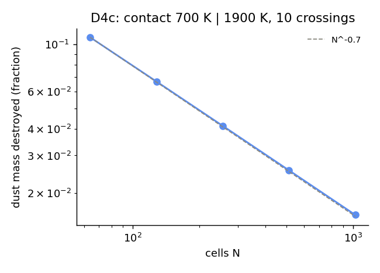
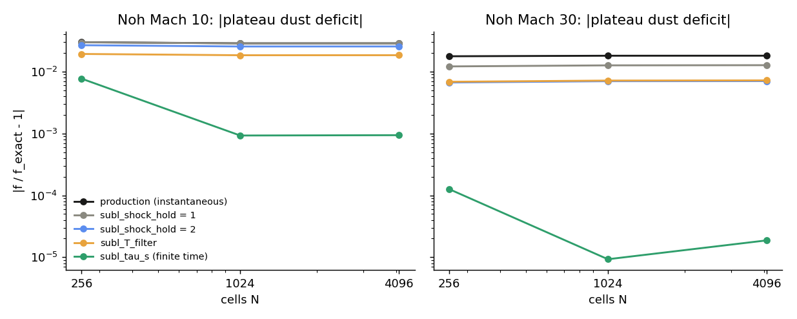
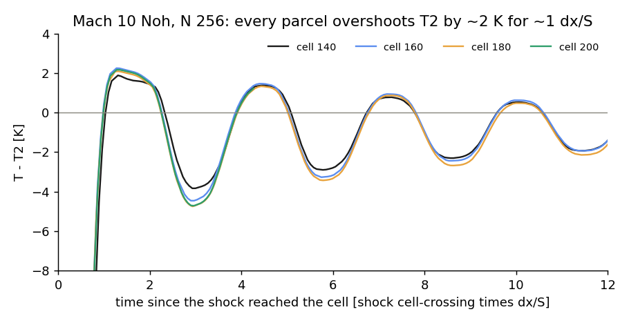

# Dust evolution (WS-4 grain growth, irreversible sublimation, dust scalars, dust -> conductivity coupling) in AthenaPK: validation report (paper I)

Version 2026-10-13 (public edition of the report of 2026-10-13). Folder `validation/dust/`. `README.md` is the index
of decks, scripts and results; every number below is read from the table named with it (`results/tables/`), each
written by a saved script with a `--check` mode.

*Public edition.* The validation was carried out in a larger private research code from which this repository was
extracted. Four parts used that code's 3-D production collapse state or its GPU builds: the cell-by-cell check of the
dust -> conductivity coupling and the destroyed-grain runaway (D8, Sec. 10), the dust census of the production run (D9,
Sec. 11), the GPU equivalence (D10, Sec. 12) and the one-cycle effect of the candidate keys on the collapse state
(Sec. 14). They are reported as results of the research code: the collapse state, its decks and the run scripts are not
part of this repository, so they cannot be re-run from it. The private development history and the production adoption
are left out. Section numbers follow the full report. Every result of the tests shipped here is unchanged; Sec. 2.3 is
the check of the code shipped here against the research code it was taken from.

---

## 0. Summary

The dust package evolves two passive scalars per cell -- the dust-to-gas ratio f_dg and the grain radius a_c -- with an
operator-split source (`ReactDust`, once per cycle on the final stage): irreversible sublimation toward
f_ref s(T), s = tanh switch about T_subl = 1500 K, at fixed grain number (a_c ~ f^(1/3)), followed by monodisperse
sweep-up growth da/dt = C (f rho / rho_gr) v_rel with C = 1/4 (Brownian + turbulent v_rel, RK2 sub-cycled at <= 10 %
per sub-step). The scalars feed the radiation opacity (tested in `../radiation_sn/`) and, through
`diffusion/dust_coupling`, the grain population of the ionization / conductivity model.

| # | test | exact answer | result | verdict |
|---|---|---|---|---|
| D0 | host gate `test_dust.cpp`, 17 analytic sub-gates; wired into CTest (`ATHENAPK_DUST_HOST_TESTS`) | closed forms | 17/17 PASS, each new gate falsified; `ctest -R dust_host_gate` passes | **PASS** |
| D1 | grain growth IN the code, 5 (rho, T) states 1e-13..1e-8 g/cm^3, 5 dt regimes | ODE of the same law (rtol 1e-12) | resolved: -3.2e-5; sub-cycled at the production growth_cap 0.1: -1.55e-3 (2nd order in the cap) | **PASS** (1 pre-registered tolerance missed, explained) |
| D2 | the growth law vs the literature | Birnstiel et al. 2012; Ormel & Cuzzi 2007 | code C = 1/4; literature monodisperse C = 1 (B12 Eq. 10), Smoluchowski 1/2; a_c x1.30 / x1.74 at rho >= 1e-11 | **DU-F3** (model choice) |
| D3 | one-zone sublimation through the H2-dissociation zone; heat-then-cool | f = f_ref s(T) per cell; frozen after cooling | 2.9e-13 per cell; irreversible (0.00034 f_ref kept while f_eq -> 0.82 f_ref) | **PASS** |
| D4 | dust fronts through moving slabs, 1D/2D, N 64..1024; restart | pure translation | budget <= 8e-12, no clamp, bounds kept; density contact x10 uniform to 5e-12; restart BIT-IDENTICAL; T contact across T_subl: numerical mixing destroys 10.8 % -> 1.6 % of the dust (order 0.70) | **PASS**; **DU-F5** (convergent) |
| D5 | Noh (Mach 10, 30) with T_subl = T2, N 256..4096 | plateau f = 0.5 f_ref | -2.9 % (M10) / -1.8 % (M30) at EVERY N: each parcel's post-shock overshoot (+0.5 % T2) is recorded by irreversible sublimation | **DU-F1** -> fixed by key (F2) |
| D6 | structured dust field through refine/derefine events (2D AMR, 64+64 level-2 blocks created/removed per output) | translation; conservation | budget 3.0e-14, no clamp, a_c bounds to 1e-11; T-contact loss AMR 3.37 % = uniform 3.34 % | **PASS** |
| D7 | production boundary (diode + clamp + wall), oblique through-flow | f = f_ref everywhere | sum(rho f)/(f_ref sum rho) - 1 <= 4.4e-16, f to 4e-15 | **PASS** |
| D8* | dust -> conductivity with f_dg != f_ref, cell by cell; destroyed grains | independent Python model (A8) | 5832 cells, f 0.005..0.84 f_ref: <= 9.4e-13; f_dg = 0: the guard gives the reference population in 1-nm grains -> eta up to 3e5x off; one cycle -> T 3e5 K | **PASS**; **DU-F4** (latent, catastrophic) -> key |
| D9* | census of the research code's production run (4 states) | -- | T_max 129 K (production run), 532 K (test-bed chain); a_c up to 3.37 a_ref; fossil core dust loss <= 1.7e-6 (6e-12 of the box) predating c1215; no new loss on the live code (CPU 20 cycles, GPU 3 cycles) | measured; **DU-F6** |
| D10* | GPU (NVIDIA GH200) vs CPU, same source, 38 decks (D1, D3, D5, F2, F5) | CPU result | smooth decks: f, a within 2.2e-12 (D1 ODE errors equal to 4 digits); Noh plateau deficits agree to 2.1e-8 absolute (per-cell 2.7e-6, shock-amplified round-off) | **PASS** |
| F5 | sublimation at the opacity table's own T5(rho) (`subl_model = semenov`) | f = f_ref s_Semenov(T, rho) | 2.1e-12 per cell | key (DU-F2) |
| port | this repository vs the research code (Sec. 2.3) | key off: bit-identical to the previous public release; dust on: bit-identical to the research code | dust off 47/47; dust on 118/118 + D6 4/4; ideal 422/422; diffusion 164/164; radiation 595/605 (+10 identical aborts) bit-identical | **PASS** |

\* research-code result on its 3-D production collapse state or GPU builds (Sec. 10-12); not re-runnable from this repository.

**Findings.** DU-F1 (shock-recorded sublimation does not converge; fix `dust/subl_tau_s`), DU-F2 (the dust package
sublimates 250-370 K hotter than the opacity table's own grain evaporation; key `dust/subl_model = semenov`), DU-F3
(growth prefactor 1/4 vs 1/2..1 in the literature; key `dust/growth_prefactor`), DU-F4 (destroyed grains -> the
conductivity sees the full reference dust in 1-nm grains; one-cycle thermal runaway; key `diffusion/dust_destroyed_zero`),
DU-F5 (contact mixing across T_subl destroys dust, convergent order 0.7), DU-F6 (fossil dust loss in the research code's
production core), DU-F7 (latent: tanh underflow on the freeze_growth path recreates dust; tanh tail sublimates ~1e-9 in
every cell above ~120 K), DU-F8 (test infrastructure: Parthenon's generic refinement criteria are ignored by AthenaPK
after initialisation). The research code's production run is not affected by DU-F1/F2/F4/F7 today: no cell is within
1000 K of any sublimation temperature (D9). They decide what happens when the first core heats toward 1000-1500 K.
All keys are default off here. The research code's production run adopted (2026-10-13) `dust/growth_prefactor = 0.5`
(C = 1/2), `dust/subl_tau_s = 1.0e6`, `dust/subl_model = semenov` and `diffusion/dust_destroyed_zero = true`;
`subl_shock_hold` and `subl_T_filter` were not adopted (superseded by `subl_tau_s`).

---

## 1. Scope

The dust's own physics and its two couplings, as decided 2026-10-07 (`README.md`): growth (Brownian + turbulent,
local Omega), irreversible sublimation, advection of the two scalars (incl. AMR, boundaries, restart) and the coupling
to the ionization / conductivity model (`mc.f_dg_scale`, `mc.a_scale`, `src/hydro/diffusion/diffusion.hpp`). NOT here:
the dust -> radiation opacity factor (`DustFactor`, bridged size law, gas/dust split): `../radiation_sn/` (R7 O6, R-F8,
R-F11). The DD5 candidate touches the opacity consumer only to keep it consistent with a moved sublimation centre.

## 2. Code under test

### 2.1 Configuration of the research code's production collapse run (2026-10-12)
From its c1365 restart Input and the OVR line of its launcher: `<physics> dust = true`; `<dust> evolve = true`,
`scalar_index = 0` (`hydro/nscalars = 2`), `a_ref_cm = 1e-5`, `f_dg_ref = 0.01`, `T_subl_K = 1500`,
`opacity_size_law = bridged`, `opacity_gas_split = true`, and as defaults `rho_grain_cgs = 3`, `alpha_turb = 0.01`,
`omega_ref_cgs = 1e-13`, `mu_n = 2.33`, `growth_cap = 0.1`, `omega_local = 1`, `subl_irreversible = 1`,
`freeze_growth = 0`; launcher: `dust/dual_energy = true`, `dust/opacity_evap = table`. Hard-coded: `subl_width = 100 K`,
`a_floor = 1e-7 cm`, `nsub_max = 200`. Couplings: `diffusion/dust_coupling = true` with
`diffusion/ion_ad_closure = tensor`, `diffusion/ion_T_subl` = 1500 K (a step: grains leave the charge balance above it),
the shared dual-energy selector with `shock_eta1` + `kv`.

Order inside the final stage (`src/hydro/hydro_driver.cpp`): radiation -> **ReactDust** -> second RKL2 Strang half
(dt/2) -> dual heating. The non-ideal half-step after React therefore sees the NEW dust state (Sec. 10).

Every deck carries these keys verbatim (`scripts/du_common.py`); forced divergences are listed there
(dedner_plain in 1D -- E-F3; radiation/gravity off -- the tests isolate the dust package).

### 2.2 Code shipped here
`src/dust/` (the package: `dust.hpp` model and integrator, `dust.cpp` Params and `ReactDust`, `tests/test_dust.cpp` the
host gate), its consumers (`src/radiation/radiation_opacity.hpp` `DustOpacityFactors`, `radiation_tasks.cpp`,
`radiation_sn.cpp`: the opacity multipliers; `src/hydro/diffusion/diffusion.hpp` `CellIon`: the conductivity grain
population with `diffusion/dust_coupling`), the scheduling in `src/hydro/hydro_driver.cpp`, the dust ICs of
`collapse_be`, and `eos_test` `scalarL<n>`/`scalarR<n>` + homologous scalar ghosts (D3/D4). Keys (all default off =
the historical behaviour): `dust/growth_prefactor`, `dust/subl_model` (+ `subl_width_K`), `dust/subl_tau_s`,
`dust/subl_shock_hold`, `dust/subl_T_filter`, `diffusion/dust_destroyed_zero`; CMake option `ATHENAPK_DUST_HOST_TESTS`.
The decks run on code where the dust fix keys did not exist yet behave identically on this code with the keys absent
(the research code's key-off gates: bit-identical in every dataset of a 3-D production collapse state).

### 2.3 Check of this repository against the research code
**Port check (2026-10-13/14, `results/tables/PORT_check_2026-10-13.txt`).** This repository's build: `9e996267`
(default flags), `838f8489` (`-ffp-contract=off`); the research code's validation branch `17c5f35b` (`-ffp-contract=off`).

1. *Dust off.* The 47 regression runs of this repository's self-gravity, EOS, dual-energy and `collapse_be` validation
   against the ideal-MHD commit (`b07e7bd`, build `d9671240`), default flags: all 47 bitwise identical in every field
   of every dump and in the history files (that commit is itself bitwise to the previous release on the same runs).
2. *Dust on.* 118 runs of this report's run lists (every line with at most 64 ranks that took at most 3000 core-s in
   its original run: D1, D3, D4, D5, D7, F2, F5 and five D10 CPU reference lines) plus the four 16-rank D6 AMR runs. 58
   of the 118 were compared with this commit's own build before the check moved to the build of the following commit
   (the EOS host-mirror speed fix, `a4bc361d`, see `../eos_tabulated/` E-F11), because this build ran these decks 13-23x
   slower per step than the research code (one quiet core; up to 60x on a loaded node); that build is bitwise identical to this one on the 47 regression runs (47/47). Result: all
   58 + 118 + D6 4/4 bitwise identical to the research code in every field of every dump (1657 dumps for the 118) and in the
   history files.
3. *Ideal MHD with the dust code.* The 422 runs of `../ideal_mhd/` Sec. 2.4 with this commit's build: all 422 bitwise.
4. *Diffusion on.* The 164 runs of the non-ideal port check: all 164 bitwise (328 dumps).
5. *Radiation on.* The 605 runs of the radiation port check: 595 bitwise identical (5940 dumps); the other 10 stop with
   rc 134 identically on both sides (the R5bis trust audit and the WF lines written with the old
   `sn_sweep_wavefront = true`), exactly as in the radiation and non-ideal port checks.
6. Host gate `src/dust/tests/test_dust.cpp`: 17/17 sub-gates pass.

A leg counts only if both runs end with rc 0 and every history file is identical. The GPU build of this tree was not
compiled or run for this check (the research code's GPU equivalence is D10).

## 3. D0 -- host gate and CTest (PASS)
`src/dust/tests/test_dust.cpp`: the 14 sub-gates of AUDIT_DUST F-13/FIX F-06/F-07 still pass on today's header, plus
(m) `growth_prefactor` (default bitwise = historical `/4.0` over 300 states; C = 0.5 vs the Brownian closed form
0.05 %), (n) `SemenovT5` = `opacity_semenov.py` at 14 densities (0 K), fixed path bitwise, compact ramp, (o) `subl_tau`
(analytic 0, 50 steps = 1 step, irreversible). Falsifiers run for (m) (24 % and 'bitwise NO'), (n) (47 K), (o) (31 %).
CTest: `-DATHENAPK_DUST_HOST_TESTS=ON` builds `test_dust` and registers `dust_host_gate` (1/1 passed).
Table: `D0_host_gate.txt`.

## 4. D1 -- growth in the code (PASS)
`eos_test compress` with alpha = 0 (uniform gas at rest), tabulated EOS, production dust keys. Reference: solve_ivp of
the same law at the cell's own (rho, T) (T from the table at the final cons state), units from the run's Params.
| regime | dt / t_grow | err a/a_ODE - 1 (all 5 states) |
|---|---|---|
| res | 0.05 | -3.2e-5 |
| sub (cap 0.1, production) | 2 | -1.55e-3 |
| sub05 / sub025 | 2 | -4.5e-4 / -1.19e-4 (order 1.78, 1.93) |
| one (one React for 6 t_grow) | 10 | -1.65e-3 |
| pref05 (growth_prefactor 0.5) | 0.05 | -7.1e-5; a_c ratio to C = 1/4: 1.30 (closed form 2^0.4 = 1.32) |
f_dg exact to 2e-13; the 1200 K state also checks the first-call sublimation (a0 = 0.99918 a_ref). v_B/v_t = 15..3e4:
growth is Brownian everywhere it matters. **The pre-registered tolerance 1e-3 is MISSED by the production setting when
dt >= t_grow (-1.55e-3)**: an under-growth of 0.16 %, second order in growth_cap, ~400x smaller than the prefactor
uncertainty (D2). Not a defect; growth_cap 0.025 would give 1.2e-4. Table: `D1_growth.txt`.

## 5. D2 -- the growth law against the literature (DU-F3)
* Prefactor: code da/dt = (1/4)(rho_d/rho_s) v_rel. Birnstiel, Klahr & Ercolano 2012 (A&A 539, A148) Eq. 10, after
  Brauer et al. 2008: da/dt = (rho_d/rho_s) Delta u, i.e. C = 1 (p. 5). The monodisperse
  Smoluchowski limit (dn/dt = -n^2 sigma v/2, sigma = pi (2a)^2, mass conserved) gives C = 1/2 (derivation: dm/dt =
  -(m/n) dn/dt = rho_d 2 pi a^2 v -> da/dt = rho_d v/(2 rho_s)); C = 1/4 corresponds to sigma = pi a^2.
* Turbulent v_rel: code sqrt(alpha) c_s St. Ormel & Cuzzi 2007 (A&A 466, 413) Eq. 27, small-particle limit:
  Delta V^2 = V_g^2 Re^(1/2) (St1 - St2)^2, i.e. ZERO for equal grains (p. 5); the
  code's closure is a heuristic between the two. Immaterial here: the OC07 value would exceed v_B only below
  ~1e-15 g/cm^3, where t_grow >> t_ff.
* Sensitivity along a collapse track (d ln rho/dt = 1/t_ff, barotropic T): a_c/a_ref at 1e-11 / 1e-10 / 1e-9 g/cm^3 =
  1.89 / 3.30 / 6.17 (C = 1/4), 2.38 / 4.31 / 8.12 (C = 1/2), 3.07 / 5.66 / 10.71 (C = 1): **x1.30 and x1.74**, the grain
  area seen by the ionization model (f/a) 0.30 -> 0.18 f_ref/a_ref at 1e-10, the bridged kappa_R factor 0.76 -> 0.61.
* Key `dust/growth_prefactor` (default 0.25, bitwise). Which C is right is a model choice; C = 1 is the
  published single-size formula. No growth barrier (fragmentation/bouncing) exists in the model: D4cprod grew a_c by
  7e4 over 1.5e12 s at 1e-9 g/cm^3 -- irrelevant on collapse timescales, a limitation to state.
Table: `D2_prefactor.txt`.

## 6. D3 -- one-zone sublimation (PASS)
`eos_test compress` (homologous; the eos_homologous ghosts now continue the scalars too -- before, they diluted the
inflowing f as rho0/rho(t)). D3a: 1e-9 g/cm^3, 1250 -> 1928 K (8x compression through the H2 dissociation zone):
**f = f_ref s(T) per cell to 2.9e-13 at every dump**, a_c = a_ref (f/f_ref)^(1/3) to 1.4e-6 (frozen growth; the residual
is advective mixing of slightly non-uniform cells). D3b: expansion from 1900 K: f = 3.35e-4 f_ref after the first React
(s(T0) = 3.35e-4) and never rises (bounded by its first-React extremes at all 19 later dumps) while the cooled gas's
equilibrium climbs to 0.821 f_ref: **irreversibility holds in the code**. Table: `D3_sublimation.txt`.

## 7. D4 -- advection, contacts, restart (PASS; DU-F5)
Periodic slabs (eos_test slab, per-side scalars), 10 crossings, 1D N 64..1024 and 2D 128^2 oblique.
* D4a / D4afrz (f front f_ref | f_ref/2 at uniform rho): dust budget <= 7.7e-12, max f <= f_ref (React's clamp never
  fires), frozen a_c inside its initial bounds to 1.3e-11, L1(f) 5.9e-2 -> 8.9e-3 (order 0.69, a PLM discontinuity).
* D4b (density contact x10 at uniform P, uniform f, a): **f and a stay uniform to 5e-12** (scalar flux = mass flux x
  reconstructed specific value), budget 1e-12.
* D4c (temperature contact 700 K | 1900 K at uniform P, each side at its own equilibrium): numerical smearing mixes the
  sides; mixed cells above ~1200 K sublimate irreversibly. **Dust lost: 10.8 / 6.7 / 4.1 / 2.6 / 1.6 % at N 64..1024**
  (order 0.70; 2D 128^2: 6.7 %). Pressure stays uniform to 5e-13. **DU-F5**: a convergent numerical destruction at
  contacts; `subl_T_filter` does not worsen it (4.14 -> 4.07 %).

* D4d: two-leg restart of D4c N 256 (restart at tlim/2, `scripts/run_D4d.sh`): **BIT-IDENTICAL**.
Table: `D4_advection.txt`. (First D4c attempt invalid: numpy floats in the deck parsed as 0 -- the known trap; rerun.)

## 8. D5 / F2 -- shock-recorded sublimation (DU-F1, fixed by key)
Planar Noh by colliding flows (the dual-energy D3 decks with the LIVE scheme: PLM predictor, kv detector, shock_eta1),
T_subl = T2 so the exact plateau is f = 0.5 f_ref. Plateau = |x - 1/2|/(S t) in 0.15..0.8.
| | N 256 | N 1024 | N 4096 |
|---|---|---|---|
| M 10 deficit (instantaneous, production) | -3.00 % | -2.88 % | -2.88 % |
| M 30 deficit | -1.78 % | -1.82 % | -1.82 % |
| recorded overshoot dT_rec (M10 / M30) | 2.83 / 1.79 K | 2.79 / 1.81 K | 2.79 / 1.81 K |
T_subl scan (T2 +- 100, 200 K) at N 1024: dT_rec = 2.79-2.83 K at every T_subl -- a temperature overshoot, not a
plateau error (the plateau itself is +2.2e-4 T2). **Mechanism (parcel trace, `runs/F/F2_M10_N256_trace`, dumps every 5
cycles)**: every parcel overshoots T2 by +1.9..2.3 K at 1.1-2.2 shock-cell-crossing times after the shock reaches it,
undershoots by ~-4.5 K, then settles (the post-shock oscillation of a captured moving shock). Irreversible sublimation
records the maximum. The transient is self-similar in dx, so the deficit is N-independent: **DU-F1**. It was 4.6 % in
T4c (dc predictor + 0.6 % hot plateau); the live scheme halves the plateau error, the recorded transient remains.
Candidate fixes (all default off, `runs/F`, table `F2_shock_hold.txt`):
| key | M10 N 256 / 1024 / 4096 | M30 N 256 / 1024 / 4096 | converges? |
|---|---|---|---|
| `subl_shock_hold = 1` (no sublimation in kv-flagged cells) | -2.99 / -2.88 / -2.88 % | -1.22 / -1.27 / -1.28 % | no |
| `subl_shock_hold = 2` (+ flagged face neighbour) | -2.69 / -2.56 / -2.56 % | -0.67 / -0.70 / -0.71 % | no |
| `subl_T_filter` (sublimation sees min(T, 1-2-1 filtered P/rho)) | -1.94 / -1.85 / -1.85 % | -0.69 % (N 256) | no |
| **`subl_tau_s` = 2.96e9 s** (finite sublimation time) | **-0.77 / -0.093 / -0.094 %** | **+0.013 / -0.0009 / -0.0019 %** | **yes** |

The trace shows a decaying post-shock ringing with a period of ~3 dx/S, not a pure 2 dx mode -- which is why the 1-2-1
filter removes only part of it. With tau the curves flatten at N >= 1024 at the hydro's own plateau error (next paragraph).

Why only tau converges: every grid-scaled remedy sees a transient whose amplitude and duration (in dx/S) do not change
with N; a fixed physical tau averages a transient of duration ~1.2 dx/S once that is << tau. With tau the remaining
deficit at N 1024 / 4096 is exactly the plateau-temperature error (M10: T_p = +2.2e-4 -> 0.094 K / W = 9.4e-4; M30:
1.9e-5 vs T_p T2 / W = 2.2e-5), and the deficit against each cell's own temperature is 2e-6 .. 3e-6 at both N: sublimation now reports the hydro's temperature, not its worst transient.
**Production value of tau** is a model choice: it must satisfy (post-shock transient ~1.2 dx_min/v_shock ~ 1 day at the
finest level of the collapse run, 6.7e9 cm, for 1-3 km/s) << tau << (local t_ff at the sublimation front ~ 2 yr at 1e-9 g/cm^3);
tau ~ 1e6 s leaves ~1.5 dex on both sides. That is a numerically motivated value inside a physical window, NOT a measured
silicate evaporation time (which would require a kinetic evaporation law -- a physics change not made here).

## 9. D6 -- AMR with a structured dust field (PASS)
2D oblique slabs, root 64^2, 16^2 blocks, 3 levels; AthenaPK `maxdensity` refinement on the dense slab, which carries one
side of the dust front, so the refined region travels with it: **64 level-2 blocks created and 64 removed between
consecutive outputs** (non-vacuous, unlike AUDIT F-20). D6a (density contact x10 carrying the f front, frozen growth):
budget **3.0e-14** (uniform 256^2: 2.3e-14), max f/f_ref - 1 = 2.2e-15 (no clamp), min a_c within 1e-11 of the IC.
D6c (temperature contact): dust lost **3.37 %** (AMR) vs **3.34 %** (uniform 256^2) -- regridding adds no loss.
Table: `D6_amr.txt`. **DU-F8 (test infrastructure)**: the first attempt used Parthenon's generic `<parthenon/refinement0>`
(derivative_order_1 on f_dg): AthenaPK tags refinement per block (`Refinement::Tag<MeshBlockData>`,
`src/hydro/hydro_driver.cpp`), a path that never evaluates the generic criteria -- they acted once at initialisation and the
mesh collapsed to the root grid. Any deck relying on `<parthenon/refinementN>` gets initialisation-only refinement.

## 10. D7, D8 -- boundary and conductivity coupling (PASS; DU-F4; D8 research code)
**D7** (production boundary: diode on every face + clamp + clamp_wall, uniform oblique flow (2, 1) c_s, 2 crossings, the
box loses 99 % of its gas): sum(rho f)/(f_ref sum rho) - 1 <= 4.4e-16, max |f/f_ref - 1| = 4e-15, frozen a_c 4e-15;
diode alone (no clamp) the same. No dust is created or destroyed at the box edge. Table: `D7_boundary.txt`.

**D8** (research code; a 3-D production collapse restart advanced one cycle with `dust/T_subl_K` lowered, then one cycle
with the cell dump `APK_ETADUMP` of one block; every dumped cell re-evaluated with the independent Python model of the
non-ideal module's A8; Hall off so eta_O, eta_A):
* D8a (T_subl 100 K: f 0.005..0.84 f_ref, a_c 0.15..1.8 a_ref): **max rel diff 9.4e-13 (O), 7.0e-13 (A) over 5832 cells**
  -- the f_dg != f_ref half of the coupling that A8 could not test.
* D8b (T_subl -1900 K: f = 0 everywhere, a_c = a_floor): the CellIon guard `f_scale = (f > 0) ? f/f_ref : 1` hands the
  charge solve the FULL reference dust mass in grains of a_floor = a_ref/100 (100x the grain area): code vs "destroyed =
  no grains" differs by median 2.5e4, max 3.1e5 in eta_O. Leg 1 (the one cycle that destroyed the grains) ended with
  ~41 000 core cells at the EOS table ceiling (3e5 K; e_int up to 1e134 code) and the next dt = 2.2e-308: the second
  RKL2 half-step after React used the collapsed ionization. **Falsified**: the same cycle with
  `diffusion/dust_destroyed_zero = true` stays healthy (T_max 391 K, dt 7.4e-6), and the code then matches the
  no-grains model to 6e-16. **DU-F4**: latent (needs f_dg = 0 exactly below 1500 K: tanh underflow above ~3500 K then
  cooling, or a destroyed cell's advected rho f undershooting to <= 0), catastrophic when hit.
(The collapse state, the decks and the D8 analysis are not part of this repository.)

## 11. D9 -- production census (measured; DU-F6; research code)
T from each restart's own EOS table and dual-energy pick, four states of the research code's production chains:
| state | cycle | T max | a_c/a_ref max | f deficit > 1e-9 (cells) | max deficit | box dust lost |
|---|---|---|---|---|---|---|
| production run | 1215 | 126 K | 3.13 | 596 | 1.7e-6 | 6.27e-12 |
| production run | 1365 | 129 K | 3.37 | 763 | 1.4e-6 | 6.28e-12 |
| production run + 3 GPU cycles of the live code | 1368 | 129 K | 3.37 | 771 | 1.4e-6 | 6.28e-12 |
| test-bed chain | 686 | 532 K | 2.24 | 1826 | 4.6e-3 | 1.1e-9 |
No cell above 500 K in production, none within 1000 K of T_subl or of Semenov's T5. No cell at the density floor, no
edge-cell anomaly, no f above f_ref. **DU-F6**: a fossil dust deficit sits in the dense core at (0.08, -0.19, 0.53)
(levels 6-8) in BOTH chains; it predates c1215, and its origin (a transient >= 830 K in production, >= 1230 K in the test bed)
cannot be recovered (the test-bed history was deleted). It is not growing: the test bed c686 -> 705 (live keys) only
spreads it by mixing (max deficit 4.6e-3 -> 1.8e-3), the GPU gate adds 3e-16. Production-negligible
(6e-12 of the dust mass).

## 12. D10 -- GPU (research code)
The 38 D10 decks of this repository (all D1 decks, D3a/b, F5, the D5 M10 N1024 Noh deck and its four F2 variants; the 1D
Noh decks with 64-cell meshblocks) were run with a GPU build (Kokkos CUDA, NVIDIA GH200) of the same research-code source
and compared with the CPU build on the final dump:

| deck set | quantity | GPU vs CPU | gate |
|---|---|---|---|
| D1 (30 decks: 5 (rho, T) x one-step / resolved / sub-cycled caps / prefactor 0.5) | max rel diff f, a; a/a_ODE - 1 | f <= 1.7e-16, a <= 1.0e-15; ODE errors identical to the printed 4 digits (e.g. sub-cycled -1.547e-3 both) | PASS |
| D3a, D3b (one-zone sublimation, freeze) | max rel diff f, a | <= 2.2e-12 | PASS |
| F5 (semenov) | max rel diff f, a | <= 7.7e-15 | PASS |
| D5 M10 N1024 + F2 hold1, hold2, filt, tau | plateau deficit dev | -2.8806e-2 / -2.8761e-2 / -2.5607e-2 / -1.8484e-2 / -9.298e-4 on both; max abs diff 2.1e-8 | PASS (<= 1e-4) |

Smooth-deck gate: max rel diff of f, a = 2.17e-12 (pre-registered <= 1e-9). On the Noh decks the per-cell difference
is larger (f <= 2.7e-6, P <= 3.3e-6): rho and P already differ at 1.3e-6 / 3.3e-6, i.e. the shock amplifies FMA /
reduction-order round-off in the hydro, and the dust follows the hydro; the plateau deficit (what DU-F1 is about)
agrees to 2.1e-8, so the shock-recorded sublimation and its `subl_tau_s` fix behave identically on the GPU.

## 13. F5 / DD5 -- sublimation at the opacity table's own temperature (DU-F2)
The v12 opacity table (Semenov et al. 2003, opacity.f) evaporates the refractory grains at T5(rho) = 902 K (1e-18),
1129 K (1e-12), 1245 K (1e-9), 1395 K (1e-8 g/cm^3), smoothly over T5 +- 100 K. The dust package sublimates at a fixed
1500 K. Between the two the opacity counts no grains while the dust package -- and through `dust_coupling` the
conductivity -- still holds f_ref (**DU-F2**; a fourth prescription, `diffusion/ion_T_subl` = 1500 K step, governs the
charge balance). Key `dust/subl_model = semenov` (+ `dust/subl_width_K`, default 100 = today's hard-coded value):
centre T5(rho) (`Dust::SemenovT5`, a port of `opacity_semenov.py`, gate (n)), Semenov's own compact sin ramp (a tanh tail
about ~1000 K would ratchet ~1e-8 of the dust out of the whole cold cloud), floored at 1e-12 so a_c never reaches 0; the
radiation consumer then measures f against the local equilibrium f_ref s(T, rho) (the table's means already contain
the equilibrium evaporation, so f/f_ref would remove it twice). Requires `opacity_evap = table`. F5 (one-zone 1250 ->
1928 K at 1e-9): f = f_ref s_Semenov per cell to **2.1e-12**, frozen a_c to 2.3e-9; at 1347 K the key has
destroyed 99.99 % of the grains, the fixed 1500 K centre keeps 95.5 %. Table: `F5_semenov.txt`.

## 14. Effect of the candidate keys on a 3-D production collapse state (research code, one cycle)
All keys incl. semenov vs key-off: cons differ in 5.2 M of 80.9 M values, max rel 1.5e-9; radiation fluxes up to
3e-2 relative in near-zero-flux cells (Sn amplifies kdust changes of ~1e-12: the equilibrium reference caps f's
round-off excess over f_ref). All keys except semenov: **NOT bit-identical** either -- 7475 cons values, max rel
1.5e-9 -- contrary to the prediction. Cause: the tanh tail. 1 - s(T) exceeds the 1e-12 tolerance for T > ~120 K
(2e-9 at 500 K), so production already removes a sliver of dust in every warm cell each step; the filter / hold change
the temperature those cells are judged at. Magnitude 1e-9; recorded as **DU-F7b**.

## 14b. Adoption in production
(Omitted in the public edition: the production adoption of the research code, 2026-10-13. Values adopted there:
C = 1/2, tau = 1e6 s, `subl_model = semenov`, `dust_destroyed_zero = true`.)

## 15. Findings
| id | finding | status |
|---|---|---|
| DU-F1 | irreversible sublimation records each parcel's post-shock overshoot (+0.5 % T2): -2.9 % (M10) / -1.8 % (M30) at every N | key `dust/subl_tau_s` converges it; hold/filter only halve it |
| DU-F2 | dust sublimation at 1500 K vs the opacity table's T5(rho) = 1130-1245 K (1e-12..1e-9): 250-370 K inconsistency | key `dust/subl_model = semenov` |
| DU-F3 | growth prefactor 1/4 vs 1/2 (Smoluchowski) .. 1 (Birnstiel+12): a_c x1.3 .. x1.74 at rho >= 1e-11 | key `dust/growth_prefactor` |
| DU-F4 | f_dg = 0 below 1500 K -> conductivity gets the reference dust in 1-nm grains -> one-cycle runaway to 3e5 K (D8b) | key `diffusion/dust_destroyed_zero` (falsified); latent |
| DU-F5 | numerical mixing at a contact across T_subl destroys dust: 4.1 % at N 256 over 10 crossings, order 0.70 | convergent; documented |
| DU-F6 | fossil core dust deficit (<= 1.7e-6, 6e-12 of the box) in the research code's production run, origin unrecoverable | not growing; documented |
| DU-F7 | (a) freeze_growth path: tanh underflow (> ~3500 K) sets f = a_c = 0, next call reads 'unseeded' and recreates the reference dust (host check); (b) tanh tail removes ~1e-9 in every cell above ~120 K | latent / negligible; documented |
| DU-F8 | test infrastructure: `<parthenon/refinementN>` criteria ignored by AthenaPK's per-block tagging after init | documented |
| -- | D1 sub-cycler -1.55e-3 at growth_cap 0.1 when dt >= t_grow (pre-registered 1e-3 missed) | 2nd order; documented |

## 16. Consequences for the collapse problem
None of the sublimation defects fires while the gas stays below ~1000 K (the research code's production run: T_max
129 K). Before a first core heats toward 1000-1500 K a run should decide: a finite sublimation time (`dust/subl_tau_s`;
the Sec. 8 window gives ~1e6 s), sublimation at the opacity table's T5(rho) (`subl_model = semenov`), no grains for
destroyed cells in the charge solve (`diffusion/dust_destroyed_zero = true`, which changes nothing until a cell is
destroyed), and the growth prefactor (it acts from the first cycle: a_c x1.30 at 1e-10 g/cm^3 for C = 1/2, Sec. 5).
Open: tau is a numerical choice inside a physical window, not a measured evaporation time (a kinetic evaporation law
would be a physics change); no growth barrier (fragmentation/bouncing) is modelled; DU-F5 (contact mixing) and DU-F6
(fossil core deficit) are documented, not fixed.

## 17. Test-infrastructure traps met in this module
numpy floats in decks parse as 0 (D4c first pass); the dual-energy shock threshold is not a Hydro Param (map::at abort,
fixed in the dust package); Parthenon generic refinement criteria ignored after init (DU-F8); AthenaPK refuses adaptive
meshes without `<refinement> type`; the eta dump fires on the first call, i.e. before React (two-leg D8); the eos_test
homologous ghosts did not carry scalars (fixed, test pgen); edits during a running build (rebuilt);
`scp "host:dir/{a,b}"` silently copies nothing with SFTP-mode scp (OpenSSH >= 9: no brace expansion).

## 18. Reproduction map
Runner: `scripts/run_list.sh` (`BIN=... LIST=<run list in inputs/> [FILTER=...] [NPAR=...]`); decks name tables as
`$REPO/...` (substitute first, see `README.md`).

| test | decks | runner | analysis |
|---|---|---|---|
| D0 | -- | `g++ -O2 -std=c++17 src/dust/tests/test_dust.cpp`, or CMake `-DATHENAPK_DUST_HOST_TESTS=ON` + `ctest -R dust_host_gate` | -- |
| D1 | `make_decks_D1.py` | `run_list.sh` LIST=D1_runs.txt | `analyze_D1.py` |
| D2 | -- | -- | `D2_sensitivity.py` |
| D3, D4, D5 | `make_decks_D3/D4/D5.py` | `run_list.sh` LIST=D345_runs.txt (or D3_/D4_/D5_runs.txt); `run_D4d.sh` | `analyze_D3/D4/D5.py` |
| D6, D7 | `make_decks_D6/D7.py` | `run_list.sh` LIST=D6_runs.txt, D7_runs.txt | `analyze_D67.py` |
| F2, F5 | `make_decks_fix.py` | `run_list.sh` LIST=F_runs.txt, F2*_runs.txt, trace_runs.txt | `analyze_D5.py --meta inputs/F2_meta.json --tag F2_shock_hold`, `analyze_F5.py` |
| D8, D9, D10, 14 | research code (not shipped) | -- | -- |
Figures: `make_figures.py`.

## 19. References
Birnstiel, Klahr & Ercolano 2012, A&A 539, A148 (Eq. 10); Ormel & Cuzzi 2007, A&A 466, 413
(Eq. 27); Brauer, Dullemond & Henning 2008, A&A 480, 859 (via B12, not read here);
Semenov et al. 2003, A&A 410, 611 (evaporation temperatures via `src/radiation/opacity_semenov.py`);
Arora & Roe 1997, J. Comput. Phys. 130, 25 (post-shock oscillations; from memory, not checked); Noh 1987, JCP 72, 78.
