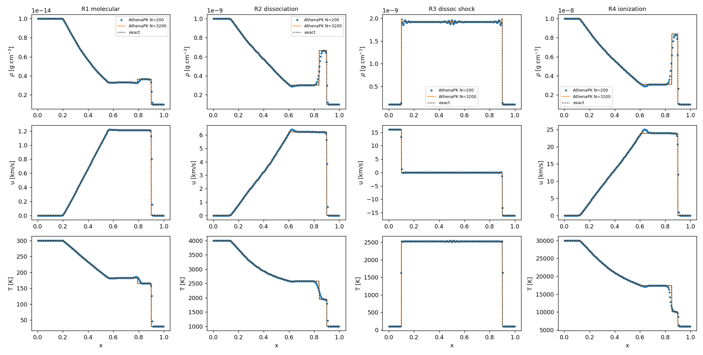
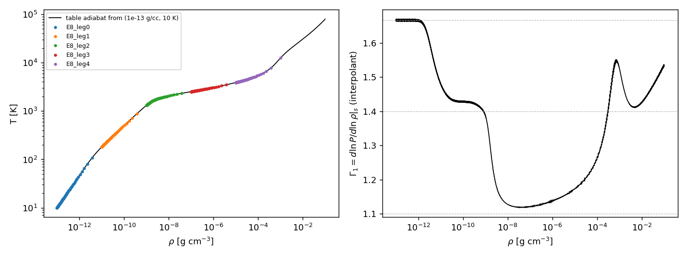

# Tabulated equation of state in AthenaPK: validation report (paper I)

Version 2026-10-06 (public edition). Folder `validation/eos_tabulated/`. This document is the authoritative report for
the EOS module; `README.md` is the index of decks, scripts and results.

*Public edition.* The validation was carried out in a larger private research code from which this repository was
extracted (self-gravity + tabulated EOS only). Passages about the private development history (commit and binary
hashes, the adoption into the production runs), about physics modules that are not part of this repository, and
about compute systems have been removed or generalised; every test result, table and figure of the EOS tests is
unchanged. Hashes that remain identify the binaries recorded in each run's `cmd.txt`.

---

## 0. Summary

The tabulated protostellar EOS (`eos = hydrogen`, table `eos_table_hires_v5_cold.bin`) was validated in the
configuration used by the production collapse runs, from the table file itself (provenance, thermodynamic
consistency, inversions) through its coupling to the MHD solver (sound waves, general-EOS Riemann problems against an
exact solver, adiabatic compression through H2 dissociation and H ionization) to the GPU path and the behaviour at
the table edges and floors.

| group | tests | verdict |
|---|---|---|
| A. The table | E1 provenance, E2 thermodynamic gates, E3 asymptotic limits, E5 inversions | PASS. Byte-identical rebuild; Saha consistency 0.16 % median; P strictly increasing in e below the 3e5 K cap; P -> e inversion error = its analytic bound 8.08e-6; T -> e -> T round trip 2e-5 in the production footprint, up to 1.3 % across dissociation/ionization (E-F7) |
| B. EOS + hydro | E6 acoustic waves, E7 Riemann problems (4 problems x 6 resolutions x 2 interpolation modes), E8 compression legs (5 legs, 10 K -> 12 500 K) | PASS. Waves travel at the interpolant's sound speed (E-F1, fixed); shocks converge to the exact general-EOS solution (R1, R3: plateaus to 1e-7); rarefactions through recombination converge slowly because no conservative scheme keeps a moving contact between EOS regimes in pressure equilibrium (Sec. 6.3); the opt-in double flux restores ~1e-6 plateaus at a measured energy cost (Sec. 6.4); compression follows the exact adiabat to <= 4e-7 after removing a known geometric term |
| C. GPU | E9 table lookups, waves, Riemann, compression, floor probe on H100 | PASS. Lookups = CPU to <= 3.3e-15; smooth flows to 1e-14 .. 5e-10; Riemann L1 differences 3-4 orders below the discretisation error |
| D. Edges and floors | E10 footprint of the production runs, floor-visibility probe | Table covers the production footprint. The pressure floor was inert and floored cells invisible (E-F5) and `eos_interp = p` mis-extrapolated below the density edge (E-F6): both FIXED (`hydro/eos_extrapolate`, default on), with a physical temperature floor (`hydro/Tfloor`, counted) and a table extended to 1e-26 g/cc (`eos_table_hires_v5_cold_rho26.bin`); a legacy build keeps an existing run bit-continuous (E-F9) |

Findings: **E-F1** P interpolation sound-speed sawtooth (FIXED, default); **E-F2** the shipped consistency
test could not read v2 tables (fixed in the copy); **E-F3** `dedner_extended` segfaults in 1D; **E-F4**
`hydro/cons_diag` segfaults in 1D; **E-F5** pressure floor inert, floored cells uncounted (FIXED); **E-F6** density
extrapolation below the table with `eos_interp = p` (FIXED); **E-F7** T -> e -> T round trip up to 1.3 %; **E-F8** 1D
meshblocks of 400 cells exceed the CUDA team-scratch limit; **E-F9** a runtime key cannot keep an existing run
bit-continuous when the inline lookups change (resolved with a compile-time legacy build); **E-F10** the slow R2/R4 convergence is
the spurious pressure of a conservative update at a moving contact between EOS regimes (Abgrall 1996), not the
table; fixed WITH PLM by an opt-in double-flux energy update (`hydro/double_flux`; contacts pressure-exact in
1D/2D/3D, CPU/GPU, refined meshes; plateaus 1e-6; energy error converging; opt-in).
Test-infrastructure traps in Sec. 12.

---

## 1. Scope

What is validated: `src/eos/eos_table.hpp` (lookup, inversion, clamp instrumentation), the table
`eos_table_hires_v5_cold.bin` and its generator `src/eos/gen_eos_table.py`, and the coupling through
`AdiabaticGLMMHDEOS` (`src/eos/adiabatic_glmmhd.hpp`: ConsToPrim, floors, `eos_floor_consistent`) to the
glmmhd/HLLD/PLM/VL2 solver. Not in scope: any other physics of the production runs.

## 2. Code under test

### 2.1 Production configuration
`eos = hydrogen`, `eos_table_file = eos_table_hires_v5_cold.bin` (md5 `f712d6a8`),
`riemann = hlld`, `reconstruction = plm`, `integrator = vl2`, `eos_floor_consistent = true`, `eos_bisections` 20
(default), `pfloor = 1e-8`, `dfloor = 1e-6` (code units), units rho0 = 5.467e-19 g/cc, v0 = 1.9e4 cm/s.
`hydro/eos_interp`: default `p_over_rho` (E-F1); `p` reproduces runs made before the fix.

Table: 400 log-rho nodes over [1e-20, 1] g/cc (0.0501 dex), 1399 log-e nodes over 10^6.527..10^13.889 erg/g
(0.0053 dex) for P, cs2, log T; 1370 log-T nodes over 0.046 K..3e5 K (0.0050 dex) for e(rho, T).
Lookups are bilinear in (log rho, log e) / (log rho, log T), edge-clamped and counted (`eos_clamp_report`).
P -> e is a fixed 20-step bisection on the log-e axis.

### 2.2 Source and binaries
The tests ran on CPU (Kokkos OpenMP back end, one thread per MPI rank) and on one H100 GPU, with binaries built from
the private research tree whose EOS code is the one shipped here: `eos/eos_table.hpp` (incl. the below-table
continuation `hydro/eos_extrapolate` and, under the CMake switch `ATHENAPK_EOS_LEGACY_LOOKUPS`, the verbatim legacy
lookups), `eos/adiabatic_glmmhd.*`, `hydro/hydro.cpp` (key reads; `hydro/Tfloor` for the tabulated EOS),
`diagnostics/cons_diag.*` (`cons-nTfloor`), `hydro/double_flux.{hpp,cpp}` with its hooks in `hydro_driver.cpp` and
the two null-default Parthenon hooks of Sec. 6.6, and the `eos_test` problem generator (`uL/uR`,
`espL_code/espR_code`, modes wave/riemann/compress/slab, the `eos_homologous` x1 BC). The binary hashes quoted below
identify the binary of each run (recorded in its `cmd.txt`; run directories are not shipped). The final validated
CPU binary is `85b625bf`.

**Extraction check (2026-10-07).** This repository's code was compared with the validated binary (`85b625bf`) on the
same decks and MPI ranks: 47 paired runs covering the self-gravity final-configuration legs (S1, D1, D2, D4, D7), three
`collapse_be` runs (deep static AMR solve, BE stability, magnetized rotating collapse to 300 cycles), the EOS 1D legs
(E6, E7e with and without double flux, E8, E10), the refined-mesh double-flux + fill legs (E7r, E7x) and 2D/3D slabs
(E7q). 12 are bitwise identical as built (incl. S1, D1, D2 and the deep-AMR solve); the rest differ at round-off
level (max |diff| / max |field| <= 1.6e-5 at moving contacts of the standard scheme, <= 2e-10 elsewhere; L1 <= 3e-6),
the same GCC FMA-contraction effect as E-F9 in the EOS report: with both trees compiled with `-ffp-contract=off`, the
28 legs with the largest differences (E7e, E7r, E8, D4, D7, L10) are BITWISE identical (the E10 probes, <= 3e-18, and
the E7q slabs, <= 8e-14, were not rerun). The history files differ only by one diagnostic column that is not part of
this code.

## 3. References and tools

| tool | what | checked |
|---|---|---|
| `scripts/eostab.py` | the v2 table in code units; bilinear exactly as the runtime | E6 predictions = measurements to 1e-4 |
| `host/e5_inversion.cpp` (+ `shims/`, `run_e5.sh`) | compiles the REAL `eos_table.hpp` on the host (KOKKOS_INLINE_FUNCTION -> inline), so E5 runs the kernels' arithmetic | — |
| `scripts/riemann_exact.py` | exact Riemann solver for any P(rho, e) (Colella & Glaz 1985): rarefactions = RK4 along the isentrope de = P/rho^2 drho, du = c/rho drho, c^2 = P_rho + P P_e/rho^2 of the interpolant; shocks = Rankine-Hugoniot root; vectorised fan sampler | Toro (2009) tests 1-5 to his printed digits; Sod fan vs analytic 2.3e-10; step refinement 2e-4 -> 5e-5 moves P* by <= 2.8e-6 on R2/R4 |
| `scripts/e7_hugoniot_check.py` | Hugoniot single-valuedness (all roots in rho at each P) and Liu's chord condition with exact shock states | Sec. 6.1 |
| `scripts/analyze_E7.py` / `analyze_E8.py` / `analyze_E9.py` / `analyze_E10.py`, `e7f_eval.py` | analyses (Sec. 13) | — |

The reference for the hydro tests is always the RUNTIME INTERPOLANT (mode `p` or `p_over_rho`), because a
conservative scheme converges to the weak solution of the equations it actually solves; the interpolant's
deviation from the physical EOS is measured separately (E2, E-F1).

---

## 4. Group A — the table

**E1 provenance.** `gen_eos_table.py build 400 1000 920 <out.h5> 399 450` rebuilds the production table
byte-identically (6.6 min, `runs/E1_rebuild`).

**E2 thermodynamic gates** (`scripts/test_eos_consistency.py`, `results/tables/E2_consistency_v5cold.txt`):
charge neutrality 5.05e-15, element conservation 2.2e-16, Maxwell identity -rho^2 (du/drho)_T = T (dP/dT)_rho - P
to 2.46e-3 (tol 3e-3, finite-difference limited), table P vs direct Saha median 1.56e-3 / max 5.5e-3 (7454 K,
1e-14 g/cc), cs2 vs Saha median 1.55e-3 / max 3.3e-2 (9047 K, 1e-13: a kink).

**E3 limits.** Gamma1 = 1.668 (10 K), 1.597 (100 K), 1.428 (500 K), 1.101 (2000 K, 1e-9 g/cc), 1.145 (1e4 K,
1e-8 g/cc).

**E5 inversions** (host harness on the real header, `results/tables/E5_inversion.txt`; identical in both modes
except where stated):

| check | result |
|---|---|
| P(rho, e) increasing in e (needed by the bisection) | strictly increasing everywhere below 3e5 K; 529 of 559 200 node pairs are EQUAL (not decreasing): the generator's T cap (3e5 K) for rho > 6e-3 g/cc. log T(rho, e) has the same plateau. e(rho, T) strictly increasing (0 violations) |
| P -> e bisection (20 steps) | max relative e error 8.08e-6 = the analytic bound 0.5 x 7.362 dex x 2^-20; resulting P error <= 9.2e-5 (dissociation/ionization, where dlnP/dlne is large); 30 steps 7.9e-9, 40 7.7e-12, 60 5e-15 |
| T -> e -> T round trip (797 x 1201 off-node points, 0.1 K-2.9e5 K) | median 1.2e-5..7.9e-5 by regime; max 1.6e-5 (< 100 K), 1.7e-4 (100-1e3 K), 1.3e-2 (dissociation, worst at 1e-19 g/cc, 1377 K), 1.2e-2 (H ionization), 7e-4 (> 3e4 K). Production footprint (rho <= 1e-10, 1-200 K): max 2.0e-5 -> E-F7 |
| clamp counters over all interior sweeps | 0 |
| rho below the table, T = 10 K | `p`: P frozen at the edge value (x2 too high at 0.5 rho_edge, x1e4 at 1e-4 rho_edge); `p_over_rho`: exactly the ideal-gas continuation rho (P/rho)_edge (ratio 1.000000); counted as `rho<` -> E-F6 |
| P below P(rho, e_min) (EspFromP) | returns e_min (1 + 8.1e-6), i.e. T = 0.063 K, and is NOT counted (the bisection runs with counting off; only the rho axis is tallied) -> E-F5 |
| 0 < e < e_min | P = P(rho, e_min) whatever e is (1e-9 e_min gives the same P); counted as `esp<` |
| production pfloor 1e-8 through InternalEnergyFromPres | e_fl = e_min (1 + 8.1e-6) at every density; P(e_fl) = 1.4e4 x pfloor at 1.3e-20 g/cc up to 1.1e19 x pfloor at 1e-5 g/cc; 0 clamps -> E-F5 |

---

## 5. Group B1 — acoustic waves (E6)

Planar eigenmode (amplitude 1e-6) on five states, one period, N = 16-256 (`runs/E6_wave`,
`results/tables/E6_waves*.txt`). Amplitude damping converges at >= 3rd order. With the legacy `p` interpolation the
phase speed is off by -1.40 / -0.85 / -0.46 / +0.16 / +0.55 % (10 K / 100 K / 500 K / 2000 K / 1e4 K) independent of N,
and equal to the interpolant's own sound speed to 1e-4 (E-F1). With `p_over_rho` at N = 256: -0.059 / -0.015 /
-0.12 / -0.16 / -0.04 %.

## 6. Group B2 — general-EOS Riemann problems (E7)

### 6.1 Problems and their exact solutions
States (rho [g/cc], T [K], u [km/s]), 1D, outflow, x0 = 0.5, t such that the fastest wave travels 0.4:

| problem | left | right | exact (p_over_rho): P* [code], u* [code], waves, T* L/R |
|---|---|---|---|
| R1 molecular (rotational excitation) | 1e-14, 300, 0 | 1e-15, 30, 0 | 1.0842e5, 6.3948; rarefaction/shock; 182 / 166 K |
| R2 dissociation (driver partly dissociated) | 1e-9, 4000, 0 | 1e-10, 1000, 0 | 2.4962e11, 32.806; rarefaction through recombination / shock; 2581 / 1947 K |
| R3 dissociating shock (colliding streams) | 1e-10, 100, +16 | 1e-10, 100, -16 | 1.3701e12, 0; two shocks, compression 19.2, 2528 K |
| R4 ionization (ionized driver) | 1e-8, 3e4, 0 | 1e-9, 6000, 0 | 3.4927e13, 125.97; rarefaction through H recombination / shock; 17 405 / 10 076 K |

Admissibility (`results/tables/E7_hugoniot_check.txt`, both modes): every shock branch is single-valued in P (one
rho root at each of 400 pressures up to 3 P*), Liu's chord condition holds strictly (one sign over 150 exact
states), every rarefaction is convex along its path (fundamental derivative G_min = 1.137 / 0.999 / 1.117 for
R1/R2/R4 with `p_over_rho`, 0.77 / 0.61 / 0.70 with `p` — the E-F1 sawtooth). R3's Hugoniot is non-monotone in
rho only ABOVE P* (957-1500 P0, where dissociation completes), outside the solution. At +-8 km/s the shocked gas
only reached 1995 K, hence +-16 km/s.

### 6.2 Results (`results/tables/E7e_riemann.txt`, figure `results/figures/E7e_riemann.png`)
L1 errors normalised by max|q|, exact cell averages from 25 600 sub-cells; plateau = median over the middle half
of each star region; N = 100 ... 3200.

| problem (p_over_rho) | L1(rho) N = 400 / 3200, order | plateau P* error N = 400 / 1600 / 3200 | shock position |
|---|---|---|---|
| R1 | 1.43e-3 / 2.04e-4, 0.87-1.00 | +3.9e-5 / +1.3e-6 / -2.0e-7 | +0.53 cells, constant |
| R2 | 4.21e-3 / 7.60e-4, 0.81-0.85 | -5.2e-4 / -2.6e-4 / -1.7e-4 | +0.10 -> -0.05 cells |
| R3 | 1.83e-3 / 2.28e-4, 0.95-1.01 | -5.3e-5 / +2.2e-6 / +6.5e-7 | -0.03 / +0.03 cells, constant |
| R4 | 5.44e-3 / 1.07e-3, 0.66-0.80 | -1.8e-3 / -8.7e-4 / -5.4e-4 | -0.22 / -0.52 / -0.78 cells |

The `p` legs behave the same against their own exact solutions (R1 P* +1.3e-5, R3 +5.6e-7 at N = 3200); their
L1 orders are lower at moderate N (0.6-0.9) because the sawtooth sound speed perturbs the fans.

### 6.3 Slow convergence through recombination
R1 and R3 (molecular rarefaction; shocks) converge to the exact plateaus at the 1e-7 level. R2 and R4, whose
rarefactions pass through H2 resp. H recombination, converge at order ~0.5-0.7 in the plateau and their shock
positions drift by a slowly shrinking fraction of the box. The reference is not the cause (P* moves by <= 2.8e-6
when the isentrope step is refined 4x). Experiment E7f (`runs/E7f`, `results/tables/E7f_bisect.txt`, p_over_rho):

| | N = 400 | 800 | 1600 | 3200 | 6400 | 12800 |
|---|---|---|---|---|---|---|
| R4 plateau P* error | -1.79e-3 | -1.11e-3 | -8.72e-4 | -5.35e-4 | -3.40e-4 | -2.19e-4 |
| R2 plateau P* error | -5.20e-4 | -3.77e-4 | -2.59e-4 | -1.72e-4 | -1.09e-4 | -6.8e-5 |

Monotone convergence at order ~0.65 out to N = 12800 (ratios 1.56-1.61 per doubling at the top): the scheme
converges to the exact solution, slowly. One change at a time on R4, N = 1600 (reference -8.72e-4): 60 bisections
-8.75e-4, CFL 0.1 -8.39e-4, RK2 integrator -8.70e-4 — not the bisection, the time step or the integrator.

**Is it the table? No (2026-10-05, four falsification tests).** The error profiles (`results/figures/
E7g_error_profiles.png`) show spikes at grid lines the fan crosses, and the interpolant's slope d lnP/d ln e JUMPS at
e nodes by up to 1.16 (R2) and 0.42 (R4) where P(e) is strongly curved through dissociation/ionization (R1: 0.010;
`results/tables/E7g_kinks2.txt`; the tabulated node values themselves are smooth). But removing those kinks does not
change the plateau error (R4, P* error at N = 3200 / 6400):

| interpolant | R4 | R2 |
|---|---|---|
| production table, bilinear | -5.35e-4 / -3.40e-4 | -1.72e-4 / -1.09e-4 |
| C1 along log rho (Catmull-Rom; E7c) | -5.34e-4 / -3.45e-4 | -1.72e-4 / -1.09e-4 |
| C1 along log rho AND log e (monotone Hermite; E7d) | -5.78e-4 / -3.62e-4 | -1.68e-4 / -1.07e-4 |
| table rebuilt with 4x the rho nodes (E7g r4) | -5.37e-4 / -3.47e-4 | -1.71e-4 / -1.09e-4 |
| table rebuilt with 2x the nodes on every axis (E7g x2) | -5.55e-4 / -3.59e-4 | -1.75e-4 / -1.09e-4 |

(each against the exact solution of its own interpolant/table). The C1 interpolant was verified on the real header
(P strictly increasing in e at 39.9 M points; slope jumps 9.8 -> 2.4e-4 along e, 2.5e-2 -> 1e-6 along rho) and then
REMOVED from the code: it is not the remedy.

**It is the reconstruction (E7h/E7i, `results/tables/E7h_scheme.txt`, `E7i_limo3.txt`).** R4, P* error at
N = 800 / 1600 / 3200 / 6400 and the L1(rho) order:

| scheme | P* error | L1 order |
|---|---|---|
| PLM, VL2 + PLM predictor (production) | -1.1e-3 / -8.7e-4 / -5.4e-4 / -3.4e-4 | ~0.75 |
| PLM, VL2 + donor-cell predictor | -6.7e-4 / -5.0e-4 / -3.3e-4 / -2.0e-4 | ~0.85 |
| PLM, RK3 | -1.1e-3 / -8.5e-4 / -5.1e-4 / -3.4e-4 | ~0.8 |
| PPM | -9.4e-4 / -6.5e-4 / -4.4e-4 / -3.6e-4 | ~0.7 |
| WENO-Z | -5.7e-4 / -2.7e-4 / -2.3e-4 / -1.8e-4 | ~0.85 |
| donor cell | -1.4e-2 / -8.7e-3 / -5.8e-3 / -4.0e-3 | ~0.5 |
| **LimO3** (Cada & Torrilhon 2009, nghost 3) | **-4.0e-5 / -4.7e-5 / -8.4e-5 / -3.9e-5** | **0.93-1.0** |

LimO3 on the other problems: R2 -8.6e-5 / -5.4e-5 / -3.6e-5 at 1600 / 3200 / 6400 (PLM -2.6e-4 / -1.7e-4 / -1.1e-4),
L1 order 0.85-0.92; R1 and R3 unchanged (plateaus ~1e-6, L1 ~10 % lower than PLM).

**The mechanism: spurious pressure at the moving contact (E7j/E7k).** The fan itself is accurate. In the left star
region the specific entropy and the Riemann invariant J are those of the exact solution to a median of ~1e-6
(R4 PLM, N = 1600 / 3200 / 6400: dJ/|u*| = -5.9e-6 / -3.0e-6 / -5.6e-7; `E7j_entropy.txt`, `E7j_invariant.txt`), so
the error does not come from the rarefaction. E7k isolates the contact: a pure contact between the two star states
of each problem (equal P and u, density and composition jump), advected (`mov`) or at rest
(`results/tables/E7k_contact.txt`; L1 / max of |P/P* - 1|):

| contact | N = 400 | 800 | 1600 | at rest (any N) |
|---|---|---|---|---|
| R4 (ionization), PLM | 2.8e-3 / 4.2e-2 | 1.8e-3 / 3.7e-2 | 1.1e-3 / 3.2e-2 | 4e-15 / 1e-14 |
| R4, LimO3 | 2.0e-3 / 3.9e-2 | 1.1e-3 / 3.4e-2 | 6.3e-4 / 3.0e-2 | 4e-15 / 1e-14 |
| R2 (dissociation), PLM | 7.7e-4 / 1.1e-2 | 4.8e-4 / 9.6e-3 | 3.0e-4 / 8.3e-3 | 5e-16 / 7e-15 |
| R1 (molecular), PLM | 5.1e-6 / 3.4e-5 | 3.5e-6 / 3.2e-5 | 3.2e-6 / 2.2e-5 | 7e-16 / 5e-15 |

At rest the contact is exact; moving, the cells that straddle it carry up to 3-4 % (R4) and 1 % (R2) spurious
pressure, and L1 converges as ~N^-0.7, the plateau's order. This is the known failure of conservative schemes at
interfaces with a nonlinear EOS (Abgrall 1996): the update mixes (rho, rho e) LINEARLY, and where Gamma varies
(dissociation, ionization) a linear mix of two states at the same P is not at that P. The pressure blips launch
acoustic waves into the plateaus. Molecular gas (R1, nearly ideal) shows 2e-5. LimO3 only sharpens the contact
(1.5-1.7x lower L1, the same maximum); it does not remove the mechanism. Not a defect of the EOS or the table.
LimO3 (`hydro/reconstruction = limo3` + `parthenon/mesh/nghost = 3`, 1.18x cells per 32^3 block) stays a
possible production change; the fix WITH PLM is Sec. 6.4. Finding E-F10.

### 6.4 Double flux: pressure-exact contacts with PLM (opt-in, `hydro/double_flux`)

Goal: a fix that keeps PLM. Chosen: the double-flux method (Abgrall & Karni 2001,
JCP 169, 594; Billet & Abgrall 2003). Implementation `src/hydro/double_flux.{hpp,cpp}` (separate TU) and a
two-task hook in `hydro_driver.cpp`:

1. At step start every cell freezes a stiffened-gas fit of the table through its own state,
   rho e = P/(g* - 1) + rho e0*, with g* = rho c^2/P (table c^2) and e0* from the cell's conserved internal energy.
   With a frozen EOS, rho e is linear in rho at fixed P, so a linear mix of two states at equal P stays at that P.
2. Each stage: the face states are reconstructed exactly as the flux kernel does; HLLD's energy flux is affine in
   the two face energies (F_E = F0 + aL E_L + aR E_R, coefficients replicated from the solver's wave speeds and
   region), so the energy flux "seen" by a cell with its own frozen EOS is the standard flux plus
   aL (E_L^frozen - E_L^table) + aR (E_R^frozen - E_R^table). Mass, momentum and B fluxes are untouched.
3. In a double-flux cell, after the standard update: E += beta dt sum (own-EOS increments), then P is taken from the
   frozen EOS and E is rebuilt from the TABLE at that P (EspFromP + 3 Newton steps on the interpolant). Total
   energy is therefore not conserved exactly where g*, e0* vary; measured below.
4. Contact sensor, PER CELL: a cell is a double-flux cell iff every face has dP/P <= kappa drho/rho
   (`hydro/double_flux_kappa`, default 0.2), or both jumps are at round-off. Shocks and adiabatic flow have
   dP/P ~ Gamma1 drho/rho with Gamma1 >= 1.1; a contact has a density jump without a pressure jump. All other cells
   are exactly the standard conservative scheme.

Scope, refused at startup otherwise: `eos = hydrogen`, HLLD, PLM or donor cell, VL2, uniform mesh (the
increments are not AMR flux-corrected; lifted in Sec. 6.5-6.6), no first-order flux correction.

How the design got there (each version measured, `results/tables/E7m_dflux.txt`, `E7n_dflux_sensor.txt`,
`E7o_dflux_contact.txt`, `E7p_dflux_cell.txt`):

| version | contacts | R1 plateau dP* (N = 3200) | R3 / R2 / R4 | verdict |
|---|---|---|---|---|
| v1: everywhere (E7m, 04db22ca) | exact (1e-14) | -1.59e-3 at every N (400-1600; not run at 3200) | R4 +4.5e-3 / +4.2e-3 / +4.1e-3 at 400 / 800 / 1600: not converging | the frozen tangent EOS is wrong across shocks |
| v2: faces with dP/P < 0.1 (E7n, 783a5a10) | exact | -1.12e-3 at every N | R3 dE/E +7.5e-4 at every N | still acts in shock feet and rarefactions (INFERRED, not isolated: table c^2 is not exactly the table's own dP/drho at fixed s, so each frozen-EOS reset in smooth flow drifts by a step-independent amount) |
| v3: per-FACE contact sensor (E7o, 4f39c532) | exact | -1.9e-6 | R1/R3 = standard; R4 -1.8e-2 (1600), -2.9e-2 (3200): GROWS with N | own-EOS increments applied without the reset in cells with one contact face; faces flip on/off on the plateaus |
| **v4: per-CELL contact sensor (E7p, 54b1958b)** | **exact** | **-1.3e-6 (standard -2.0e-7)** | **converge, below** | **adopted** |

Results of v4 (E7p; standard PLM in brackets; dE/E = (E_dflux - E_std)/E_std of the whole domain at t_final):

| problem | N = 400 | 800 | 1600 | 3200 | 6400 |
|---|---|---|---|---|---|
| R4 plateau dP* | +1.8e-4 [-1.8e-3] | +1.6e-4 [-1.1e-3] | +1.3e-6 [-8.7e-4] | -3.2e-6 [-5.4e-4] | -1.2e-6 [-3.4e-4] |
| R4 L1(rho) | 5.4e-3 [5.4e-3] | 3.1e-3 [3.1e-3] | 1.78e-3 [1.82e-3] | 1.02e-3 [1.07e-3] | 5.9e-4 [6.3e-4] |
| R4 dE/E | +9.0e-4 | +6.2e-4 | +4.3e-4 | +2.9e-4 | +1.9e-4 |
| R2 plateau dP* | +2.6e-4 [-5.2e-4] | +2.7e-5 [-3.8e-4] | -5.5e-6 [-2.6e-4] | -2.6e-6 [-1.7e-4] | -3.7e-6 [-1.1e-4] |
| R2 L1(rho) | 4.2e-3 [4.2e-3] | 2.3e-3 [2.4e-3] | 1.32e-3 [1.35e-3] | 7.4e-4 [7.6e-4] | 4.5e-4 [4.6e-4] |
| R2 dE/E | +5.3e-4 | +3.4e-4 | +2.1e-4 | +1.4e-4 | +8.6e-5 |
| R1 plateau dP* | +2.6e-5 [+4.0e-5] | -2.2e-6 [+4.7e-6] | -2.0e-6 [+1.3e-6] | -1.3e-6 [-2.0e-7] | +4.1e-7 |
| R1 dE/E | -2.7e-6 | -1.9e-6 | -1.1e-6 | -5.8e-7 | — |
| R3 plateau dP* | -5.3e-5 [-5.3e-5] | -8.8e-6 [-8.9e-6] | +2.1e-6 [+2.2e-6] | +5.9e-7 [+6.5e-7] | — |
| R3 dE/E | +2.6e-6 | +1.3e-6 | +6.5e-7 | +3.3e-7 | — |
| pure contact R4, max |P/P*-1| | 3.2e-14 [4.2e-2] | 3.8e-14 [3.7e-2] | 4.8e-14 [3.2e-2] | 8.9e-14 [2.8e-2] | 1.4e-13 [2.3e-2] |
| pure contact R4 dE/E | +2.4e-3 | +1.5e-3 | +8.9e-4 | +5.5e-4 | +3.4e-4 |
| pure contact R2, max |P/P*-1| | 1.8e-14 [1.1e-2] | 4.9e-14 [9.6e-3] | 5.3e-14 [8.3e-3] | 9.4e-14 [7.2e-3] | 2.0e-13 [6.1e-3] |

So with PLM: moving contacts are pressure-exact to round-off; the R2/R4 plateaus reach the 1e-6 level (the level of
R1/R3 and of the reference solver) from N = 1600 on, 65-280x below standard PLM at N = 3200-6400; L1(rho), which
includes the shock positions, is equal to or up to 7 % below standard. The price is the energy: +1.9e-4 (R4) and
+8.6e-5 (R2) of the domain's total energy at N = 6400, converging at order ~0.6 (the width of the smeared contact),
always positive here; R1/R3 (no regime change at the contact) 1e-6.

Falsification and non-regression:
* Smooth acoustic waves must not trigger the sensor: E6 states S1-S5, N = 16-256, double flux on vs off with the
  same binary (`runs/E6_dflux`): all 25 final states BITWISE identical (the key was active: fields allocated, wall
  time higher). The sensor never fired.
* Key off: binary 54b1958b reproduces the previous default binary a15514d6 BITWISE on all 20 1D legs
  (`runs/EF56_regate`: E10 probes, E7e n400 x 8, E6 S1-S5, E8_leg2 61 outputs).
* Legacy build of the same source (`-DATHENAPK_EOS_LEGACY_LOOKUPS=ON`): on a 3D production restart (64 ranks, full
  production configuration, 3 cycles) BIT-IDENTICAL to the pre-fix binary a6870124.
* Wall time (1D, 50 concurrent runs on one node, noisy): 1.04-1.5x. Not a 3D cost measurement.

### 6.5 Double flux in 2D/3D, with mesh refinement and on the GPU (2026-10-06)

The items deferred in Sec. 6.4, in the order they were done. Final source: CPU
`37c90051` (bitwise = `fe0caa0f` on four double-flux runs, `runs/E7u_bitid37`), GPU `84aab51e` (same source).

**v6 design change (for refinement).** For a frozen EOS (g, e0) the own-EOS increment of a face energy flux is
X/(g-1) + e0 Y - Z with X = aL PL + aR PR, Y = aL rhoL + aR rhoR, Z = aL E_tab,L + aR E_tab,R. X, Y, Z are stored as
the fluxes of a field `dflux_xyz` ({Cell, Independent, WithFluxes, OperatorSplit}: flux-corrected with the hydro
fluxes, excluded from every {WithFluxes, Cell} pack and from the lean registers), so a coarse cell at a fine/coarse
face gets the increment of exactly the restricted flux it receives. The coefficient task now runs before the flux
correction is sent. v6 reproduces v4 in 1D (`results/tables/E7t_dflux_v6.txt`: contacts <= 1e-13; R2/R4 plateaus
within a few 1e-6 of v4; energies to 3 digits; R3 identical).

**Two bugs found and fixed on the way.**
* Scratch overrun (in the double-flux code itself): the coefficient kernel sized its reconstruction scratch rows by
  the hydro count, but `Reconstruct` writes every prim component; with any extra advected component (e.g. a
  passive scalar) it wrote past `wl` into the next array. Seen as 2.8e-4 differences in R2/R4 between runs with and
  without such a component; after sizing from `prim.GetDim(4)` the two are BITWISE identical. Production runs carry
  passive scalars, so this would have hit the first production use.
* nvcc rejects a device lambda that first captures a variable inside `if constexpr` (GPU build failed; CPU fine).

**2D and 3D, uniform mesh (E7q, `results/tables/E7q_slab.txt`).** New `eos_test` mode `slab`: periodic oblique slab of
pure contacts, wave vector (mx, my, mz) in box units, velocity along k (R4 star states). Exact solution: translation
at uniform P*.

| case | double flux max / L1 |P/P*-1| | standard | dE/E over the run (double flux) |
|---|---|---|---|
| 2D k = (1,1), N = 64 / 128 / 256 / 512 | 1.1e-14 / 2.0e-14 / 2.4e-14 / 1.1e-12 | 9.3e-2 / 6.9e-2 / 5.3e-2 / 4.4e-2 | +1.8e-2 / +1.1e-2 / +6.6e-3 / +4.1e-3 |
| 3D k = (1,1,1), N = 32 / 64 / 128 | 7e-15 / 2.0e-14 / 1.4e-14 | 8.4e-2 / 6.3e-2 / 5.2e-2 | +3.1e-2 / +1.9e-2 / +1.2e-2 |

Invariance (bitwise, key on and off): 2D N = 128 in 32^2 blocks on 4 ranks = one block; 3D N = 64 in 16^3 blocks on 8
ranks = one block; k = (1,0) on a 2D grid = the 1D run row by row (the x2 path adds nothing). The energy price is
larger than in the Riemann problems because half of the box is a slab bounded by two regime-changing contacts; it
converges at order ~0.7.

**Mesh refinement (E7r, `results/tables/E7r_amr.txt`).** R4 moving contact in 1D through a 2-level static patch
(smr) and with `maxdensity` adaptive refinement whose fine/coarse boundary rides on the contact (amr); oblique 2D slab
with a static patch and adaptive refinement. Max |P/P*-1| over 8 snapshots:

| case | standard | v5 (coarse cells at fine/coarse faces standard) | v6 (flux-corrected X, Y, Z) | v6 + piecewise-constant prolongation (E7v) |
|---|---|---|---|---|
| 1D smr | 6.4e-2 | 8.1e-3 | 1.35e-3 | **1.2e-13** |
| 1D amr | 5.3e-2 | 9.7e-4 | 5.5e-4 | 4.3e-4 |
| 2D smr | 1.2e-1 | 8.9e-2 | 5.1e-3 | 4.5e-4 |
| 2D amr | 8.5e-2 | 4.1e-2 | 4.0e-3 | 3.0e-5 |
| (1D uniform, same coarse N) | 6.4e-2 | 2e-14 | 2.8e-14 | — |

The residual on refined meshes is born where the contact crosses a fine/coarse boundary (error located at the
level jumps, then radiated as sound). E7v isolates it (validation-only key `hydro/cons_prolong_pc`): with
piecewise-constant prolongation of `cons` the 1D static case becomes exact, so the source is the minmod prolongation of
CONSERVED variables into ghost cells -- rho and E interpolated separately mix rho e linearly, the same Abgrall effect,
in cells that never get the double-flux reset. What remains with piecewise-constant prolongation comes from
restriction (2D) and from regridding block interiors (amr). OPEN: an EOS-consistent ghost fill (prolong P, set E from
the table at the prolongated P) would remove the prolongation part; restriction/regrid need the same idea. Not
implemented. `hydro/cons_prolong_pc` is a diagnostic, not a remedy (first-order ghosts).

**GPU (E9g, `results/tables/E9g_dflux_gpu.txt`, H100).** Pressure-exact on the device: 1D contact 4.2e-14, 2D slab
1.7e-14, 3D slab 1.0e-14 (CPU 3.1e-14 / 2.0e-14 / 2.0e-14). GPU vs CPU: contacts <= 2e-13; R4 Riemann L1(rho) 2.4e-6
(discretisation error 5.4e-3); 1D adaptive refinement L1 3.8e-7 with identical cycle counts.

**Non-regression with the key off (fe0caa0f / a5cd4e41).** 20 1D legs bitwise vs a15514d6; E6 waves with the key on
bitwise = standard (the sensor never fires); E7r decks with minmod prolongation reproduced bitwise by a5cd4e41.
Legacy build of the final source (incl. `hydro/cons_prolong_pc`): BIT-IDENTICAL to a6870124 on the production
restart.

Still open at this point: EOS-consistent ghost prolongation/restriction for refined meshes (done in Sec. 6.6); a
production-like 3D run (done in Sec. 6.6); first-order flux correction stays refused. Relevance: the production runs
stay <= 133 K so far (R1 regime, 2e-5 at contacts); the effect matters past ~1500 K.

---

### 6.6 EOS-consistent fill for refined meshes (2026-10-06)

**Final design (binary 85b625bf; `hydro/double_flux_ghost_fill`, default true with double flux on a refined mesh;
`hydro/double_flux_fill_sensor`, default true).** Prolongation, restriction and regridding interpolate rho and E
separately, which mixes rho e linearly -- the Abgrall effect again, in cells the double-flux reset never sees. The
PRESSURE is carried as its own field `dflux_p` ({Cell, Independent, FillGhost, OperatorSplit}, the same refinement
operators as cons). `DoubleFluxRefreshP` sets it to P(cons) in block interiors before every boundary send and after
every ConsToPrim, so Parthenon restricts it (average of the fine P), prolongates it (the limited stencil applied to P)
and carries it through regrids. Where the transported P and P(cons) disagree (> 1e-12) AND the cell passes the
double-flux contact test on the transported pressure, E is rebuilt from the table at the transported P (rho, momenta,
B as interpolated): in ghost regions next to a block on another level (`DoubleFluxGhostFill`, run before ConsToPrim
by `ConsToPrimDoubleFlux`, which replaces Hydro's FillDerived only when the fill is on) and in regridded interiors
(`DoubleFluxPostRegrid`). Two optional hooks were added to the vendored Parthenon (external/parthenon_local, 13
lines, null by default): `Mesh::PreSendBoundBufsHook` (SendBoundBufs, before the send-side restriction) and
`Mesh::PostRegridHook` (after the regrid prolongation/restriction, before the first exchange); AthenaPK installs them
in main.cpp only when the fill is on.

**How it got there (each step measured; `results/tables/E7w_ghostfill.txt`, `E7w2_pfield.txt`, `E7w3_sensor.txt`,
`E7w4_sensor.txt`; max |P/P*-1| over 8 snapshots of the E7r decks).**

| version | 1D smr | 1D amr | 2D smr | 2D amr |
|---|---|---|---|---|
| standard | 6.4e-2 | 5.3e-2 | 1.2e-1 | 8.5e-2 |
| v6 (flux-corrected X, Y, Z only) | 1.35e-3 | 5.5e-4 | 5.1e-3 | 4.0e-3 |
| v7a: prolongated ghosts from the coarse buffer | 4.0e-14 | 4.7e-4 | 4.8e-4 | 4.0e-3 |
| v8: transported pressure, unconditional | 5.8e-14 | 2.2e-13 | 1.6e-13 | 2.5e-14 |
| v8 + contact sensor, post-regrid sensor on ghosts | 5.8e-14 | 4.5e-4 | 1.6e-13 | 2.7e-14 |
| **final: + post-regrid sensor on interior neighbours** | **5.8e-14** | **2.2e-13** | **1.6e-13** | **2.7e-14** |

* v7a read the coarse buffer through `MeshData::PackVariables({"cons"}, /*coarse=*/true)` first. The MeshData pack
  cache is keyed WITHOUT the coarse flag, so that call returns the FINE pack once it exists; a built-in self-check
  (prolongate the coarse density the same way, compare with Parthenon's) showed 45-170 % deviations, then exactly 0
  after reading `Variable::coarse_s` per block. v7a fixed only prolongated ghosts.
* v8 covers restricted ghosts (fine-P average) and regrids. Unconditional, it was exact on the tests but in a
  production restart (below) it rewrote non-contact ghosts at level jumps: e_int changed by up to 44 % in 3 cycles, 89 % of
  those cells on block faces -- interpolating P instead of E is a different ghost scheme in steep fronts, not a
  contact fix. Hence the contact sensor.
* The post-regrid hook runs before the post-regrid exchange, so its sensor must ignore (not yet valid) ghosts.

**Checks of the final version.** Fill off: the four E7r runs reproduced bitwise. Key off (standard): reproduced
bitwise. Acoustic wave S3 through a static patch (E7x decks, N = 32/64/128): BITWISE identical to standard (the
sensor never fires in sound waves; the unconditional v8 differed by 1e-7..6e-9 of the amplitude). Production restart (E7z: 3D collapse at 1.1 t0, 64 ranks, the full production configuration incl. self-gravity and
10-level Jeans AMR, 3 cycles): double flux + fill vs key off, e_int max 1.9e-5,
99.99 % 8.4e-6, rho max 2.0e-10, 0 cells above 1e-3 -- inside the noise floor of the same binary on 48 vs 64 ranks
(e_int max 2.8e-5). The production state at 1.1 t0 (<= 133 K) has no contact where the method changes anything,
as R1 predicted. Wall time 623 s vs 589 s (+6 %).
Key off: 20 1D legs bitwise vs a15514d6 (`runs/EF56_regate_v8`). Legacy build of this source incl. the
Parthenon hooks: BIT-IDENTICAL to a6870124 on the production restart. GPU (E9i, H100, GPU 26b44e57 built from the identical source; `results/tables/E9i_gf_gpu.txt`): all four
refined-mesh contacts pressure-exact on the device (max |P/P*-1| 2.2e-13 / 9.9e-14 / 1.6e-13 / 2.4e-14 for 1D amr / 1D
smr / 2D smr / 2D amr), same cycle counts as the CPU, GPU-CPU max rel diff <= 4.1e-12 (rho) and <= 1.1e-13 (P).

---

## 7. Group B3 — homologous compression along the adiabat (E8)

Uniform gas compressed by the planar homologous flow v = -alpha (x - xc) (`eos_test compress`), 33 cells (the
centre cell at rest), ghosts = exact homologous continuation (`eos_homologous`). Five legs of 100x compression
start on the table adiabat through (1e-13 g/cc, 10 K): 1e-13 -> 1e-11 (10 -> 181 K), 1e-11 -> 1e-9 (-> 1309 K),
1e-9 -> 1e-7 (-> 2515 K, into dissociation), 1e-7 -> 1e-5 (-> 3888 K), 1e-5 -> 1e-3 (-> 12 476 K, into H
ionization). Reference: the exact adiabat de/dln rho = P/rho of the same interpolant from the leg's actual initial
state. A total-energy scheme assigns the cell-averaged kinetic energy of the sub-cell velocity gradient to the
internal energy at (alpha dx C)^2/24 (C = compression): alpha was chosen to keep that at ~1e-6 of e, and a leg
at alpha/2 measures it.

| leg | e/e_ad - 1 at 100x: alpha / alpha/2 / CFL 0.15 / 60 bisections | Richardson alpha -> 0 | box uniformity |
|---|---|---|---|
| 0 (10 -> 181 K) | +1.26e-6 / +3.4e-7 / +1.9e-6 / +1.23e-6 | +3e-8 | 3e-9 |
| 1 (-> 1309 K) | +2.58e-6 / +4.8e-7 / +4.0e-6 / +2.56e-6 | -2e-7 | 2e-8 |
| 2 (-> 2515 K) | +5.42e-6 / +1.26e-6 / +7.3e-6 / +5.65e-6 | -1.3e-7 | 6e-8 |
| 3 (-> 3888 K) | +1.04e-5 / +2.35e-6 / +1.36e-5 / +1.08e-5 | -3e-7 | 4e-7 |
| 4 (-> 12 476 K) | +1.07e-5 / +2.94e-6 / +1.54e-5 / +1.13e-5 | +3.5e-7 | 1.4e-6 |

The residual scales as alpha^2 (ratio 3.6-4.6 for alpha/2), i.e. it is the geometric kinetic-energy term; with it
removed the scheme follows the adiabat to <= 4e-7 through dissociation and into ionization. A smaller time step
does not reduce it (CFL 0.15 is 1.3-1.5x larger: more steps, more of the same sub-cell term), and 60 bisections
change nothing. The `p` interpolant has its own adiabat, 0.24 / 0.20 / 0.02 / 0.03 / 0.23 % hotter in T per leg
than `p_over_rho` (E-F1 in compressional heating); the scheme follows it equally well.

Adiabat landmarks (`results/tables/E8_adiabat_path.txt`, figure `results/figures/E8_adiabat.png`): T = 100 K at
3.3e-12 g/cc, 2000 K at 7.7e-9 g/cc; Gamma1 = 1.666 below 1e-12, 1.43 plateau (1e-10), minimum 1.118 at
3.8e-8 g/cc (H2 dissociation), recovery above 1e-4 and the H-ionization dip near 1e-2. Literature
(Masunaga & Inutsuka 2000, ApJ 531, 350): the regimes and their order are those of their central evolution
(adiabatic first core, second collapse once H2 dissociates near 2000 K); a QUANTITATIVE overlay needs their
central T(rho) data, which are not in the abstract and were not available offline — not done. Their path is not
adiabatic (radiative losses), so only the regimes are comparable anyway.

---

## 8. Group C — GPU (E9)

One H100 (GPU binaries 56149b55 / 4d8a6115) vs one CPU rank (890d7f56 / a6870124), same source and decks
(`results/tables/E9_gpu_cpu.txt`, `E9_riemann_L1.txt`, `E9_decomposition.txt`). The t = 0 dump compares the
LOOKUPS (IC energy through EintFromRhoTk on the device, P = Pof in the first ConsToPrim).

| test | t = 0 (lookups) | end of run |
|---|---|---|
| E6 waves, 5 states, N = 128 (427 cycles) | max rel 2.3e-15 in P, rho bitwise | rho, P within 1.2e-14 .. 8.1e-14 |
| E7e Riemann, 4 problems x 2 modes, N = 400 as 4 x 100 blocks (E-F8) | P <= 3.3e-15, 4 of 8 bitwise | same cycle count and final time; L1(GPU - CPU)/max 3e-10 .. 6.5e-6, 3-4 orders below the L1 error vs exact (1.3e-3 .. 6.0e-3), which agrees to all 4 printed digits |
| E8 compression legs 2 and 3 (12 427 / 7970 cycles) | bitwise | rho, P within 5e-10 |
| E10 floor probe, 6 legs | P <= 2e-16 | P <= 1.5e-15; the same flooring / clamp behaviour |

The pointwise maxima at discontinuities (up to 3e-4 in E7e) are a round-off-level shift of a jump within a cell,
hence the L1 metric. CPU decomposition / binary checks: 4 x 100 vs 1 x 400 blocks and binary a6870124 vs 890d7f56
are BITWISE identical on all 8 E7e N = 400 legs. **GPU path: PASS.**

**With the E-F5/E-F6 fix (E9f, GPU a967dca0 = source of CPU a15514d6, `runs/E9_gpu_final`,
`results/tables/E9_gpu_fix.txt`).** The extrapolating lookups run through out-of-line helpers on CUDA, so they were
re-checked: the six floor probes (incl. negative-energy and sub-edge cells, i.e. the new below-table paths) agree
with the CPU to <= 1.3e-15; E8_leg2 to 5.2e-10 after 12 427 cycles; R4 N = 400 L1(rho) difference 5.1e-6 against a
discretisation error of 5.4e-3. Same cycle counts everywhere. Double flux and Tfloor were NOT run on the GPU.

---

## 9. Group D — production footprint and floor probe (E10)

### 9.1 What production occupies
Restarts of a production collapse run at two epochs (1520 blocks, levels 0-7, 49.8 M cells): rho = 1.8e-20 ...
1.5e-11 g/cc, T = 0.67 ... 133 K (0.05-dex bins; 99.9 % of cells per density bin between 9.4 K and 133 K). Inside
the table everywhere — but the AMBIENT sits only 0.25 dex above the table's lower density edge (1e-20 g/cc). No cell
has e below the table (0 of 49.8 M), none has e <= 0.

### 9.2 Clamp counters in the logs
Across three production runs (726 to 1872 cycles each) every cell-state clamp was `esp<` = a lookup with
0 < e < e_min (T < 0.063 K): transient stage/ghost states (none survive into the restarts); one run also walked off
the LOW-DENSITY edge 29 times (E-F6).

### 9.3 Floor-visibility probe (`runs/E10`, `results/tables/E10_probe.txt`)
Thin 3D box (32 x 4 x 4; cons_diag needs 3D, E-F4), 1e-17 g/cc, left half 10 K, right half planted with
e = 0.5 e_min (sub-edge) or e = -1e-3 code (negative), production pfloor/dfloor, `cons_diag = true`,
`eos_floor_consistent` true/false, 3 cycles.

| leg | EOS clamp lines | cons-npfloor | right-half P/rho | total energy |
|---|---|---|---|---|
| control | 0 | 0 | 0.981 (10 K) | 26.9144 |
| sub-edge, fc true / false | 3 (2304, 2176, 2176 `esp<` lookups per cycle) | 0 / 0 | 6.2098e-3 = P(e_min)/rho | 13.4998 = unchanged (e kept at 0.5 e_min) |
| negative, fc true / false | 0 | 0 / 0 | 6.2099e-3 | 13.5424 = 13.4572 + 0.0852 injected (e raised to e_min) |

A cell with e <= 0 is floored to the table edge, energy is injected, and NOTHING records it — not the clamp
counter (the lookup takes the gm1 branch, the bisection is uncounted), not cons-npfloor in either
`eos_floor_consistent` setting (after the flooring pass the cell's P is P(e_min) >> pfloor). A sub-edge positive
e is counted but not floored, and its pressure is that of e_min, not of its energy (here x2). -> E-F5.

With the fix (default build a15514d6, `runs/EF56_final`, `results/tables/E10_probe_fix_final.txt`):

| leg | cons-npfloor (cycles 0-3) | right-half P/rho | total energy |
|---|---|---|---|
| sub-edge | 0 (not floored: P = 0.5 P(e_min) > pfloor) | 3.1049e-3 = 0.5 x 6.2098e-3 | 13.4998 (unchanged) |
| negative | 256, 224, 208, 208 | 5.467e-10 = pfloor/rho | 13.4572 (no visible injection) |

With `hydro/eos_extrapolate = false` all six legs reproduce the old E10 runs bitwise.

### 9.4 Physical closure of E-F5 and E-F6

**Where is the continuation physically right? (`scripts/ef56_validity.py`, `results/tables/EF56_validity.txt`).**
Below the energy edge (T < 0.063 K) the table itself is an ideal gas: P/(rho e) on the bottom e row is 0.666675 at
all 400 density nodes (2/3 = 0.666667), so the gamma = 5/3 continuation of E-F5 is exact physics, not a guess.
Below the density edge the continuation (P = rho (P/rho)_edge at fixed e) is compared with a direct Saha
calculation at 1e-21, 1e-22, 1e-24 g/cc: <= 3e-5 in P and T for T <= 300 K, but 4-20 % off in the H2-dissociation
(~1000 K) and H-ionization (3000-5000 K) bands, where composition depends on density. So the continuation is
realistic for cold gas only.

**Extended table (shipped as `src/eos/eos_table_hires_v5_cold_rho26.bin`).** `src/eos/gen_eos_table.py` gains `rho_pad_pts`
(argv[11]): prepend rows below the original density edge at the same d log rho, keeping the e and T axes from the
original rows. `runs/EF6_table/v5cold_rho26.bin` (md5 cb68bd0f): 520 rows down to 1e-26 g/cc; identical e/T axes;
the original rows' P, log T and e(T) BIT-IDENTICAL; cs2 differs only on the former edge row (row 0), by up to 6.1 %,
because its one-sided derivative becomes central (the old edge value was the less accurate one). New rows vs direct
Saha at off-node densities: max 2.0e-2, typically 1e-3 (the v5_cold table's continuation at the same points:
up to 3.2e-1; `results/tables/EF6_table_check.txt`). E2 thermodynamic gates pass on the extended table
(`E2_consistency_rho26.txt`). Regenerating with `rho_pad_pts = 0` is byte-identical to
`eos_table_hires_v5_cold.bin` (f712d6a8). Switching tables changes results only in cells near 1e-20 g/cc (cs2 of
row 0) and below.

**Physical floor (`hydro/Tfloor`).** The extrapolating EOS makes `pfloor = 1e-8` bind, which drives a floored cell
to T ~ 0. A temperature floor is the physical choice. `hydro/Tfloor` previously required the ideal-gas `mbar_over_kb`
and so could not be used with the tabulated EOS; it now works with `eos = hydrogen` (code temperature units,
1 = 10.015 K) and floored cells are counted in a new `cons-nTfloor` history column. Probe with `Tfloor = 0.2726`
(2.73 K, CMB; binary 04db22ca, `runs/EF5_tfloor`): negative-energy and sub-edge legs end at P/rho = 0.26782 (code),
i.e. T = 2.729 K with mu = 2.33; `cons-nTfloor` 256, 224, 192, 192 as the left gas sweeps over the probe;
`cons-npfloor` 0 (pfloor never reached); control leg 0 floored cells. `hydro/Tfloor` is set per deck.

---

## 10. Findings

**E-F1 — sound-speed sawtooth from interpolating P on a log-rho axis (FIXED; `hydro/eos_interp = p_over_rho` is the
default).** Interpolating P bilinearly in (log rho, log e) is linear in P on a 0.05-dex log-rho axis; interpolating
P/rho_node and multiplying by rho removes it. E6 + E8 quantify it (phase speed up to 1.4 %, adiabat 0.2 % in T per
100x compression, rarefaction convexity G_min 0.6 instead of 1.0).

**E-F2 — the shipped consistency test could not read v2 tables** (fixed in the suite's copy only).

**E-F3 — `glmmhd_source = dedner_extended` segfaults in 1D** (indexes y/z neighbours). Validation-only.

**E-F4 — `hydro/cons_diag = true` segfaults in 1D** (VERIFIED, gdb: `ConsDiagReduce` evaluates the X2/X3
boundary-face fluxes, which a 1D mesh does not allocate; null dereference at the first history write).
Production is 3D; validation-only. Workaround: thin 3D boxes.

**E-F5 — the pressure floor was inert under the tabulated EOS and floored cells were invisible (VERIFIED; FIXED
2026-10-05, key `hydro/eos_extrapolate`, default true).** The lowest pressure the table can return, P(rho, e_min) =
6.21e-3 rho (code; T = 0.063 K), exceeds the production `pfloor = 1e-8` by 4 to 19 decades over the table's density
range, so (a) a cell with 0 < e < e_min was never floored -- it was counted (`esp<`) but got P(e_min), more
pressure than its energy holds; (b) a cell with e <= 0 was floored to e_min (InternalEnergyFromPres clamps silently
at the table edge) with energy injected, and no diagnostic saw it: the clamp counter was not touched and
`cons-npfloor` (P <= pfloor) stayed 0 with `eos_floor_consistent` on AND off. FIX: below the e axis the gas is
continued as the ideal gas it is (cold H2, rotation frozen, gamma = 5/3): P, cs2 and T scale with e/e_min at fixed rho,
EspFromP inverts that exactly, T below the T axis gives e ~ T. Verified (`host/e5_inversion.cpp`,
`results/tables/E5_inversion_final.txt`; probe `runs/EF56_final`, `results/tables/E10_probe_fix_final.txt`, binary
a15514d6): the floor now binds at P = pfloor exactly, a negative-energy cell is floored to P = pfloor with negligible
energy injection (tot-E 13.4572 vs 13.5424 before), and `cons-npfloor` counts it (256 -> 224 -> 208 cells as the
left gas sweeps over the probe); a sub-edge cell carries the pressure of its own energy (0.5 P(e_min) for
e = 0.5 e_min); every such lookup is counted as `esp<` (EspFromP's below-table exit is now counted too). In-table
lookups are bitwise the legacy ones (0 of 1 431 582 differ; 14 in-table 1D legs bitwise). An earlier ConsToPrim
floor-event counter was dropped (see E-F9). The production pfloor = 1e-8 now means T -> 0 in a floored cell; the
physical closure is `hydro/Tfloor` (now usable with the tabulated EOS and counted, Sec. 9.4); setting it is a deck
decision. Physical validity of the gamma = 5/3 continuation: the table's bottom row IS ideal (P/(rho e) = 0.666675).

**E-F6 — with `eos_interp = p` the pressure was frozen below the table's lower density edge (VERIFIED; FIXED by the
same key).** At rho < 1e-20 g/cc the legacy mode returned P(rho_edge, e): x2 too high at 0.5 rho_edge, x10 at 0.1.
With the key on, `p` continues as P = rho (P/rho)_edge, exactly what `p_over_rho` already does (verified: ratio
1.000000 at 0.5-1e-4 rho_edge). The production ambient sits 0.25 dex above the edge; one production run walked off
it 29 times. The continuation is physically right only below ~300 K (<= 3e-5 vs Saha; 4-20 %
off in the dissociation/ionization bands); the realistic closure is the extended table to 1e-26 g/cc (Sec. 9.4,
<= 2 % vs Saha, original rows bit-identical except row-0 cs2), shipped as `eos_table_hires_v5_cold_rho26.bin`.

**E-F7 — T -> e -> T is not an identity (VERIFIED, characterisation).** e(rho, T) and T(rho, e) are two
independently bilinear tables; their composition errs by up to 1.3 % in T across H2 dissociation and H
ionization (2e-5 in the production footprint). Every code path that goes T -> e -> T inherits it (e.g. an IC set
from T). It bit this suite: the first E7 decks passed T and the pgen re-derived e, which shifted the initial
pressures by up to 4.6e-4 and was exactly the plateau error those runs stalled at; any T-based coupling above
1000 K is where it would matter.

**E-F8 — 1D meshblocks of 400 cells abort on the GPU** (`Kokkos::Impl::ParallelFor<Cuda, TeamPolicy> could not
find a valid execution configuration`: per-team scratch for a 400-cell pencil exceeds the CUDA limit; 128 runs).
Production meshblocks are 32^3; affects only long-pencil test decks.

**E-F9 — a runtime key cannot keep an existing run bit-continuous when the inline lookups change (VERIFIED,
2026-10-05).** Gates on a 3D production restart (64 ranks, full production configuration, 3 cycles): every version
of the fix with the key OFF differed from the pre-fix binary a6870124 (cons max rel 1.1e-4), although the 1D tests and
the host harness were bitwise. Bisection: the same source with only the new MEMBERS is BIT-IDENTICAL; the changed
inline bodies alter GCC's inlining decisions (`nm`: `Pof` went out of line in the ConsToPrim TU, ...) and with them
the FMA contraction in the callers. Five restructurings (verbatim legacy branch, select style, out-of-line helpers,
private bilin copy, forced inlining) moved the fingerprint but never removed it. Scale: the SAME pre-fix binary on 48
instead of 64 ranks differs from itself by cons max rel 1.08e-4 after 3 cycles -- the key-off differences are
round-off reordering amplified by the stiff coupled solvers of the production configuration, not physics.
Resolution: a compile-time switch. CMake `-DATHENAPK_EOS_LEGACY_LOOKUPS=ON` compiles the original lookups verbatim
(key refused); that build is BIT-IDENTICAL to a6870124 with the default keys and with the continuity keys
(`eos_interp = p`, `vl2_predictor_recon = dc`). Use it to continue an existing run bit-continuously; the default
build carries the fix.

**E-F10 — a conservative scheme cannot keep a moving contact between EOS regimes in pressure equilibrium; this,
not the table, is the slow R2/R4 convergence (VERIFIED; FIXED opt-in with PLM, `hydro/double_flux`, default off).**
Sec. 6.3-6.4: not the table (four falsifications), not the integrator or time step; the star-region entropy and
Riemann invariant are right to ~1e-6; a pure moving contact carries up to 3-4 % spurious P (R4), converging as
N^-0.7, exact at rest (Abgrall 1996). Double flux (Abgrall & Karni 2001) with a per-cell contact sensor makes moving
contacts pressure-exact (1e-14) and brings the R2/R4 plateaus to ~1e-6 (65-280x below PLM at N = 3200-6400) with no
change in acoustic waves (bitwise) or in R1/R3; price: +1e-4 .. +4e-4 of the total energy at contacts between
regimes, converging at order ~0.6. LimO3 reduces the error 3-9x without fixing the mechanism. Double flux is
validated in 1D/2D/3D, on CPU and GPU and, with the sensor-gated EOS-consistent fill, on statically and adaptively
refined meshes (Sec. 6.5-6.6).

## 11. Defaults in this code

| item | status |
|---|---|
| E-F1 | `hydro/eos_interp = p_over_rho` is the default; `p` reproduces runs made before the fix |
| E-F5 / E-F6 | `hydro/eos_extrapolate`, default true. CMake `-DATHENAPK_EOS_LEGACY_LOOKUPS=ON` compiles the legacy lookups verbatim (key refused) to continue a pre-fix run bit-continuously |
| E-F5 floor | with the fix `pfloor` binds and drives a floored cell's T to ~0; `hydro/Tfloor` (e.g. 0.2726 = 2.73 K) works with the tabulated EOS and is counted (`cons-nTfloor`) |
| E-F6 table | `eos_table_hires_v5_cold_rho26.bin` (to 1e-26 g/cc, <= 2 % vs Saha, original rows bit-identical except row-0 cs2) is shipped and recommended |
| E-F10 contacts | `hydro/double_flux = true` (opt-in, default off) makes contacts pressure-exact with PLM in 1D/2D/3D, on CPU and GPU (Sec. 6.4-6.5); energy +1e-4..4e-4 (Riemann) to 1e-2 (slab, N = 128) at regime-changing contacts, converging. Refined meshes: pressure-exact with the sensor-gated EOS-consistent fill (`hydro/double_flux_ghost_fill`, default on with double flux; Sec. 6.6; two null-default hooks in the vendored Parthenon). Production restart: effect within the noise floor at <= 133 K, +6 % wall time. Alternative: LimO3. Matters past ~1500 K |
| E-F7 round trip | characterised; relevant to any T-based coupling above 1000 K |
| constant mu outside the EOS | the EOS has a variable mu(rho, T) (2.33 molecular -> 1.27 atomic -> 0.6 ionized); any other module that assumes mu = 2.33 is valid only below ~2000 K |
| table coverage | complete for the production footprint (rho 1.8e-20-1.5e-11, T 0.7-133 K) and the design range up to 3e5 K |

## 12. Test-infrastructure traps met in this module (not code findings)
* numpy 2 writes `np.float64(x)` for repr(); Parthenon's `GetReal` uses `atof`, which returns 0.0 for it
  SILENTLY (an E8 tlim of 0, an E10 energy of 0). Cast to float before writing decks.
* An environment that sets `OMP_PROC_BIND=spread` + `OMP_PLACES=threads` breaks concurrent runs: many independent 1-rank `mpirun`s in one
  job then pin every process to the job's first core (0.6 s/cycle instead of 0.01). Set `OMP_PROC_BIND=false`.
  Even then 48 concurrent 1-rank runs cost ~0.08 s/cycle vs 0.01 alone (not investigated).
* sbatch snapshots the script at submission: edits after `sbatch` do not reach a queued job.
* A homologous ghost BC that extrapolates each side from its own edge cell amplifies a uniform translation
  (ratio > 1) — the first E8 set stalled with dt -> 1e-72; the symmetric version is stable.
* `self_gravity/scripts/run_one.sh` uses `mpirun --bind-to core`: concurrent independent 1-rank runs all land on
  core 0 (use `scripts/run_one_nobind.sh`).
* sbatch passes the submitting shell's TMPDIR; if that directory is deleted before the job runs, the build/run
  fails ("can't open .../ccXXXX.s"). Submit with `--export=ALL,TMPDIR=/tmp`.
* Bit-identity gates must compare against a reference built from the SAME tree minus the change (a6870124 here);
  older references differ for unrelated reasons.

## 13. Reproduction map

| test | decks (`inputs/`) | run script (`runs/`) | analysis (`scripts/`) | tables (`results/tables/`) | figure |
|---|---|---|---|---|---|
| E1 | — | E1_rebuild.sh | — | — | — |
| E2/E3 | — | — | test_eos_consistency.py | E2_consistency_v5cold.txt | — |
| E5 | — | host/run_e5.sh | (the harness) | E5_inversion.txt | — |
| E6 | E6_wave_* (make_decks_eos.py) | E6_waves.sh, E6b_prho.sh | analyze_E6.py | E6_waves*.txt/json, E6_fix_P_over_rho.txt | — |
| E7 | E7e_* (make_decks_eos2.py e7) | E7e.sh; E7f_bisect.sh | e7_exact.py, e7_hugoniot_check.py, analyze_E7.py, e7f_eval.py | E7_exact.json, E7_hugoniot_check.txt, E7e_riemann.txt/json, E7f_bisect.txt (E7_riemann_v1_Tdeck.* = superseded first set) | E7e_riemann.png |
| E8 | E8_leg* (make_decks_eos2.py e8), E8_legs.json | E8_E10.sh | analyze_E8.py | E8_compress.txt/json, E8_adiabat_path.txt | E8_adiabat.png |
| E9 | as E6/E7e/E8/E10 | E9_gpu.sh, E9_gpu2.sh, E9_gpu3.sh, E9_cpu_mb100.sh, E6cpu_ref.sh | analyze_E9.py, e9_riemann_l1.py | E9_gpu_cpu.txt, E9_riemann_L1.txt, E9_decomposition.txt | — |
| E10 | E10_probe_* (make_decks_eos2.py e10) | E8_E10.sh | analyze_E10.py | E10_probe.txt | — |
| E-F5/E-F6 fix | E10_probe_*, E7e_*_n400, E6, E8_leg2 | EF56_final.sh | host/run_e5.sh, analyze_E10.py | E5_inversion_final.txt, E10_probe_fix_final.txt | — |
| E-F5/E-F6 closure | E10_probe_*_fctrue (+ `hydro/Tfloor`) | EF5_tfloor.sh, EF6_table.sh, EF56_regate.sh | ef56_validity.py, ef6_table_check.py, analyze_E10.py (`EF5_tfloor "E10_probe_*" E10_probe_Tfloor.txt`) | EF56_validity.txt, EF6_table_check.txt, E2_consistency_rho26.txt, E10_probe_Tfloor.txt | — |
| E7 EOS-consistent fill (refined meshes) | E7r_*, E7x_wave_S3_smr_n* | E7v_prolong.sh, E7w_ghostfill.sh, E7w2_pfield.sh, E7w3_sensor.sh, E7w4_sensor.sh, E7x_wave.sh, E9i_gf_gpu.sh | e7r_eval.py, e9i_eval.py | E7v_pc.txt, E7w_ghostfill.txt, E7w2_pfield.txt, E7w3_sensor.txt, E7w4_sensor.txt, E7x_wave_smr.txt, E9i_gf_gpu.txt | — |
| E7 double flux 2D/3D/AMR/GPU | E7q_*, E7r_*, E7k/E7e (E7t) | E7q_slab.sh, E7r_amr.sh, E7t_v6.sh, E7u_bitid37.sh, E7v_prolong.sh, E9g_dflux_gpu.sh + E9g_cpu.sh | e7q_eval.py, e7r_eval.py, e7m_eval.py (`E7t E7t_dflux_v6.txt`) | E7q_slab.txt, E7r_amr.txt, E7v_pc.txt, E7t_dflux_v6.txt, E9g_dflux_gpu.txt | — |
| E7 contact + double flux | E7k_*_{mov,rest}_n*, E7e_*_p_over_rho_n*, E6_wave_* | E7k_contact.sh, E7m_dflux.sh, E7n_dflux.sh, E7o_dflux.sh, E7p_dflux.sh, E6_dflux.sh | e7j_entropy.py, e7j_invariant.py, e7k_eval.py, e7m_eval.py (`E7p E7p_dflux_cell.txt`) | E7j_*.txt, E7k_contact.txt, E7m/E7n/E7o/E7p_*.txt | — |
| E7 diagnosis | E7c_* (archived), E7d_*, E7g_*, E7e (E7h/E7i overrides) | E7d.sh, E7g.sh, E7g_table_*.sh, E7h_scheme.sh, E7i_limo3.sh | e7g_kinks2.py, e7g_profiles.py, e7g_eval.py, e7f_eval.py, analyze_E7.py (E7_PREFIX) | E7g_kinks2.txt, E7g_tables.txt, E7d_riemann.txt, E7h_scheme.txt, E7i_limo3.txt | E7g_error_profiles.png |

## 14. References
Abgrall 1996, JCP 125, 150 (pressure oscillations of conservative schemes at material interfaces); Abgrall & Karni
2001, JCP 169, 594 (double flux); Billet & Abgrall 2003, Computers & Fluids 32, 1473; Cada & Torrilhon 2009, JCP 228,
4118 (LimO3); Colella & Glaz 1985, JCP 59, 264; Liu 1975, JDE 18, 218 (shock admissibility); Masunaga & Inutsuka
2000, ApJ 531, 350; Toro 2009, Riemann Solvers and Numerical Methods for Fluid Dynamics (3rd ed.).
