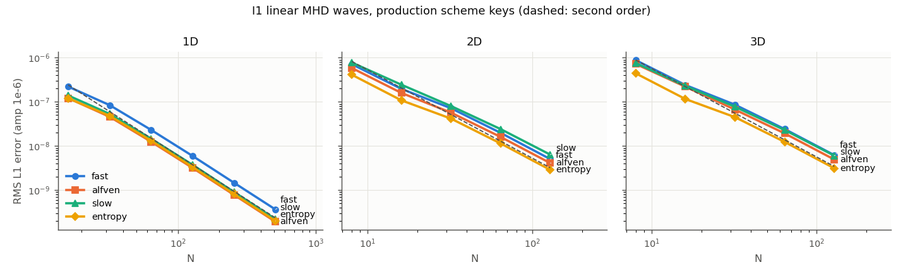
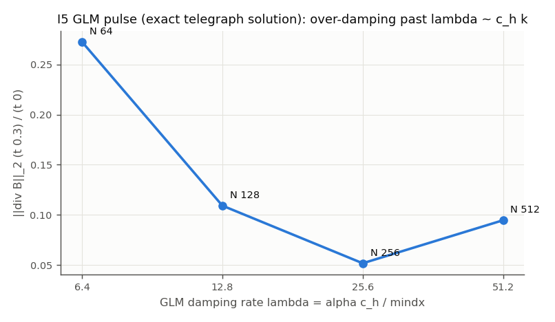
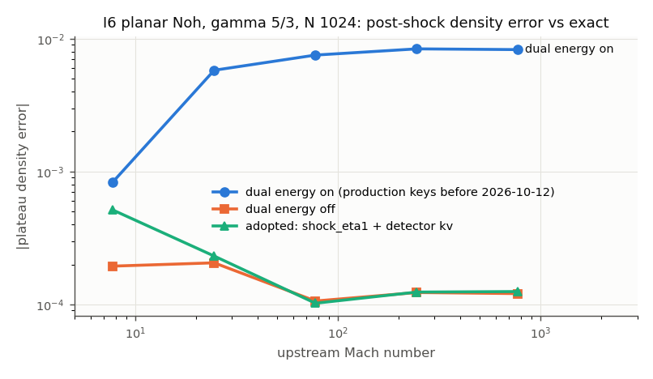

# Ideal MHD (HLLD + PLM + VL2, GLM/Dedner divergence cleaning, boundary treatment) in AthenaPK: validation report (paper I)

Version 2026-10-13 (public edition of the report of 2026-10-12). Folder `validation/ideal_mhd/`. `README.md` is the
index of decks, scripts and results; every number below is read from the table named with it (`results/tables/`), each
written by a saved script with a `--check` mode.

*Public edition.* The validation was carried out in a larger private research code from which this repository was
extracted. Three tests used a 3-D production collapse state of that code: the effect of the shock-detector fix on the
first-core accretion shock (I6d, Sec. 9.3 and 12.4) and the worst-cell div B of the production state (I8, Sec. 11).
They are reported as results of the research code: the collapse state, its decks and the run scripts are not part of
this repository, so they cannot be re-run from it. The private development history and the production adoption are left
out. Section numbers follow the full report. Every result of the tests shipped here is unchanged; Sec. 2.4 is the check
of the code shipped here against the research code it was taken from.

---

## 0. Summary

The research code's collapse run advances the MHD equations with HLLD fluxes, PLM reconstruction and the VL2 predictor-corrector (PLM
predictor since 2026-10-11), cleans div B with GLM (extended Dedner source, alpha 0.1), uses the tabulated H2/H EOS with
double flux and the dual-energy formalism, and closes the box with diode boundaries plus a boundary flux clamp. Each part
was tested against a problem with an exact answer; three defects were found and fixed behind default-off keys (adopted in
the research code's production run on 2026-10-12).

| # | test | exact answer | result | verdict |
|---|---|---|---|---|
| I1 | linear MHD waves (fast, Alfven, slow, entropy), 1D/2D/3D, production keys | eigenvector after one period | order 2.01-2.04 (1D N 512), 1.92-1.99 (2D N 128), 1.93-1.98 (3D N 128) | **PASS** |
| I1c | linear waves through the production tabulated EOS | table eigenvector | N-independent phase floor 5.6 % (acoustic) with the live `eos_interp = p`; 0.26 % with `p_over_rho` | **= E-F1** |
| I2 | circularly polarised Alfven wave | exact nonlinear wave | amplitude loss per period 3rd order (1.9e-4 at N 128), phase 2nd order | **PASS** |
| I3 | MHD Riemann problems RJ2a, diverging RJ2a, Brio-Wu | NEW exact MHD Riemann solver; BW vs N 16384 | L1 order 0.83-1.05 to the exact solution | **PASS** |
| I4 | field-loop advection 2D/3D | exact return at t = 1 | ME 0.946 at N 256; mean div B order ~1.7; worst cell at the loop edge | **PASS** |
| I5 | GLM div-B pulse (+ SMR, + coarse-level pulse) | telegraph equation (FFT) | transport 2nd order; damping was 1st order in dt; global lambda over-damps coarse levels | **PASS**; **IM-F3** fixed, **IM-F4** documented |
| I6 | Noh 1D/2D/3D (Mach 8-775), tabulated Noh (M 3-30), production test bed* | Noh 1987; exact star state | production dual energy under-heated strong shocks (+0.8 % plateau, non-converging); fixed: <= 5e-4 at every Mach, converging | **IM-F1** fixed |
| I6x2 | dual_energy hand-over X2 (pre-shock Tfloor undershoot) | P >= P_adiabat upstream | caused by the retired dc predictor; 0 Tfloor hits with the live PLM predictor | **CLOSED** |
| I7 | outgoing waves and gas at rest at the production boundary | 9x larger box; exact no-inflow wall rarefaction | the clamp removed the outside pressure (gas at rest: rho -4.8 %); fixed: wall state to 1e-5 .. 2e-3 | **IM-F2** fixed |
| I8* | worst-cell div B in the production state, 20 cycles | diagnostic | worst cell 0.279 -> 0.223; growth only on L7/L8; box faces 2.2 % under-dense (IM-F2) | measured |
| port | this repository vs the research code (Sec. 2.4) | key off: bit-identical to the previous public release; keys on: bit-identical to the research code | key off 47/47, keys on 422/422 runs bit-identical | **PASS** |

\* research-code result on a 3-D production collapse state (Sec. 9.3, 11, 12.4); not re-runnable from this repository.

The fix keys (all default off): `hydro/glmmhd_damping = midpoint` (IM-F3), `hydro/dual_energy_shock_eta1 = true` with
`hydro/dual_energy_shock_detector = kv` (IM-F1), `hydro/boundary_flux_clamp_wall = true` with
`hydro/diode_energy_consistent = true` (IM-F2).

## 1. Scope

The ideal-MHD part of the collapse problem: HLLD, PLM, VL2 with the PLM predictor, GLM cleaning (`dedner_extended`, alpha 0.1),
and the domain boundary (diode BCs + `boundary_flux_clamp`). Its interfaces to modules validated elsewhere are tested
where the ideal-MHD step owns the behaviour: the dual-energy selector at shocks (I6), the tabulated EOS in waves (I1c).
Not here: AMR/Jeans refinement (own module; the coarse-fine behaviour of GLM is in I5b/I5c/I8), Sedov and Orszag-Tang
(PLAN D2: skipped, no exact answer / no new information), Hall (off in production), the MHD Noh variant (PLAN D3: not
needed, X2 explained by the predictor).

## 2. Code under test

### 2.1 Configuration of the research code's production collapse run (2026-10-12)
`fluid = glmmhd`, `riemann = hlld`, `reconstruction = plm`, `integrator = vl2`, `cfl = 0.3`, `vl2_predictor_recon =
same`, `divergence_control = glm` (the only option: CT was removed 2026-09-24), `glmmhd_source = dedner_extended`,
`glmmhd_alpha = 0.1`, `first_order_flux_correct = 0`, `boundary_flux_clamp = true`, diode BCs on all six faces (standard
`DiodeBC`; `fused_bc = 0`), `nghost = 2`, `dfloor = 1e-6`, `pfloor = 1e-8`, `eos = hydrogen` (rho26 table,
`eos_interp = p`), `double_flux = true`, `Tfloor = 0.2726`, dual energy `eta1 5e-2`, `eta2 0.1`, `kappa 3`,
`shock_comp 0.02`, `flux = density`, `unsigned_prim`, `exact_resync`, `heat_exact`, `shared_select`, `dual_comp_ghost`,
`boundary_clamp_dual`. GLM: c_h = cfl mindx / dt_hyp with the GLOBAL finest dx (hydro.cpp:335); damping
psi *= exp(-alpha c_h beta dt / mindx) after every stage (dedner_source.cpp). Since 2026-10-12 that run also sets the five fix keys.

### 2.2 Two tiers of tests
* **S (scheme)**: gamma-law EOS (gamma 5/3; Brio-Wu 2) because the exact answers need it; every other production key
  verbatim except three the code enforces: `double_flux = false` (requires eos = hydrogen, hydro.cpp:965), `Tfloor = -1`
  (the ideal-gas floor needs a units block, hydro.cpp:1172) and the validation escape `eos_table_allow_no_radiation`
  (dual energy without radiation, hydro.cpp:2195). Periodic boxes set `boundary_flux_clamp = false` (behaviour-identical:
  the clamp skips periodic faces since DE-F2). Shared deck pieces: `scripts/im_common.py`.
* **P (production)**: `eos = hydrogen` and every key verbatim (I1c, I6x2, I6c, I6d, I8).

### 2.3 Code shipped here
Problem generators: `linear_wave_mhd`, `cpaw`, `field_loop` (restored upstream AthenaPK problems; CT block removed,
dual-energy slot initialised, `p0` keys; IM-F5 out-of-bounds writes fixed), and `ideal_mhd` (modes `shocktube`, `noh`
[1-3D, P0 or T0], `divb` [Gaussian pulse]); `eos_test` gained `wave_fast` (perpendicular fast mode). The three fixes
are default-off keys in `src/hydro/hydro.cpp` (shock detector, wall flux on clamped faces), `src/bvals/
boundary_conditions_apk.hpp` (energy-consistent diode) and `src/hydro/glmmhd/dedner_source.cpp`
(`GLMDampingExponential`, scheduled in `src/hydro/hydro_driver.cpp`).

### 2.4 Check of this repository against the research code
**Port check (2026-10-13, `results/tables/PORT_check_2026-10-13.txt`).** This repository's build: `d9671240` (default
flags), `b9d5181e` (`-ffp-contract=off`).

1. *Keys off.* The 47 regression runs of this repository's self-gravity, EOS, dual-energy and `collapse_be` validation
   against the previous public version (commit `9626856`, build `cd69c066`), default flags: all 47 bitwise identical
   in every field of every dump and in the history files.
2. *Keys on.* 422 runs of this report's run lists -- every line with at most 8 ranks that took at most 600 core-s in its
   original run (I1, I1c, I2, I3, I4, I5, I6, I6b, I6c, I6x2, I7 and the fix runs) -- with this repository and with the
   research code's validation branch (`17c5f35b`), both `-ffp-contract=off`: all 422 bitwise identical in every field of
   every dump (1538 dumps) and in the history files. A leg counts only if both runs end with rc 0.

The GPU build of this tree was not compiled or run for this check.

## 3. I1 -- linear MHD waves (PASS)

**Setup** (Gardiner & Stone 2005; Stone et al. 2008): rho 1, B = (1, sqrt 2, 1/2) in the wave frame, P 1/gamma
(beta = 2P/B^2 = 0.37, HL units), amplitude 1e-6, one wave period; 1D [0,1] N 16-512; 2D [0,2]x[0,1] 2N x N (k along
(1,2)); 3D [0,3]x[0,1.5]^2 2N x N x N (lambda = 1, pgen angles). **Exact answer**: the initial eigenvector.
**Metric**: RMS over the 8 conserved components of the volume-averaged L1 error (pgen `linearwave-errors.dat`).
`make_decks_I1.py`, `analyze_I1.py` -> `I1.txt`.

| RMS L1 (order vs N/2) | fast | Alfven | slow | entropy |
|---|---|---|---|---|
| 1D, N 512 | 3.65e-10 (2.01) | 1.92e-10 (2.02) | 2.20e-10 (2.04) | 2.01e-10 (2.02) |
| 2D, N 128 | 5.05e-9 (1.97) | 4.11e-9 (1.97) | 6.38e-9 (1.92) | 2.89e-9 (1.99) |
| 3D, N 128 | 6.23e-9 (1.96) | 4.95e-9 (1.97) | 6.05e-9 (1.93) | 3.14e-9 (1.98) |

* **Low beta (I1b)**: P0 0.04875 (beta 0.030) gives e_int/E = 0.043 < eta1, so ConsToPrim selects the advected energy
  in every cell (`adiabatic_glmmhd.hpp:206`). Errors equal the dual-off run to 4 digits (Alfven, entropy), 0.6 % (fast)
  and are 16 % smaller for the slow wave (1.83e-10 vs 2.18e-10, N 512); order unchanged.
* The dc predictor (retired) is also 2nd order on linear waves (1D fast 2.13, slow 2.09): SG-F4 is specific to converging
  stagnation points.
* 3D N 64 is pre-asymptotic (1.75-1.86); the added N 128 rung gives 1.93-1.98.

## 4. I1c -- linear waves through the production EOS (= E-F1)

**Setup**: state S1 of the EOS module (rho0 1e-18 g/cc = 1.8292 code, T0 10 K, c_s 1.27949 code from the rho26 table,
bilinear exactly as the runtime), production P-tier keys, `eos_test` mode wave; `wave_fast` = perpendicular fast mode in
B0y (c_f^2 = c_s^2 + B0y^2/rho0); one period on [0,1]. **Metric**: L1 after one period relative to the wave amplitude.
`make_decks_I1c.py`, `analyze_I1c.py` -> `I1c.txt`.

| N 512 (order 256 -> 512) | acoustic | fast, v_A = c_s (beta 1.2) | fast, beta 0.025 (dual branch) |
|---|---|---|---|
| live `eos_interp = p` | 5.62e-2 (0.00) | 2.78e-2 (0.00) | 1.11e-3 (0.11); dual off identical |
| `eos_interp = p_over_rho` | 2.60e-3 (0.02) | 1.31e-3 (0.09) | 9.9e-5 (2.45) |

With `p` the error is a resolution-independent phase error: the EOS module's E-F1 (-1.40 % phase speed at 10 K; 2 pi x
1.4 % = 0.088 rad per period ~ 5.6 % in L1); fast modes carry their thermal fraction. Falsification: `p_over_rho` (code
default since a6a42558) removes 95 %, the remaining 0.26 % equals the EOS module's p_over_rho phase error (-0.059 %).
Production keeps `p` for bit-continuity (IM-F6, a reminder of E-F1, not a new defect).

## 5. I2 -- circularly polarised Alfven wave (PASS)

**Setup** (Toth 2000): rho 1, P 0.1, b_par 1, b_perp 0.1 (beta 0.198), gamma 5/3; travelling (v_par 0) and standing
(v_par -1); 2D [0,2]x[0,1] 2N x N, 3D. **Exact answer**: the nonlinear wave translates unchanged at v_A = 1.
**Metric**: amplitude A and phase from the projection of b_z' + i b_y' on exp(i k x'), plus cpaw's L1.
`make_decks_I2.py`, `analyze_I2.py` -> `I2.txt`.

| 2D, one period | N 8 | 16 | 32 | 64 | 128 |
|---|---|---|---|---|---|
| travelling: 1 - A(1)/A(0) | 0.488 | 0.102 | 0.0131 | 1.58e-3 | 1.89e-4 (order 3.07) |
| travelling: phase [rad] | 3.4e-2 | 3.75e-2 | 1.46e-2 | 4.24e-3 | 1.14e-3 (order 1.89) |
| standing: 1 - A(1)/A(0) | -- | 1.74e-2 | 2.23e-3 | 2.73e-4 (order 3.03) | |

16 periods at N 32: A 0.737 (1.7 %/period), phase 0.155 rad; left polarisation: same amplitude, mirrored phase. The
one-period L1 orders (1.96, 1.49, 2.86, 4.00) are not usable alone: L1 mixes the 3rd-order dissipation, the 2nd-order
phase error and the O(dx^2) sinc(k dx) amplitude of the discrete-curl initial field (A(0) = 0.9946 at N 32).

## 6. I3 -- MHD Riemann problems vs a new exact solver (PASS)

**Exact solver** `scripts/exact_mhd_riemann.py` (PLAN D1 (a); approach of Torrilhon 2002 / Takahashi & Yamada 2014, own
code): regular solutions (fast, rotational, slow wave on each side + contact). Unknowns |B_t| behind both fast waves,
|B_t| and its direction at the contact; equations: u, v_y, v_z, P continuous at the contact. Shocks from the MHD Hugoniot
(m^2 (b2 V2 - b1 V1) = Bx^2 (b2 - b1), normal momentum, e2 - e1 + 
[V] + [V][b]^2/4 = 0) with the Alfvenic
admissibility condition; rarefactions by RK4 along the primitive eigenvector; rotational discontinuities with
[v_t] = +- sign(Bx) [B_t]/sqrt(rho). **Self-checks with equations the solver does not use**: every shock and rotational
discontinuity satisfies F(W2) - F(W1) = s (U2 - U1) with the full conservative MHD flux to <= 5e-15, entropy is constant
through every fan to 3e-14, contact residual 3e-15. A spurious root at the pole of m^2 (V2 = b1 V1/b2) was found and
excluded during construction.
**Setup**: [0,1], x0 0.5, N 128-4096 + 16384, production scheme keys, outflow BCs (RJ2a has inflow at x = 0; the
boundary is I7's subject). `make_decks_I3.py`, `analyze_I3.py` -> `I3.txt`.

| problem | waves | rho L1, N 4096 | order 2048 -> 4096 | rho L1, N 16384 |
|---|---|---|---|---|
| RJ2a (Ryu & Jones 1995 Fig. 2a) | 2 fast, 2 rotational, 2 slow shocks + contact | 4.25e-4 | 0.89 | 1.27e-4 |
| RJ2a_div (u_L -0.6, u_R +0.6; project variant) | fast + slow rarefactions + contact | 2.19e-4 | 0.94 | 6.23e-5 |
| Brio-Wu (vs N 16384 run; compound wave) | -- | 3.72e-4 | 1.05 | -- |

First-order L1 convergence is the expected rate with discontinuities. RJ2a star states (exact): rho L* 1.634300,
R* 1.473453, P* 1.931672; numerical plateau means at N 256: 1.62758 / 1.46765 / 1.93252.

## 7. I4 -- field-loop advection (PASS)

**Setup** (Gardiner & Stone 2005): A_z = amp (R - r), R 0.3, amp 1e-3, P 1 (beta 2e6), v = (2, 1) on [-1,1]x[-0.5,0.5]
(3D: rotated cylinder, v = (1, 1, 2)); exact return at t = 1. **Metric**: ME/ME0, L1(|B| - |B|_IC), |div B| dx/B0
(volume mean and worst cell, centred differences as dedner_source.cpp). `make_decks_I4.py`, `analyze_I4.py` -> `I4.txt`.

| | N 32 | 64 | 128 | 256 | 3D 32 | 3D 64 |
|---|---|---|---|---|---|---|
| ME(t=1)/ME0 | 0.647 | 0.838 | 0.909 | 0.946 | 0.717 | 0.860 |
| L1(abs B)/L1(abs B_0) | 0.369 | 0.212 | 0.129 | 0.079 | 0.305 | 0.185 |
| mean div B | 6.1e-4 | 1.8e-4 | 5.9e-5 | 1.9e-5 | 1.2e-3 | 3.9e-4 |
| worst cell | 8.3e-3 | 3.6e-3 | 2.4e-3 | 1.9e-3 | 7.7e-3 | 4.1e-3 |

The worst cell sits inside the loop near its edge (r/R 0.68-0.95), where |B| jumps. alpha 0 / 0.1 / 0.4 (N 128): mean
8.3e-5 / 5.9e-5 / 6.4e-5, worst 2.3e-3 / 2.4e-3 / 2.8e-3, ME 0.9093 / 0.9089 / 0.9074 -- alpha does not set div B here.
drat 10: B identical to 4 digits. The second-order damping (12.1) leaves ME and div B unchanged to 3 digits.

## 8. I5 -- the GLM subsystem against the telegraph equation (PASS; IM-F3 fixed, IM-F4)

**Setup**: Gaussian div-B pulse Bx = 1e-3 exp(-r^2/0.05^2) in gas at rest (P 0.6, c_s = c_h = 1), periodic unit box, 1D
N 64-1024 and 2D N 64-512, alpha 0 / lambda 10 fixed / production 0.1. **Exact answer**: with B0 = 0 the extended-GLM
sources are O(bamp^2) and, per Fourier mode, the irrotational field and psi obey a' = -i|k| psi,
psi' = -i c_h^2 |k| a - lambda psi (lambda = alpha c_h / mindx), solved exactly; the reference is sampled on dx_finest/2,
which holds every level's cell centres (one reference for uniform and refined meshes). c_h = 1 falsified directly: the
error is minimal at c = 1.00 (6.0e-6) vs 1.4e-5 / 1.2e-5 at 0.98 / 1.02. `make_decks_I5.py`, `analyze_I5.py` -> `I5.txt`.

* **Transport** (alpha 0): L1 order 1.62 / 1.73 / 1.81 / 1.94 (1D N 64-1024), 1.70 / 1.95 / 2.00 (2D N 64-512).
* **IM-F3**: at fixed lambda 10 the order fell to ~1 (1D 0.98 at N 512, -0.12 at 1024); at N 512 the error halved with
  cfl 0.3 -> 0.15 -> 0.075 (2.54e-7 / 1.21e-7 / 7.9e-8): the per-stage psi multiply is a first-order (Lie) split.
  FIXED by `glmmhd_damping = midpoint` (12.1).
* **IM-F4**: lambda = 0.1 c_h/mindx grows with resolution; past lambda ~ c_h k the cleaning turns diffusive (diffusivity
  c_h^2/lambda) and slows: exact div-B decay at t 0.3 is 0.273 / 0.109 / 0.052 / 0.095 for lambda 6.4 / 12.8 / 25.6 /
  51.2; the code follows it to 0.6 % of the signal at N >= 256. I5b (pulse inside 1-2 SMR levels) = uniform finest mesh to
  3 digits. I5c (pulse on a coarse N 64 level, refined corner patch of 0-3 levels far from it): each added level doubles
  lambda and the coarse cleaning changes exactly as the telegraph equation predicts. In production a structure of size l
  is cleaned ~ alpha l / mindx times slower than optimal on coarse levels -- the mechanism of audit F-11, now measured.
  No change made (a level-local lambda weakens coarse damping, F-11).

## 9. I6 -- Noh implosion (IM-F1) and the X2 hand-over

### 9.1 Gamma-law Noh, production scheme keys incl. diode + clamp
**Setup**: rho0 1, v0 1 toward the origin, P0 1e-6 (Mach 775; P0 1e-2 .. 1e-6 for the Mach scan), box [-1,1]^d with the
origin on a cell corner, t 0.6. **Exact answer** (Noh 1987): r_s = 0.2, post-shock rho = 4 / 16 / 64 (d = 1/2/3), cold
upstream on its adiabat; finite Mach: Rankine-Hugoniot of the reflected shock. `make_decks_I6.py`, `analyze_I6.py`,
`analyze_I6b.py` -> `I6.txt`, `I6b.txt`.

| 1D plateau rho/rho2 - 1 | N 256 | 512 | 1024 | 2048 |
|---|---|---|---|---|
| dual energy OFF | -2.1e-3 | +2.5e-4 | -1.2e-4 | -7.5e-6 |
| production keys before 2026-10-12 (dual ON) | +7.3e-3 | +7.8e-3 | +8.3e-3 | +8.2e-3 |

Mach scan (N 1024, dual ON): -8.4e-4 / +5.8e-3 / +7.5e-3 / +8.4e-3 / +8.3e-3 at M 8 / 24 / 77 / 245 / 775; dual OFF
<= 2e-4 at every Mach. **Mechanism (IM-F1)**, from dual_switched dumps: half of the cells within 3 dx of the shock were
switched -- a shock-front cell whose e_int was still below eta1 E took the cold advected energy (and its E was rewritten
to match), so the shock under-heated, ran slow and compressed too much (the dual-energy module's D6 mechanism, here at
high Mach). One key at a time at M 775: eta2 off, exact_resync off: no change; eta1 0.01 / 0.02: +3.7e-4 / +1.5e-3;
`dual_energy_shock_eta1 = true` (legacy compression flag): -1.3e-4 / -4.7e-6 / -1.2e-7 at N 1024 / 2048 / 4096.
Multi-D: dual ON keeps the cold upstream on its adiabat (P/P_ad 0.98-1.03); dual OFF heats it 7.7-336x; the axis-diagonal
imprint converges at first order (2D -6.9 % -> -1.1 %). But shock_eta1 with the legacy flag RE-HEATS the 3D upstream
(P/P_ad up to 53 at N 128): the flag comp = -div v dt >= 0.02 also fires in smooth spherical infall (2 v0 dt/r = 0.021;
a dual_comp dump shows 100 % of the smooth upstream flagged). Falsified: shock_comp 0.05 or cfl 0.15 remove it. The
legacy shock flag is dt-dependent -> fixed by a new detector (12.3).

### 9.2 Tabulated-EOS Noh (the dual-energy module's D3 decks, live PLM predictor)
`analyze_I6c.py` -> `I6c.txt`; exact general-EOS star state from `D3_meta.json`.

| plateau rho/rho2 - 1 | dual off | production keys before 2026-10-12 | adopted (shock_eta1 + kv) |
|---|---|---|---|
| M 10 | +3.3e-6 | +1.40e-3 | -1.7e-4 |
| M 30 | +2.3e-6 | +1.26e-3 | -6.6e-7 |
M 3: identical in all arms (nothing switches). The dual-energy module had measured dual OFF as the worst arm (-4.6e-3)
and rejected shock_eta1 (DE-F8) -- both under the dc predictor, retired 2026-10-11.

### 9.3 Production test bed (I6d; research code)
The 3-D production test state (a collapse restart of the research code, production keys), legacy-flag shock_eta1
vs the production run I8 cell by cell: after 2 cycles P changes by > 1e-3 in 169 of 6.74 M cells (max 10 %), all at the first-core accretion shock
(level 8; density jump across two cells median 9.7, -dv_n/c_s 1.8) -- IM-F1 is active in the collapse run. These cells
compress by 0.020-0.024 per step, i.e. AT the legacy threshold: the dt-dependence matters in production too.
(The collapse state and `analyze_I6d.py` are not part of this repository.)

### 9.4 X2 (closed)
The dual-energy module's X2: the cell ahead of the planar tabulated-EOS Noh shock undershot to P/P0 = 0.273 = Tfloor/T0.
Rerun (`analyze_I6x2.py` -> `I6x2.txt`): the dc predictor reproduces it exactly (10 Tfloor hits in 5/27 history rows,
9/25 snapshots, min 0.2729; also M 30 and N 4096, dual on or off); the PLM predictor gives 0 Tfloor hits and min P/P0 =
1.000 in all five runs. X2 belongs to the SG-F4 / NI-F1 family and is closed by the 2026-10-11 adoption.

## 10. I7 -- the production boundary (IM-F2)

**Setup**: each problem in [0,1] (N 512) after its waves left, against the [0,1] part of the same problem in [-4,5] at
the same dx; plus a new exact test: gas leaving a no-inflow wall at u0 (B_x = 0, B ~ rho) must form the reflecting-wall
rarefaction, rho* from the fast Riemann invariant u0 = int c_f drho/rho. `make_decks_I7.py`, `make_runs_fix.py`,
`analyze_I7.py`, `analyze_fix.py` -> `I7.txt`, `F.txt`.

| | diode + clamp (before) | outflow | diode + clamp, adopted fix |
|---|---|---|---|
| Brio-Wu t 0.3: max abs drho / mass | 0.35 / -1.8 % | 2.0e-3 / +4e-5 | 0.072 / -1.1 % |
| RJ2a_div t 0.5: max abs drho / mass | 2.4e-2 / -0.93 % | 4.1e-4 / +1.8e-4 | 3.2e-2 / -0.81 % |
| gas at rest + div-B pulse, t 0.8: max abs u, rho - 1 | 0.049, -4.8 % | 6e-9 | 4e-9, -9e-9 |
| no-inflow wall, u0 0.01 / 0.1, By 0: rho_wall/rho* - 1 | -3.5e-2 / -6.6e-2 | -- | -1.3e-5 / -1.4e-3 |
| no-inflow wall, u0 0.01 / 0.1, By 1: rho_wall/rho* - 1 | -3.4e-2 / -5.1e-3 | -- | -1.2e-4 / -1.8e-3 |

**IM-F2** (mechanism read in `ClampBoundaryFluxes`): on any boundary face whose mass flux pointed inward -- by any
amount -- the clamp zeroed the whole normal momentum flux, including P + B^2/2 - Bn^2. The edge cell lost the outside
pressure, accelerated outward and drove a rarefaction into the box; in gas at rest the O(1e-6) mass flux of the GLM
pulse sufficed. In addition the diode ghost kept E after its inward momentum was zeroed (internal energy made from the
removed motion). Brio-Wu and RJ2a_div keep a difference with the fix because they have genuine back-flow into the box,
which the clamp refuses by design (B1). Production (I8): gas flows inward through every face (v_n = -4.6e-6), and the
first cell layer was 2.2 % under-dense.

## 11. I8 -- worst-cell div B in the production state (research code)

**Setup**: the 3-D production test state, 20 cycles with the production keys (PLM predictor, eta_face_harmonic), 1646 blocks of 16^3, levels
0-8; rel = the HydroHstMaxDivB formula on block interiors (the dumps carry no ghosts) at c686 / c696 / c705, plus the
per-cycle .hst (all cells). Envelope score at c706: 0 spikes, max 53 K. (Collapse state and analysis not shipped.)

* .hst worst cell 0.279 (c686) -> 0.254 -> 0.230 -> 0.223 (c706), flattening; at c686 it exceeds the interior max
  (0.163): the worst cell sits on a block face.
* Volume mean by level (c686 -> c705): L0 4.8e-4 and L1-L5 0.7-1.7e-4 (stationary; L0 the IM-F4 over-damped level),
  L6 4.4e-4 -> 4.8e-4, L7 2.2e-3 -> 3.6e-3, L8 2.9e-3 -> 6.6e-3 (cells > 1e-2: 7 % -> 15 %).
* Coarse-fine faces host the extreme cells at times (c686: the 10 worst interior cells 1-2 cells from one, L6-7,
  beta 18-41) but are not the main source: the fraction of cells > 1e-2 is 0.44-0.56 % at every distance.
* Box faces: first layer 2.2 % under-dense and under-pressured, second 1.0 %, third 0.1 %, stationary (IM-F2).

## 12. Fixes (user: "fix imf1 and imf2 properly. improve the glm damping order")

All three are default-off keys. Key-off: the earlier runs reproduced bitwise (`keyoff_*` in `F.txt`), and so did the
research code's 3-D production test state in every dataset. The GLM and wall runs were made with an intermediate build;
two of them repeated on the final code are bitwise identical (only the dual-energy detector changed in between).
`analyze_fix.py` -> `F.txt`.

### 12.1 IM-F3 -> `hydro/glmmhd_damping = midpoint`
`GLMDampingExponential` (dedner_source.cpp) replaces the per-stage multiply for VL2, with psi0 from the step-start
register "u1" and psi_pre the value after the stage's flux update: stage 1 (h = dt/2) psi = psi0 e^{-lambda h} +
(psi_pre - psi0) phi1(lambda h), phi1(z) = (1 - e^{-z})/z; stage 2 psi = psi0 e^{-lambda dt} + (psi_pre - psi0)
e^{-lambda dt/2} (exponential midpoint: second order, exact for a vanishing flux increment).

| I5, fixed lambda 10, L1 Bx | N 64 | 128 | 256 | 512 | 1024 |
|---|---|---|---|---|---|
| 1D, legacy (lie) | 4.12e-6 | 1.46e-6 | 5.01e-7 | 2.54e-7 | 1.32e-7 |
| 1D, midpoint | 3.92e-6 | 1.34e-6 | 3.48e-7 (1.94) | 8.57e-8 (2.02) | 2.07e-8 (2.05) |
| 2D, midpoint (lie at 512: 3.41e-8) | 1.22e-6 | 3.24e-7 | 7.32e-8 (2.15) | 1.68e-8 (2.12) | |
cfl 0.3 / 0.15 / 0.075 at N 512: 8.57 / 7.75 / 7.55e-8 (time error now below the spatial error). Production alpha:
2D N 512 error 3.1e-9 vs 5.3e-8 (17x).

### 12.2 IM-F2 -> `hydro/boundary_flux_clamp_wall` + `hydro/diode_energy_consistent`
On a clamped (inflow) face the momentum flux is that of a reflecting wall: total pressure P* = P_tot - rho c_f u_away
(acoustic solution of the cell / mirror-cell Riemann problem; u_away = the cell's velocity away from the wall), normal
flux P* - Bn^2, tangential -Bn Bt; mass, energy and scalar fluxes stay zero (no inflow, as intended by B1). The diode
ghost subtracts the kinetic energy of the zeroed inward momentum from E (standard `DiodeBC`; the key refuses `fused_bc`).
Results in section 10: the exact wall state to 1.3e-5 .. 1.8e-3 (legacy 3.4-6.6 %), gas at rest at rest to 4e-9.

### 12.3 IM-F1 -> `hydro/dual_energy_shock_eta1 = true` + `hydro/dual_energy_shock_detector = kv`
The shock flag in `dual_comp` becomes a dt-independent 1/0: a cell is a shock when it compresses (div v < 0), the
entropy proxy K = P/rho^{5/3} across its neighbours jumps by > 2x (`dual_energy_shock_jump` 1.0,
`dual_energy_shock_gamma` 5/3) AND the normal velocity drops by > 0.3 x the largest |v| or c_s among the neighbours
(`dual_energy_shock_dv`). Both readers (eta2's guard, shock_eta1's keep-E) see this physical flag. Development, each
step measured: `pjump` (pressure jump) fixed 1D but fired in smooth, grid-steep 3D infall (pressure ratio ~2 per two
cells near the origin; 3D upstream P/P_ad 31); `kjump` (entropy jump) removed that but let a CHAIN walk outward in 3D (the
flagged cell ahead of the front took E - KE - ME, whose oblique-flow truncation noise heated it and flagged its upstream
neighbour; seen in dual_switched/dual_comp dumps from t ~ 0.13, P/P_ad up to 3e5); the velocity jump in `kv` breaks the
chain.

| | production keys before 2026-10-12 | adopted (kv) |
|---|---|---|
| 1D Noh plateau, M 8 / 24 / 77 / 245 / 775 (N 1024) | -8e-4 / +5.8e-3 / +7.5e-3 / +8.4e-3 / +8.3e-3 | -5.1e-4 / -2.3e-4 / +1.0e-4 / +1.2e-4 / +1.3e-4 |
| 1D M 775, N 1024 / 2048 / 4096 | +8.3e-3 / +8.2e-3 / (not converging) | +1.3e-4 / +6.8e-6 / +5.4e-7 |
| 1D shock position, cells (t 0.2 / 0.4 / 0.6) | +0.3 / +0.2 / -0.9 | -0.6 / -0.8 / -0.9 (dual off +0.4 / +0.2 / +1.1) |
| 3D N 128 / N 64 upstream P/P_ad | 0.98-1.00 | 0.981-1.006 / <= 1.03 |
| 2D N 512 plateau | +0.39 % (cancellation) | -1.02 % (= dual off -1.10 %) |
| tabulated D3 plateau, M 10 / 30 | +1.40e-3 / +1.26e-3 | -1.7e-4 / -6.6e-7 |
| dual_energy D1b cold pancake M 1000, max dP | 5.43e-3 | 5.43e-3 (identical) |
Threshold sensitivity: dv 0.15 / 0.3 / 0.5 give identical plateaus. (The median-crossing shock-radius metric of
`analyze_I6b.py` scatters by about one cell; the direct cell-level position is in the table.)

### 12.4 Production test bed with all fix keys (research code)
The 3-D production test state + 3 cycles, all five keys, against I8 cell by cell: P changes by > 1e-3 in 502 / 640 of 6.74 M cells after 1 / 2 cycles, > 0.1 in 1 / 10
(max x5.0, one L7 cell); rho <= 2.5e-3. 95-98 % of these cells are shock-like (density jump ~10, -dv_n/c_s ~2.1), all on
levels 7-8: the first-core accretion shock. Their per-step compression (median 0.015) is below the legacy 0.02 threshold
-- the legacy flag missed them. P rises in 50-56 % and falls in the rest (with the 1/0 flag the eta2 guard also acts in
cells the legacy compression exempted). Envelope hot-cell score unchanged (probe T, 1 spike, max 232 K).

## 13. Adoption in production
(Omitted in the public edition: the production adoption of the research code, 2026-10-12.)

## 14. Findings

| ID | finding | status |
|---|---|---|
| **IM-F1** | dual energy under-heated strong shocks: shock-front cells took the cold advected energy; +1.3e-3 (tabulated, M 10-30), +0.8 % non-converging (gamma-law, M > 100); active at the production accretion shock; the legacy shock flag was dt-dependent | FIXED (shock_eta1 + detector kv) |
| **IM-F2** | boundary flux clamp zeroed the pressure part of the momentum flux on every inflow face; diode ghosts heated by the removed inflow; production box faces 2.2 % under-dense | FIXED (clamp_wall + diode_energy_consistent) |
| **IM-F3** | GLM psi damping first order in dt (Lie split) | FIXED (glmmhd_damping = midpoint) |
| **IM-F4** | global lambda = alpha c_h / mindx over-damps cleaning on coarse levels (audit F-11, measured) | documented, no change |
| **IM-F5** | restored upstream `linear_wave_mhd` / `cpaw` wrote host arrays out of bounds in 1D/2D | fixed (test code) |
| **IM-F6** | E-F1 governs MHD waves too: production runs `eos_interp = p` (1.4 % phase speed at 10 K) | reminder; switching is a separate user decision |
| X2 | pre-shock Tfloor undershoot (dual_energy hand-over) | CLOSED (dc predictor, retired 10-11) |

## 15. Consequences for the collapse problem

* With the IM-F1 keys the accretion shock of the first core keeps its shock heating: a few hundred cells per cycle
  change by > 1e-3 in P at levels 7-8 (12.4, research code).
* With the IM-F2 keys the outer boundary is in pressure equilibrium with no inflow; the 2.2 % face-layer deficit without
  them is a boundary artefact, far from the core.
* Unchanged and characterised: the scheme orders (I1-I4), the GLM cleaning level on coarse levels (IM-F4), the worst-cell
  div B tail at L7/L8 (I8). The E-F1 phase error stays wherever `eos_interp = p` is set (IM-F6; the code default is
  `p_over_rho`).

## 16. Test-infrastructure traps met in this module

* numpy floats in deck templates print as `np.float64(x)`, which Parthenon reads as 0 -- always `float()` (the
  dual-energy module's de_common already warns).
* The science dumps have no ghost zones: block-rim cells cannot be scored for div B; an interior-only div-B norm depends
  on the block size (I5 first version) -- use exact spectral norms or the .hst.
* run_list jobs read the deck at launch: a deck regenerated after submission is not picked up (wall test rerun).

## 17. Reproduction map

Runner: `scripts/run_list.sh` (`BIN=... LIST=<run list in inputs/> [FILTER=...] [NPAR=...]`); decks name tables as
`$REPO/...` (substitute first, see `README.md`).

| test | decks / run lists | analysis -> table |
|---|---|---|
| I1 | `make_decks_I1.py`, `inputs/I1_runs.txt` (+ `I1_runs_r*.txt` for the multi-rank 2D/3D rungs) | `analyze_I1.py` -> `I1.txt` |
| I1c | `make_decks_I1c.py`, `inputs/c4.txt`, `c5.txt` | `analyze_I1c.py` -> `I1c.txt` |
| I2 | `make_decks_I2.py`, `inputs/I2_runs.txt` | `analyze_I2.py` -> `I2.txt` |
| I3 | `make_decks_I3.py`, `inputs/I3_runs.txt`, `exact_mhd_riemann.py` | `analyze_I3.py` -> `I3.txt` |
| I4 | `make_decks_I4.py`, `inputs/I4_runs.txt` | `analyze_I4.py` -> `I4.txt` |
| I5 / I5b / I5c | `make_decks_I5.py`, `inputs/I5_runs.txt` | `analyze_I5.py` -> `I5.txt` |
| I6 / I6b / I6c / I6x2 | `make_decks_I6.py`; `inputs/I6_runs.txt`, `I6b_runs.txt`, `I6c_runs.txt`, `I6x2_runs.txt`, `c4_big.txt`, `c6.txt` | `analyze_I6.py`, `analyze_I6b.py`, `analyze_I6c.py`, `analyze_I6x2.py` |
| I7 | `make_decks_I7.py`, `inputs/I7_runs.txt`, `c4.txt` | `analyze_I7.py` -> `I7.txt` |
| fixes | `make_runs_fix.py` (`inputs/F_runs_*.txt`), `inputs/FK_*`, `FV_*`, `F_dbg.txt` | `analyze_fix.py` -> `F.txt` |
| I6d, I8, 12.4 | research code (not shipped) | -- |
Figures: `make_figures.py` (from the json tables). I6c / I6x2 read the tabulated Noh decks of `../dual_energy/`.

## 18. References

Gardiner & Stone 2005, JCP 205, 509; Stone et al. 2008, ApJS 178, 137; Toth 2000, JCP 161, 605; Brio & Wu 1988, JCP 75,
400; Ryu & Jones 1995, ApJ 442, 228; Torrilhon 2002, ETH SAM report 2002-06 (v); Takahashi & Yamada 2014, J. Plasma
Phys. 80, 255 (v); Dedner et al. 2002, JCP 175, 645; Mignone & Tzeferacos 2010, JCP 229, 2117; Noh 1987, JCP 72, 78.
(v) = checked by the test catalogue; the rest are quoted from memory and must be checked before they enter the paper.
