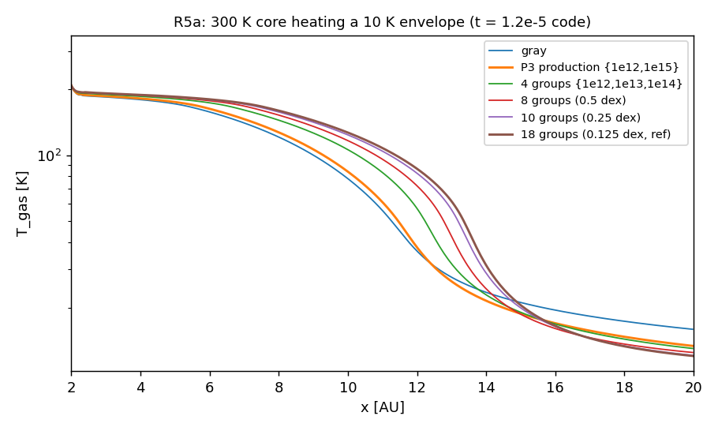
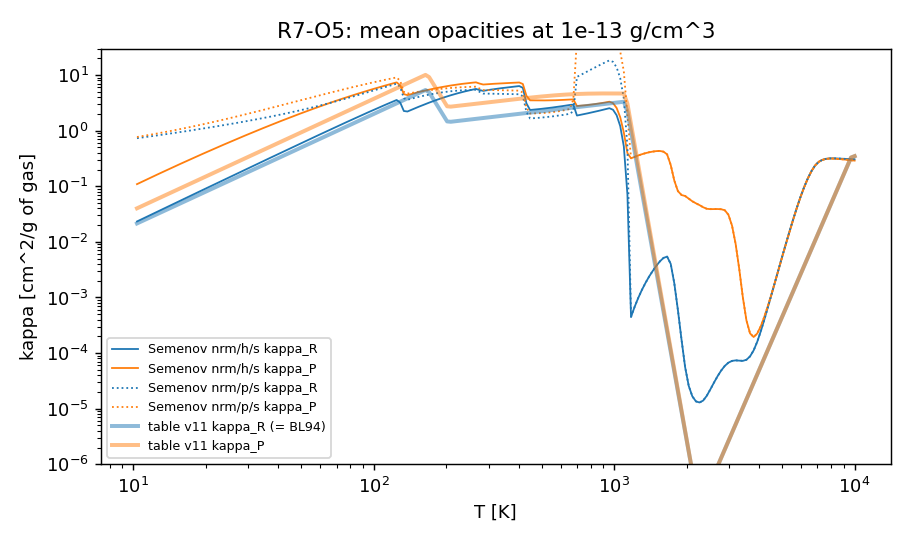
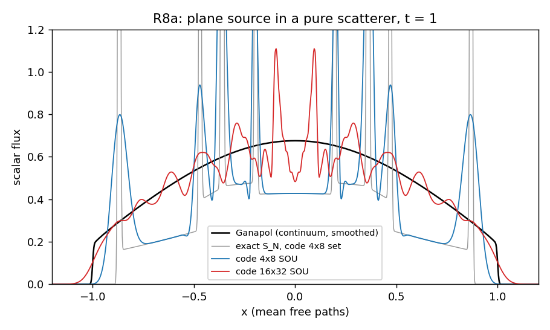
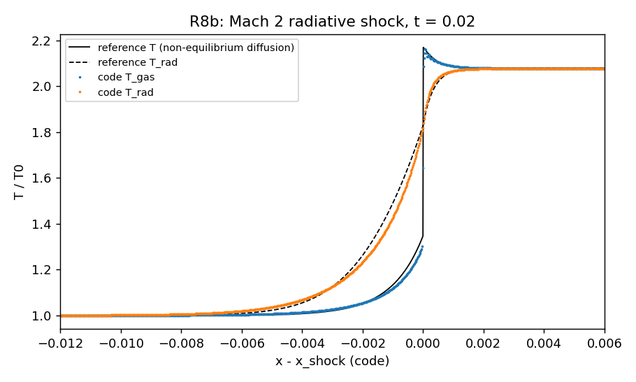

# Radiation transport (discrete ordinates, Sn) and opacities in AthenaPK: validation report (paper I)

Version 2026-10-11 (public edition of the report of 2026-10-10). Folder `validation/radiation_sn/`. `README.md` is the
index of decks, scripts and results; every number below is read from the table file named with it
(`results/tables/`). Each table is written by a saved script with a `check` mode.

*Public edition.* The validation was carried out in a larger private research code from which this repository was
extracted. That code also couples the radiation to a dust-evolution package and was gated on 3-D production collapse
restarts; that coupling, those gates, the private development history and the production adoption are not part of
this repository and are left out (in this repository the dust multipliers of the opacities are exactly 1, Sec. 2.1).
Section numbers follow the full report. Every result of the tests shipped here is unchanged.

---

## 0. Summary

The radiation of the collapse runs is gray-in-group discrete ordinates (32 ordinates, second-order upwind (SOU)
differencing, BiCGSTAB preconditioned by ordered transport sweeps, implicit Fleck matter coupling at the full speed of
light) on tabulated mean opacities. It was tested against known answers in 0-D, 1-D, 2-D and 3-D, on CPU and H100 GPU,
and across restarts.

| group | tests | verdict |
|---|---|---|
| Consolidation | R0: the earlier Sn gates G8-G11, K1/K3/K4/K5, FLECK, RAY, SEAM, restart; host tests | all reproduce their archived numbers; the restart re-seeded the ordinates after every fresh-start chain's first restart: **R-F1, FIXED** |
| Matter coupling | R1: 0-D multigroup relaxation vs the exact multigroup ODE (91 runs, stiffness 0.07-1000) | the code is its own discrete scheme to <= 2e-6; the one-Fleck-factor same-group scattering lets a far-IR group lag by 25 % after one production step: **R-F3, FIXED** (`sn_fc_scatter`) |
| Coupled transport | R2: Su-Olson non-equilibrium Marshak wave (linearised, +A/-A pairs) | PASS: L1 5.4e-4 vs the code-ordinate reference at dz 0.025, 2.1 % vs S64 at 4x8 ordinates (0.33 % at 8x16) |
| Thin limit | R3: searchlight, crossing beams, shadow (2-D) | PASS after **R-F10 FIXED** (SOU let negative flux through an opaque column; positivity limiter `sn_sou_limiter`) |
| Conservation | R4: the dual-energy D7 hand-over | the D7 0.29 % loss = the convergence norm: **R-F6, FIXED** (`sn_norm = b`, `sn_local_tol`) |
| Resolution in frequency and angle | R5, R13: group count / edges (1-D), ordinates (3-D), hot core in a cold envelope | **R-F13**: 8 groups (X8 edges) give envelope heat 0.964 / 0.986 of a 34-group reference at 150 / 300 K (3 groups 0.848 / 0.910); 32 ordinates are enough there (0.4 % vs 288) |
| Solver | R5, R13: hot thick core, many groups | **R-F12 FIXED**: SOU-consistent preconditioner + gray (linear multifrequency-gray) DSA with one multigrid V-cycle |
| Boundaries, operator gate | R13, R0 K-gates | **R-F15 FIXED** (incoming condition on non-diode faces), **R-F16 FIXED** (operator self-check on the coupled solve, mutant-tested) |
| Production-configuration regression | R0-R8 re-run with the production solver overlay (Sec. 15) | PASS (all answer checks; one previously aborting R1 case now completes) |
| Portability | R6: GPU (H100) vs CPU, same source / deck / ranks | identical to round-off (<= 8e-13 of max E) or the solver tolerance (<= 3e-7); iterations equal; first dt identical |
| Opacities | R7: provenance (O1), table vs definition (O2), lookup (O3), Semenov (O5) | v9 regenerated bit-for-bit; **R-F4, R-F5, R-F9 FIXED** (tables v10b/v11, log lookup, no ice-front greying); **R-F11 FIXED**: table v12 = Semenov et al. 2003 dust + Helling 2001 gas (format v4) |
| Benchmarks | R8: Ganapol plane source, Lowrie & Edwards radiative shocks (M 2, 3), 3-D point source | PASS: shock T1 to 0.04 %, Zel'dovich spike to 0.3 %; plane-source variance to 0.2 %; ray effects quantified |

**Solver finding R-F12** (R5, R6, R13): in a hot (1000 K), optically thick (tau_cell ~ 30) core the adopted convergence
keys needed ~1700-1950 BiCGSTAB iterations per step and the solve failed. FIXED in two steps: the SOU-consistent
preconditioner (`sn_precond_stencil = sou`, 4x) and a gray diffusion-synthetic acceleration of the coupled solve
(`sn_gray_dsa`, one fixed multigrid V-cycle per preconditioner application): 1-D 1000 K 241/292/263 -> 41/44/34
iterations, 8 groups 295/249/237 -> 50/41/55.

## 1. Scope

In scope: the Sn transport (angular quadrature, step / SOU / limited-SOU differencing, BiCGSTAB and its preconditioner,
boundary conditions, the convergence criteria), the matter coupling (Fleck, the coupled Fleck & Cummings solve), the
multigroup structure, and everything that decides what opacity the transport sees: the opacity table, its generator and
runtime lookup. Not in scope: the hydrodynamics (`../dual_energy/`, `../eos_tabulated/`), self-gravity
(`../self_gravity/`), and physics that is not part of this repository (dust evolution).

## 2. Code under test

### 2.1 Configuration
`transport = sn`, `sn_nzeta = 4` x `sn_npsi = 8` = 32 ordinates, `n_group = 3` on {0, 1e12, 1e15, inf} Hz,
`sn_spatial = sou` (kappa 1), `sn_solver = bicgstab` + `sn_smoother = ordered` (1 sweep), `sn_bc_incoming = planck`
(10 K), `sn_rel_tol = 1e-8`, `sn_max_iterations = 4000`, `creduc = 1` (full c), `sn_matter_coupling`, Fleck alpha 1,
`sn_dual_energy`, `sn_fallback`, `sn_krylov_dot_scale`, `sn_skip_extinction`, `sn_skip_group_rel = 1e-12`; tabulated
opacity v9 (a7f55ddd). Decks overlay these keys (`scripts/rad_common.py` `PROD_RAD`). The ADOPTED fix set
(`rad_common.ADOPTED_RAD`): table v11 (162bb0cf), `opacity_interp = log`, `sn_norm = b`, `sn_local_tol = 1e-3`,
`sn_conserve_residual`, `sn_fc_scatter`, `sn_sou_limiter = positive`.

Configuration of the production collapse runs since 2026-10-10: the above with table **v12**
(`src/radiation/opacity_table_v12x8_semenov_hs_fmt4.bin`, md5 609ef263), **`n_group = 8`** with
`nu_edges_hz = 1.5e12 3e12 5e12 8e12 1.2e13 1.8e13 3e13`, `sn_precond_stencil = sou`, `sn_gray_dsa`
(`sn_gray_dsa_solver/type = MG`, `max_iterations = 1`, `max_coarsenings = 1`), `sn_precond_sweeps = 2`, and the
bit-identical / tolerance-level speed keys `sn_sweep_wavefront = 5`, `sn_sweep_group_batch`,
`sn_gd_skip_sweep_exchange`, `sn_krylov_fused`, `hydro/lean_exchange[_rad]`, `parthenon/mesh/flat_bnd_kernels`.

*Dust.* The research code multiplies the opacities by a dust factor from its dust-evolution package (grain growth and
depletion relative to the reference grains of the table). That package is not part of this repository; here the
factors are exactly 1, which is what the research code computes with the dust package off. None of the decks of this
suite turns the dust package on, so every test here ran with factor 1. *Update 2026-10-13:* the dust-evolution package
is now part of this repository (`src/dust/`, report `../dust/DUST_VALIDATION.md`); with `<physics> dust = true` the
multipliers are computed as in the research code (`DustOpacityFactors`, including the R-F8 / R-F11 keys
`dust/opacity_evap`). The tests of this suite are unchanged (dust off, factor 1).

### 2.2 Source and binaries
The tests ran with binaries of the private research tree (the hashes quoted below identify them; run directories with
`cmd.txt` are not shipped). Every code change is a key, default off, in its own translation unit. The radiation code
shipped here is that tree's final version (2026-10-11) minus the dust-package coupling.

**Port check (2026-10-11, `results/tables/PORT_check_2026-10-11.txt`).**

The code shipped here was compared with the research tree it was taken from (source of the
research code's production branch at 2026-10-11, built here as `836a7db8` with `-ffp-contract=off`). This repository's
build: `46b778e5` (default flags), `f8233dda` (`-ffp-contract=off`).

1. *Radiation off.* The 47 regression runs of this repository's self-gravity, EOS and `collapse_be` validation against
   the previous public version (commit `6ad2906`, build `f670bcad`), default flags: 46 bitwise identical in every
   field of every dump (100 dumps); the 47th (`L10_hennebelle_mu5`, magnetized turbulent collapse, 300 cycles, 33 dumps)
   differs by at most 8.8e-11 of max |prim| (L1 1.3e-15), history identical. With both compiled with
   `-ffp-contract=off` (`6ad2906` rebuilt from git, `3c244569`) that run is bitwise identical in all 33 dumps: the
   difference is GCC contracting a*b+c into fused multiply-adds differently in the restructured `collapse_be`
   barotropic kernel, not arithmetic.
2. *Radiation on, both trees with `-ffp-contract=off`.* 593 runs sampled from the run lists of this report (every CPU
   line with <= 8 groups, <= 8 MPI ranks and <= 700 core-seconds in its original run; R0, R1, R2, R3s4, R4, R5, R6
   CPU, R8a/b, R13, RF*, WF*): 590 ran to completion and are bitwise identical in every field of every dump (5921
   dumps) and in the history files. The other 3 (`R5bis` bisection variants of the 1000 K core) stop on both
   sides at the same point with the BiCGSTAB trust audit (R-F12 regime, 2482-3414 iterations in the longest solve; the original
   default-flag runs completed, so in this regime the audit's decision depends on round-off); their solver logs
   agree line for line and every dump written is bitwise identical. Two operational notes: 7 `WF_cpu` lines were re-run
   with `sn_sweep_wavefront = 1` (README), and 5 hot-core lines were re-run with a longer Parthenon task timeout
   after one side hit the 300 s wall-clock limit on a shared node (bitwise before and after).
3. *`collapse_be` with radiation.* The L10 collapse with radiation (Sn, 3 groups, table v11) and dual energy on, 32
   ranks, 10 cycles (`-ffp-contract=off`): bitwise identical to the research tree in every dump, the history and the
   final restart (including the ordinates `sn.u`); a restart at cycle 5 continued to cycle 10 is bitwise identical
   to the continuous run with both codes (exercises the Sn restart pre-check in `main.cpp`).
4. Radiation host tests (`src/radiation/tests/run_host_tests.sh`): 5/5 pass on this tree.

Two source comments were edited after these builds; the shipped source rebuilds to byte-identical binaries
(`46b778e5`, `f8233dda`). The GPU build of this tree was not compiled or run for this check (R6 covers GPU vs CPU of
the research tree).

## 3. Consolidation (R0, `R0_gates.txt`)

The earlier Sn gates were copied into this module (decks `scripts/make_decks_R0.py`, checkers `scripts/r0_checkers/`)
and re-run on the current binary in two families: the original decks and the production solver keys. All reproduce:
G8 thick equilibrium, G9 coupling (drift 3.1e-10), G10 scattering, G11 Fleck (production family: the checker's 1e-12
monotonicity criterion fails on 6e-12 solver noise after equilibrium; temperature error 2.7e-9), K1/K3/K5, K4 diffusion
limit (SOU D_meas/D = 0.9994-0.9995 at tau_cell 0.2-1; step 1.15-1.77), FLECK (order 1.04), RAY (32 ordinates: rms
0.30 step, 0.84 SOU), SEAM (AMR error 1.601e-2 step / 2.595e-3 SOU, to every printed digit). Host tests 5/5
(`src/radiation/tests/run_host_tests.sh`).

**R-F1 (FIXED).** The two-leg restart test failed: `Sn::Initialize` decided the P1 re-seed of the ordinates from the
stored `parthenon/time/ncycle`, which is 0 in every restart written by a run that started at t = 0, so the first restart
of every fresh-start chain re-seeded sn.u: E_rad 17 % off one step later. Diagnosis falsified twice before the fix
(`main()` reads Info/NCycle); re-test BIT-IDENTICAL (`scripts/r0_restart*.sh`, `scripts/cmp_bitwise.py`).

**R-F7 (environment).** (a) The test runners stacked all MPI ranks on one hardware thread (OMP_PROC_BIND=spread without a
per-rank mask, x91 slower, looked like a hang); fixed with `srun --cpu-bind=cores`. (b) A genuine Open MPI 5.0.7 sm-BTL
hang on 8-rank mesh-refined Sn runs (31 of 34 launches, both launchers); tcp never hangs. Library vs application not
decided (MPICH or a debug Open MPI would decide).

## 4. Matter coupling (R1, `R1_relax.txt`; fix `RF3_fc_scatter.txt`)

A uniform periodic box with T_gas != T_rad relaxes under the full production solver; the exact multigroup ODE is
integrated independently in Python with band means recomputed from B_nu (`scripts/r1_model.py`). The code equals its
own discrete scheme (a Python replica of the step) to <= 2e-6 (solver tolerance / group share), conserves energy to
1e-8 and converges to the ODE as dt -> 0 (first order). **R-F3**: one Planck-weighted Fleck factor per cell and
same-group effective scattering make a low-opacity group relax at f chi c instead of chi c: at the production dt the
far-IR group is 25 % off after one step, 0.79 % after four (v9 table), while the Fleck & Cummings cross-group
re-emission is 0.4 % -> 5e-13. FIXED by `sn_fc_scatter` (one coupled BiCGSTAB over all groups): 25.5 % -> 0.43 %.
It is the dominant cost of the adopted set (x2.3 per step on CPU, +41 % memory).

## 5. Transport benchmarks with coupling and in the thin limit (R2, R3)

**R2 Su-Olson** (`R2_su_olson.txt`, `R2_ref_convergence.txt`; linearised around 10 K with +A/-A pairs, a keyed test
source `sn_test_source`). Semi-analytic reference by Fourier series + matrix exponential (`scripts/su_olson_ref.py`),
both on the code's own ordinates (spatial/temporal error) and on Gauss S64 (angular error). At tau = 10: U L1 1.7e-3
(dz 0.05) -> 5.4e-4 (dz 0.025) vs the code-ordinate reference; 2.1 % vs S64 with 4x8 ordinates, 0.33 % with 8x16; step
differencing 8x worse than SOU; the linearisation error (3.6e-4 single run) cancels in the pair.

**R3 free streaming** (`R3_free_streaming.txt`, `RF10_R3_limiter.txt`). Crossing beams superpose to 8.7e-16 (exact in
Sn, impossible in M1); the transverse face-flux integral is conserved to 0.9992-1.0055 (SOU, dx 1/32) and
0.99997-1.000001 (1/64); fronts within 1-2 cells of c t. **R-F10**: SOU is not positive; behind an opaque column
(tau 11.5) it transmitted -7.5 % / -5.2 % of the incident beam (dx 1/32 / 1/64) where +4.4 % / +2.1 % is predicted
from its own spread beam, and min I/I0 reached -13 % / -19 % (not converging). FIXED by the lagged per-face
positivity limiter `sn_sou_limiter = positive` (phi fixed from I^n, so the operator stays linear and conservative):
min I -3.8e-11, transmission +2.23 % (predicted +2.15 %), +0.26 % at 256x128; K4, G9, R2 and SEAM unchanged to every
printed digit; it needs `sn_local_tol`.

## 6. Conservation and convergence (R4)

**R-F6**: the 0.29 % loss of e + E_rad in the dual-energy D7 box (`inputs/R4_D7_ref.in`) is the convergence norm:
(a) ||b||_1 contains the streaming inflow (|Omega|/dx) I_up, so where chat dt >> dx the accepted iterate's error per
step is ~ rel_tol chat dt/dx; (b) the norm is one global L1 sum dominated by the bright regions, which hides local
residuals (on a 3-D collapse restart of the research code: per-cell defect median 1.9e-4, p99 8 %, max 3x the cell's
own E_rad per step). FIXED by `sn_norm = b` (norm without streaming) and `sn_local_tol` (per-cell energy residual: max
defect 3.07 -> 1.3e-3 of E_rad). `sn_conserve_residual` alone is NOT recommended (it charges local residuals of up to
3 E_rad to the gas); after the local bound it absorbs <= 2.5e-6 of e_int.

## 7. Resolution in frequency and angle; solver robustness (R5, R6)

**Problem** (`scripts/make_decks_R5.py`): a dense hot top-hat core (|x| < 2 AU, 1e-11 g/cm^3, 300 or 1000 K) in a
1e-13 g/cm^3, 10 K envelope, radiation initially Planck at the local T, Planck boundary at 10 K, the adopted fix set,
60 forced steps of 2e-7 code (= 4 production dt). The core is optically thick (tau ~ 1e3) and cools slowly, so its
photosphere heats the envelope quasi-steadily; the envelope's absorption of the core's spectrum (dust kappa_nu ~
nu^1.8) is the multigroup question. Group partitions (opacity tables built by the v11 recipe with the matching edges,
`scripts/gen_tables_R5.sh`; the 3-group one is v11 byte for byte): gray, P3 (production), nested L3/L4/L6/L10/L18 over
[1e11, 1e15] (4 ... 0.25 dex), edge variants E3, E4, E8, and F10/F18 = 0.25 / 0.125 dex over [1e12, 1e14]; > 8 groups
use a test build with `ATHENAPK_MAX_GROUP = 24`.

**R-F13** (`R5c_groups_ordinates.txt`, 300 K core, envelope 3-18 AU, reference F18; F10 -> F18 changes the envelope
heat Q by 1.9 %, so F18 is within ~0.6 % of converged):

| partition | groups | Q / Q_ref | median / max dT/T | T = 50 K at [AU] | s/cycle (1-D) |
|---|---|---|---|---|---|
| gray | 1 | 0.760 | 0.24 / 0.59 | 11.26 | 0.14 |
| P3 production {1e12, 1e15} | 3 | 0.781 | 0.16 / 0.59 | 11.45 | 0.35 |
| E4 {1e12, 1e13, 1e14} | 4 | 0.881 | 0.083 / 0.48 | 12.23 | 0.62 |
| E8 (0.5 dex) | 8 | 0.937 | 0.048 / 0.34 | 12.77 | 1.44 |
| F10 (0.25 dex, [1e12, 1e14]) | 10 | 0.981 | 0.014 / 0.12 | 13.19 | 1.53 |
| F18 (reference) | 18 | 1 | 0 | 13.35 | 2.92 |

P3's group 1 spans 1e12-1e15 Hz, so the envelope absorbs 1.8e13 Hz core photons with an opacity averaged at its own
10 K: the production partition behaves almost like gray. Groups beyond [1e12, 1e14] add nothing (L18 = F10 to 0.1 %).
**Ordinates** (R5b, 3-D 48^3, 300 K, 3 groups, reference 12x24 = 288 ordinates): envelope T max error 0.44 %
(4x8) / 0.28 % (6x12) / 0.19 % (8x16), envelope heat Q +0.37 % / +0.22 % / +0.12 %; the 1.5 % shell rms is the cube
geometry (identical at every ordinate count), not ray effects. 32 ordinates suffice for this absorbed-heating
problem; ray effects matter in thin streaming (R0 RAY, R8c). With table v12 the adopted partition is X8 (8 groups;
`R13_groups_v12.txt`, `R13d_groups_v12_diode.txt`): envelope heat 0.964 / 0.986 of a 34-group reference at 150 / 300 K.

**R-F12** (`R5_groups_ordinates.txt` first pass, `inputs/R5bis_runs.txt` bisect). At 1000 K every arm of the first
pass needed 1700-1950 iterations per step and failed: the trust audit aborted (true residual 8e-6 vs recurrence 5e-9)
or BiCGSTAB diverged (rel 4e9 -> NaN guard). No single adopted key is the cause; the old production keys need 257-517
iterations, step differencing 273. Two things combine: the preconditioner is a STEP sweep while the operator is SOU (a
poor match in thick cells), and `sn_norm = b` / `sn_local_tol` ask for a true residual the old streaming-dominated norm
never demanded. With the Fleck factor << 1 the effective scattering ratio is ~1, whose slow modes are diffusive.
Partial fix `radiation/sn_precond_stencil = sou` (`radiation_sn_precond.cpp`: the sweep inverts the operator's own SOU
/ limited-SOU stencil, still one fixed linear operator): 1000 K 3 groups 1735 -> 421-454 iterations, all complete;
300 K 192 -> 82. Remedy for the rest: a consistent gray diffusion-synthetic acceleration `sn_gray_dsa`
(`radiation_sn_graydsa.cpp`, Sec. 14).

**R6 GPU vs CPU** (`R6_gpu_cpu.txt`; same source, deck and 1 rank; GPU = one H100, binary 65e6a2f9). PASS on every
gate: G9, K4, S1, S3, R8c identical to round-off (<= 8e-13 of max E_rad; R8c 9e-16); R1, R5 (the 1000 K core with the
R-F12 preconditioner: 452 vs 454 iterations per step) and R8a equal to the solver tolerance (1e-7 / 3e-8 / 3e-7 of max
E); iteration counts equal to 0-3 %; first dt identical everywhere, including the 1-D blocks of 640 and 1200 cells. A
first GPU binary (71690c5e) had been built while radiation_sn.cpp was being edited and silently lacked the new key; it
needed 3.6x the CPU's iterations on R5 and 2x on R8c, which is how it was caught (Sec. 12); every GPU number here is
from the clean rebuild.

## 8. Opacities (R7)

**O1 provenance** (`R7_O1_provenance.txt`): v9 (a7f55ddd), v7_f23 fmt3 and fmt2 regenerated bit for bit.
**O2/O3** (`R7_O2_O3_opacity*.txt`): **R-F4** v9 kappa_P 0.75 % low below 140 K (400-point Simpson cannot integrate
the x^1.8 shape near 0); **R-F5** the runtime lookup is linear in kappa on a 0.025-dex T grid: +25.6 % kappa_P in the
evaporation regime (kappa ~ T^-24), -24.5 % at the 140 K kink. FIXED by table v10b (accurate quadrature, T grid 8x
finer with nodes on 140/170 K) and `opacity_interp = log`: lookup error median 1e-12, p99 6e-4.
**R-F9** the generator greyed 35 % of the dust spectrum at ice sublimation (kappa_P/kappa_R 1.871 -> 0.96 within 1 K,
up to 1300 K): FIXED by `--shape gasfrac` -> table v11 (`R7_v11_gasfrac.txt`): the gray part is now the BL94 gas
fraction, kappa_P/kappa_R 1.871 to ~300 K then smoothly 1.48 (1000 K), 1.01 (2000 K); table vs independent truth
2.1e-6. **O4** the format's T-only group multipliers cost <= 4.4e-6 with v11.
**O5 / R-F11** (`R7_O5_semenov.txt`): v11 vs Semenov et al. 2003, computed with the authors' Fortran code
(downloaded, compiled, `scripts/r7_o5_semenov.py`):

kappa_R within -15 % below 275 K, x0.32 at 275-425 K, ~x1.4 at 680-1500 K, 10-1000x low in the gas regime;
kappa_P 2.5x low at 10-100 K (Semenov kappa_P/kappa_R 4.7 at 10 K vs 1.87) and 1e3-1e4 x low at 1500-3000 K (v11's
gas part is gray). FIXED by table v12 (Sec. 14): Semenov et al. 2003 monochromatic dust + Helling 2001 gas means.

## 9. Benchmarks (R8, `R8_benchmarks.txt`)

**R8a Ganapol plane source** (pure isotropic scatterer, c = 1). Reference: the closed form (Ganapol 2001), verified
here against a 4e7-particle Monte Carlo (rms z 0.97, total 1 to 1e-12), plus the EXACT discrete-ordinates solution on
the code's own angular set (Fourier + eigen-decomposition) to separate angular from space-time error.

A discrete-ordinates code cannot converge pointwise at fixed angles: its uncollided flux is a set of spikes at
x = mu_n t instead of the flat top e^{-t}/(2t) (phi(0, 1) = 0.43-0.49 vs 0.675). In the measures that converge, the
code PASSES: variance = the continuum (2/3)(t - 1 + e^{-t}) to 0.2 % (SOU) / 0.6 % (step); Wasserstein distance to
Ganapol 3.9e-2 / 1.1e-2 / 3.5e-3 for 4x8 / 8x16 / 16x32 ordinates, at the level of the exact S_N solution's own
(4.4e-2 / 1.4e-2 / 4.6e-3); particles conserved to 1e-8.

**R8b radiative shocks** (Lowrie & Edwards 2008 model problem: gray absorption, P0 = 1e-4, C = 1000, kappa 577.35;
colliding flows, problem generator `rad_shock`). Reference: a non-equilibrium-diffusion phase-plane solution written
for this module (`scripts/radshock_ref.py`), both "static" (the code's physics: no radiation force or O(u/c) terms) and
"full" (with them; changes T1 by 3e-4 at M 2). Ferguson, Morel & Lowrie (2017) report Sn and diffusion agreeing to
~1 % on these landmarks.

| M0 | T1 / T0 | rho1 | Tmax (spike) | theta at the shock | precursor theta L1 |
|---|---|---|---|---|---|
| 2 code (t 0.02) | 2.0772 | 2.2861 | 2.163 | 1.828 | 3.3 % |
| 2 reference | 2.0781 | 2.2857 | 2.171 | 1.828 | -- |
| 3 code | 3.6577 | 3.0058 | 4.239 | 3.472 | 4.3 % |
| 3 reference | 3.6667 | 3.0000 | 4.264 | 3.455 | -- |

The "full" M 3 reference did not integrate (stiff manifold); the static one is the like-for-like comparison.

**R8c 3-D point source**: the R8a medium in 3-D, reference by the exact plane -> point relation. Ray effects
quantified: rms of phi/ref - 1 over r < 0.9 t 0.92 (4x8) -> 0.37 (8x16); radial Wasserstein 4e-2
(front-resolution-limited at dx 0.025); 0.1-1.5 % leaves the box through the faces by t = 1.

## 10. Findings

| id | what | status |
|---|---|---|
| R-F1 | restart re-seeded the ordinates after a fresh-start chain's first restart | FIXED |
| R-F2 | BiCGSTAB recurrence vs true residual: the audit's own norm false-alarmed | FIXED (audit uses the true residual / setup norm) |
| R-F3 | same-group Fleck scattering: far-IR group lags 25 % per production step | FIXED `sn_fc_scatter` (x2.3 cost) |
| R-F4 | v9 kappa_P -0.75 % below 140 K | FIXED (table v10b/v11) |
| R-F5 | linear-kappa lookup +25.6 % in the evaporation regime | FIXED (`opacity_interp = log`, finer table) |
| R-F6 | convergence norm: streaming in the norm; global L1 hides local residuals up to 3 E_rad | FIXED `sn_norm = b`, `sn_local_tol` |
| R-F7 | (a) rank stacking in the test runners; (b) Open MPI sm hang on refined Sn runs | (a) fixed in the runners; (b) tcp, open |
| R-F9 | ice-sublimation greying of the spectral shape | FIXED (table v11, `--shape gasfrac`) |
| R-F10 | SOU negative transmission behind an absorber | FIXED `sn_sou_limiter = positive` |
| R-F11 | v11 vs Semenov 2003: kappa_P 2.5x low at 10-100 K, x0.3 kappa_R at 275-425 K, gas regime 1e1-1e4 x low | FIXED: table v12 (Semenov 2003 + Helling 2001, format v4) |
| R-F12 | BiCGSTAB fails in a hot thick core with the adopted keys | FIXED: `sn_precond_stencil = sou` + gray DSA (`sn_gray_dsa`) |
| R-F13 | 3 groups under-heat the envelope by 22 % (300 K core) | ADOPTED: 8 groups (X8 edges) |
| R-F14 | fused BC paths skipped the incoming condition on the coupled Krylov vector | FIXED (`bvals/fused_bc_mesh.cpp`) |
| R-F15 | `sn_bc_incoming` applied only on diode faces (test decks with outflow faces ran without the inflow) | FIXED (package boundary function on every non-diode face) |
| R-F16 | no operator self-check on the coupled (Fleck & Cummings) solve | FIXED (`SnFCVerifyOp`; a 1e-6 mutant fails on all multigroup decks) |

(R-F8 concerned the dust-package coupling and is not part of this edition.)

## 11. Consequences for use

1. All radiation findings are fixed; the configuration of the production collapse runs is the one of Sec. 2.1.
2. 8 groups cost ~4x the Sn work of 3 groups per iteration; the speed keys of Sec. 14 recover most of it.
3. Accuracy settings: `sn_local_tol` (the criterion that sets the iteration count), `sn_rel_tol`, the ordinate count (32).
4. Above ~3000 K (second collapse) the X8 top group (> 30 THz) would need splitting again.

## 12. Test-infrastructure traps met in this module

* Rank stacking: OMP_PROC_BIND=spread + an srun/mpirun without a per-rank CPU mask puts every rank on one hardware
  thread (x91, looks like a hang). Always `--cpu-bind=cores` (R-F7).
* `pkill -f <pattern>` from a tool shell kills the shell itself. Use pgrep, then kill PIDs.
* Editing a source file while a (10-minute nvcc) build runs leaves an object compiled from the old source with a newer
  mtime; the next incremental build skips it. GPU binary 71690c5e silently lacked `sn_precond_stencil` and mixed two
  SnParams headers; caught because the GPU needed 3.6x the CPU's iterations. Touch and rebuild; check new keys with
  `strings`.
* `srun --exact -n 1` gets one CPU's memory share: a 1-rank 100^3 Sn run was OOM-killed in 4 s (`SRUN_EXTRA=--mem=`).
* numpy 2 writes np.float64(x) into f-strings; Parthenon reads that as 0 (`rad_common.fmt`).
* In multigroup outputs `rad.Er` is group 0 only; sum `rad.Er_g*`.
* Parthenon appended one deflate filter per dataset to a shared HDF5 property list; past 32 datasets (34-group decks)
  the output aborted. Patched in `external/parthenon/src/outputs/parthenon_hdf5.cpp` (`H5Premove_filter`).

## 13. Reproduction map

Decks: `scripts/make_decks_R{0,1,2,3,5,8,13}.py`, `make_lists_R6.py`; run lists `inputs/*_runs.txt` (rundir | deck |
overrides | ranks), runners `scripts/run_list_srun.sh` (CPU, bound), `run_list_gpu.sh` (one H100). Tables:
`analyze_R{0,1,2,3,5,6,8,13}.py`, `r7_*.py`; each `run | check`. References: `r1_model.py`, `su_olson_ref.py`,
`ganapol_ref.py`, `radshock_ref.py`; Semenov's code (not shipped, Sec. 8). Figures: `scripts/make_figs.py`.

## 14. Fix rounds 3-4 and the speed work (2026-10-09/10)

* **R-F11 (v12):** Semenov et al. 2003 monochromatic dust (absorption for kappa_P, transport extinction for kappa_R),
  Helling 2001 gas means above evaporation, opacity.f's region blends; checks vs the authors' code 0.988-1.005, vs
  independent quadrature 1.3e-4, C++ loaders vs numpy 1e-15 (`R7_v12_semenov.txt`). Build:
  `src/radiation/build_opacity_v12.sh` (3 groups), `build_opacity_v12x8.sh` (8 groups).
* **R-F12 (gray DSA):** `radiation/sn_gray_dsa` with `sn_gray_dsa_solver/*` (Parthenon multigrid, one V-cycle per
  preconditioner application); the first apparent failure of it was R-F15 (outflow test faces).
* **R-F13 (8 groups):** `R13_groups_v12.txt`; restart remap `scripts/remap_restart_groups.py` (conservative per cell,
  old group and ordinate to <= 7.8e-16; a 3 -> 3 identity remap runs BIT-IDENTICAL).
* **Speed (8 groups):** radiation moments out of the hydro halo exchanges (`hydro/lean_exchange_rad`, bit-identical),
  a two-level DSA V-cycle and 2 sweeps per application, a coalesced warp-per-row sweep (`sn_sweep_wavefront = 5`),
  group batching, fused Krylov updates (`sn_krylov_fused`), and one-thread-per-element boundary kernels
  (`parthenon/mesh/flat_bnd_kernels`). The bit-identical keys reproduce the key-off state exactly; `sn_krylov_fused`
  and `sn_sweep_wavefront = 5` agree to the solver tolerance with identical iteration counts.

## 15. Production-configuration regression (R0-R8)

Every line of the R0/R1/R2/R3/R8 run lists re-run by the R-F15 binary with the production solver overlay where it
applies. R1: 300 of 301 lines byte-identical, the remaining case (stiffness 7.4) aborted before and now completes (E_g
error 7.0e-3 vs the IMC reference's 1.07e-2). R2, R3: pass. R8: accuracy columns identical. R0: every answer check
passes (errors 2-30x smaller); the K-gates' missing operator self-check on the coupled path was R-F16 (fixed; 36/36
with the coupled gate). Host suites 5/5.

## 16. References

Verified: Semenov D., Henning Th., Helling Ch., Ilgner M., Sedlmayr E. 2003, A&A 410, 611 (the code and its header);
Ferguson J. M., Morel J. E., Lowrie R. B. 2017, "Nonrelativistic grey Sn-transport radiative-shock solutions"
(arXiv:1612.06346; parameters and the Sn-vs-diffusion statement). Not re-verified for this report: Su B., Olson G. L.
1997, Ann. Nucl. Energy 24, 1035; Ganapol B. D. 2001, LA-UR-01-1854 (plane-source formula; checked numerically here);
Lowrie R. B., Edwards J. D. 2008, Shock Waves 18, 129; Fleck J. A., Cummings J. D. 1971, J. Comput. Phys. 8, 313; Bell
K. R., Lin D. N. C. 1994, ApJ 427, 987; Pollack J. B. et al. 1994, ApJ 421, 615; Helling 2001 (gas mean
opacities); Larsen E. W. 1982 (DSA consistency).
