# Self-gravity in AthenaPK: validation report (paper I)

Version 2026-10-04 (public edition). Folder `validation/self_gravity/`. This document is the authoritative report;
`README.md` is the index of decks, scripts and results.

*Public edition.* The validation was carried out in a larger private research code from which this repository was
extracted (self-gravity + tabulated EOS only). References to the private development history (commit and binary
hashes), to the production runs' internal files and to compute systems have been removed or generalised; every test
result, table and figure is unchanged. Hashes that remain identify the binaries recorded in each run's `cmd.txt`.

---

## 0. Summary

The self-gravity module was validated in the configuration used by the production collapse runs (Sec. 2), against exact
solutions, independent 1D references, the Athena++ and artemis test problems and published benchmarks.
Every quantitative test converges to its reference at the expected order; seven findings were made, of which
three were code defects that are now fixed, one was a defect of the MPI library, and the rest are
characterisations or properties of the test set-ups.

| group | tests | verdict |
|---|---|---|
| A. Poisson solve (static) | S1 periodic sinusoid, S2 Gaussian, S3/S3a uniform sphere (uniform + AMR), S4 binary on 4 AMR levels, S5 Maclaurin spheroid, S6 Plummer, S7 production IC, S8 MPI invariance, S9 solver controls | PASS. Potential and force converge at 2nd order; production multipole BC formulation has a documented, resolution-independent potential floor for compact sources (1.3 %) that does not affect the force where the mass is |
| B. Gravity + hydro | D1/D2 Jeans waves, D3 dispersion relation, D4 advected slab (artemis), D5/D6 polytropes (artemis), D7 pressure-free collapse | PASS. 2nd-order convergence; artemis golden numbers reproduced to 1-2 %; D7 central density on the exact cycloid to 5e-4 |
| C. Deep AMR | DA1 production IC on 6 static levels, DA2 free fall through 4 static levels, DA3 = L7 collapse of the production IC to AMR level 13 vs an exact 1D solution | PASS. No coarse/fine artefact; DA2 within 0.027 % of t_ff to rho/rho0 = 3760; L7 within 0.29 % of the collapse time at n_J = 16, constant through levels 4-13 |
| D. GPU path | Poisson, deep static AMR, Jeans, free fall, adaptive collapse to 14 levels | PASS. GPU = CPU to 1e-13 (phi) and to float32 output precision (dynamic runs) |
| E. Literature | L1 Mullen et al. polytrope + atmosphere, L2 Spitzer sheet, L3 n = 5 polytrope (+ collapse), L4 Lin-Mestel-Shu spheroid, L5 Evrard, L6 Bonnor-Ebert stability, L7 Larson-Penston, L8 singular isothermal sphere, L9 Boss-Bodenheimer, L10 Hennebelle et al. 2011 | PASS for L1-L7 and L8 (static); L9/L10 qualitative (no sink particles); L8 dynamic not applicable without sinks |
| F. Final configuration | S1, D1, D2, D4, D7 re-run with the final production defaults and the production gravity keys only | PASS. 2nd order everywhere, 0 non-converged solves without hand tuning; D7's first-order-in-dt term gone |

Findings (Sec. 11): **SG-F1** BiCGSTAB warm-start residual + round-off stall in periodic boxes -> NaN (FIXED,
cleared for production); **SG-F2** artemis vs AthenaPK CFL definition; **SG-F3** an earlier work package
measured rho_max, not rho_c; **SG-F4** first-order-in-dt error from VL2's donor-cell predictor (FIXED: PLM
predictor is now the production default); **SG-F5** collapse_be's static ambient still flows into the cloud;
**SG-F6** no NaN guard (FIXED: `hydro/nan_check`); **SG-F7** MPI deadlocks = Open MPI 5.0.7 shared-memory
fast boxes (FIXED by MCA setting).

---

## 1. Scope

What is validated: AthenaPK's self-gravity package (`src/self_gravity/`, Parthenon's BiCGSTAB and multigrid
solvers) and its coupling to the MHD solver, exactly as configured in the production collapse runs. What is not:
the tabulated EOS (separate report, `validation/eos_tabulated/`), sink particles (not used), and any other physics of
the production runs.

---

## 2. Code under test

### 2.1 Production configuration

The self-gravity block of every deck is `inputs/_grav_production.inc`, copied verbatim from the self-gravity block of
the production collapse runs:

| key | value | meaning |
|---|---|---|
| `four_pi_G` | 1 | code units, G = 1/(4 pi) |
| `solver` | BiCGSTAB | Krylov outer solver |
| `preconditioner` | Multigrid (FAS, SRJ2 pre/post smoothers, `max_coarsenings` 20) | geometric multigrid V-cycle over the AMR hierarchy |
| `residual_tolerance`, `relative_residual` | 1e-6, true | stop when the residual falls by 1e-6 relative to the INITIAL residual (Sec. 3.2) |
| `seed_from_phi` | true | warm start from the previous potential |
| `max_iterations` | 200 | |
| `*_bc` | multipole on all six faces | Sec. 3.3 (shell split + uniform split, both on by default) |
| `mp_deterministic`, `packed_bc` | true | reproducible multipole reductions; packed ghost fill |
| `phi_operator_split` | true | grav.phi excluded from the hydro low-storage update |
| `phi_prolongation` | linear | phi prolongation in AMR |
| `task_collection_timeout_in_seconds` | 7200 | (Parthenon default 300 s hangs a 256^3 solve) |

Tests depart from this block only where the problem requires it (periodic boxes: `use_swindle = true`,
periodic gravity BCs; `four_pi_G` for the Jeans and literature problems). Hydro is the production one:
glmmhd (B = 0) + HLLD + PLM + VL2, `dedner_extended`, and from round 2 on the production floors.

### 2.2 Source, binaries and provenance

The tests ran on CPU (Kokkos OpenMP back end, one thread per MPI rank) and on one H100 GPU, with binaries built from
the private research tree. Its self-gravity sources, the Parthenon solver headers and the Parthenon
communication/mesh/driver/task files are those shipped in this repository (`src/self_gravity/`,
`external/parthenon_local/`), plus the fixes of this report: SG-F1 (BiCGSTAB `safe_fallback` and
`roundoff_floor`), SG-F4 (`hydro/vl2_predictor_recon`, default `same`), SG-F6 (`hydro/nan_check`, default on), the
validation-only closed-wall BC `reflecting_val`, and the test problem generators `grav_analytic`, `jeans_wave`,
`grav_slab`, `polytrope` and `profile1d`. Every run directory recorded `cmd.txt` with date, node, job, binary md5,
deck md5 and the full command line (run directories are not shipped; the decks and run scripts are).

**Extraction check (2026-10-07).** This repository's code was compared with the validated binary (`85b625bf`) on the
same decks and MPI ranks: 47 paired runs covering the self-gravity final-configuration legs (S1, D1, D2, D4, D7), three
`collapse_be` runs (deep static AMR solve, BE stability, magnetized rotating collapse to 300 cycles), the EOS 1D legs
(E6, E7e with and without double flux, E8, E10), the refined-mesh double-flux + fill legs (E7r, E7x) and 2D/3D slabs
(E7q). 12 are bitwise identical as built (incl. S1, D1, D2 and the deep-AMR solve); the rest differ at round-off
level (max |diff| / max |field| <= 1.6e-5 at moving contacts of the standard scheme, <= 2e-10 elsewhere; L1 <= 3e-6),
the same GCC FMA-contraction effect as E-F9 in the EOS report: with both trees compiled with `-ffp-contract=off`, the
28 legs with the largest differences (E7e, E7r, E8, D4, D7, L10) are BITWISE identical (the E10 probes, <= 3e-18, and
the E7q slabs, <= 8e-14, were not rerun). The history files differ only by one diagnostic column that is not part of
this code.

---

## 3. The algorithm

### 3.1 Equation and discretisation
The package solves lap(phi) = 4 pi G (rho - rho_bar_swindle) with a second-order 7-point cell-centred Laplacian
on the AMR mesh (`src/self_gravity/poisson_equation.hpp`); rho_bar_swindle is the mean density for periodic
boxes (Jeans swindle) and 0 otherwise. Ghost values at physical boundaries use FixedFace semantics
(face value pinned, ghost = 2 phi_face - interior).

### 3.2 Solver
Parthenon's BiCGSTAB (`external/parthenon/src/solvers/bicgstab_solver.hpp`) preconditioned by one FAS multigrid
V-cycle (SRJ2 smoothers, geometric coarsening through the AMR levels and below the root grid). Convergence test:
rms(r) < tol * rms(r0) with r0 = rhs - A x0 the residual of the INITIAL GUESS (`rhs2 = (r0, r0)`), so with the
warm start (`seed_from_phi`) the test is relative to the warm-start residual, not to rms(rhs) (SG-F1). One solve
per integrator stage (`hydro_driver.cpp`, stage-consistent source): stage s solves for the stage-start density.

SG-F1 fix (validation branch): (a) `solver_params/safe_fallback` (default true): an unconverged solve whose final
residual is non-finite or larger than the initial one returns the INITIAL GUESS instead of its last iterate;
(b) `solver_params/roundoff_floor` c (swindle only, default 64): a solve also counts as converged when
rms(r) < c eps sqrt(N_cells) 4 pi G rms(rho), the measured round-off floor of the swindle problem. Both are inert
on a converged isolated solve (production is bit-identical, Sec. 11).

### 3.3 Isolated boundary conditions (multipole, `src/self_gravity/multipole.hpp`)
Face values come from an expansion of the interior mass through l = 2, recomputed every solve:
* shell split (`mp_shell_split`, default on): at each boundary point of radius r the mass is split into the part
  inside r (exterior expansion M</r + p<.n/r^2 + Q<:nn/(2 r^3)) and outside r (interior expansion
  S0 + r n.S1 + (r^2/2)(3 n_i n_j S2_ij - T0)), so both series converge; moments are binned in radial shells
  about the coordinate origin, dipole carried explicitly.
* uniform split (`mp_uniform_split`, default on): rho = rho_bar + delta rho; the uniform box part uses the exact
  potential of a homogeneous rectangular prism (Nagy et al. 2000) and only delta rho is expanded.
Design target: the production box, where low-density gas fills the box corners (45 % of the mass outside the
inscribed sphere at t = 0). The price is a resolution-independent ~1.3 % potential offset for COMPACT sources
(S2-S6), harmless for the force where the mass is (Sec. 5).

### 3.4 Coupling to the hydrodynamics (`ApplyGravitySource`, `src/self_gravity/self_gravity.cpp`)
Per stage, with that stage's beta dt: momentum += rho g dt with g from centred differences of phi; energy +=
flux-weighted gravitational work, sum over faces of (mass flux x phi difference across the face) dt/(2 dx)
(Artemis form, consistent with the mass fluxes of the same stage, so total energy including W is conserved up
to the flux-phi mismatch). `phi_operator_split` keeps grav.phi out of the hydro update.

### 3.5 AMR
Multigrid uses Parthenon's GMG hierarchy; phi is prolongated linearly to new blocks and the warm start uses it.
Refinement in the collapse tests: Jeans criterion with n_J cells per Jeans length (production n_J = 8).

---

## 4. References, tools and metrics

### 4.1 Exact and reference solutions
| tool | what | checked |
|---|---|---|
| `scripts/exact_potentials.py` | closed-form potentials: uniform sphere, Gaussian, truncated Plummer, Maclaurin spheroid (Chandrasekhar 1969; B&T 2008 eq. 2.140), homogeneous prism (Nagy, Papp & Benedek 2000), arbitrary spherical rho(r) by quadrature, periodic sinusoid (Tomida & Stone 2023 eq. 29) | self-tests: quadrature to 1e-11, Maclaurin vs integral 1e-14, prism vs 200^3 direct sum 7e-6 |
| `scripts/lagr1d.py` | 1D spherical Lagrangian self-gravitating hydro (exact g = -G M(<r)/r^2, KDK leapfrog, von Neumann-Richtmyer viscosity; barotropic or adiabatic EOS; pressure or rigid outer boundary) | self-test vs the cycloid; references converged in N (e.g. L7: N = 1000 vs 2000 crossing times agree to 2.4e-5) |
| `scripts/similarity.py` | Larson-Penston (shooting through the sonic point; D0 = 1.6658) and Shu (1977) expansion wave, derived and solved here | reproduces D0 ~ 1.67, D -> 8.86/x^2, V -> -3.28 and m0 = 0.975 |
| `scripts/make_tables.py` | initial states for the literature tests (hydrostatic tables checked to a residual < 1e-6) | — |
| artemis golden values | `grav_slab` regression numbers | — |

### 4.2 Metrics
* static: eps_norm = rms((phi - phi*)/phi*) (Tomida & Stone eq. 31); wall = max over the boundary layer; force
  error = |grad_h phi - grad_h phi*| / |grad_h phi*| with both gradients on the same stencil (isolates solver +
  BC error from the gradient truncation); per AMR level for DA1/S3a/S4.
* dynamic: RMS-L1 of (rho, M, P) against the exact solution (Athena++ convention); central density rho_c (cell
  nearest the centre) against the exact or 1D solution; crossing times t(rho_c = X) against the 1D reference;
  energy budget E_k + E_th + W.

---

## 5. Group A — Poisson solve (static density, one cycle)

Problem generator `grav_analytic` (densities sub-sampled 8^3 per cell at surfaces, 10^3 for the binary); deck
`inputs/static_poisson.in` (+ production block); suites `runs/suite_static*.sh`; analysis
`scripts/analyze_static.py` -> `results/tables/static.json`.

**S1 — periodic triple sinusoid** (A++ `poisson.cpp` iprob 1; Tomida & Stone 2023 Sec. 4.1). rho = 2 + sin sin sin
in [0,1]^3, G = 1, periodic, swindle. Exact phi = -4 pi G A sss / (3 (2 pi)^2) (zero mean).
rms error 4.86e-4, 1.21e-4, 3.01e-5, 7.53e-6, 1.88e-6 at N = 16-256: **order 2.00** at every doubling; one cold-start
FMG sweep (tol 1e-2) already reaches the truncation error. Round 1 needed a hand-set absolute tolerance on this
problem (SG-F1); see Sec. 10 for the production keys alone.

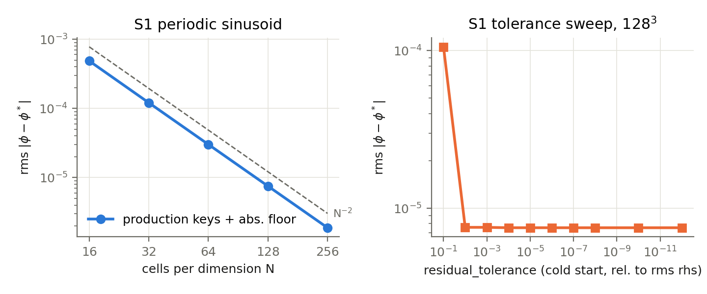

**S2-S7 — isolated boxes** (box [-8,8]^3 unless stated; multipole BCs):

| test (N = 32 / 64 / 128 / 256) | eps_norm, production BC | eps_norm, splits off | core force error, production |
|---|---|---|---|
| S2 Gaussian, M = 1, sigma = 1 | 1.32e-2 / 1.33e-2 / 1.33e-2 / 1.33e-2 | 8.51e-4 / 2.12e-4 / 5.28e-5 / 1.32e-5 | 2.12e-2 / 5.39e-3 / 1.34e-3 / 3.36e-4 |
| S3 uniform sphere R = 4 | 1.34e-2 / 1.33e-2 / 1.33e-2 / 1.33e-2 | 5.95e-4 / 1.87e-4 / 2.00e-5 / 9.41e-6 | 2.26e-4 / 2.77e-4 / 2.74e-4 / 2.74e-4 |
| S5 Maclaurin a = 4, e = 0.9 | 1.35e-2 (all N) | 5.02e-4 / 3.78e-4 / 3.83e-4 / 3.70e-4 | 3.14e-3 / 4.85e-4 / 1.83e-4 / 1.26e-4 |
| S6 Plummer a = 1, r_t = 6 | 1.33e-2 (all N) | — | 1.71e-2 / 4.69e-3 / 1.18e-3 / 3.01e-4 |
| S7 production collapse_be IC | 3.89e-3 / 3.87e-3 / 3.86e-3 / 3.86e-3 | 2.23e-2 (all N) | 8.34e-3 / 2.15e-3 / 5.92e-4 / 1.85e-4 |

Reading. (i) For compact sources the production BC formulation carries a resolution-independent 1.33 % rms
(4.5 % at the wall) potential offset; it is nearly harmonic, so the FORCE converges at ~2nd order regardless
(S2, S6, S7). (ii) On the production field (S7, mass reaching the wall) the production formulation is 5.8x better
than splits off (0.39 % vs 2.23 %) and zero-Dirichlet walls are unusable (19 % mass-weighted force error): the
formulation is right for the problem it serves. (iii) Maclaurin's splits-off floor (3.7e-4) is the l = 2
truncation (Athena++ goes to l = 4). (iv) Box-size sweep (Maclaurin, dx = 0.125, half-width 6/8/12/16): eps_norm
1.41e-2, 1.35e-2, 1.34e-2, 1.33e-2 — the split floor does not shrink with the box.

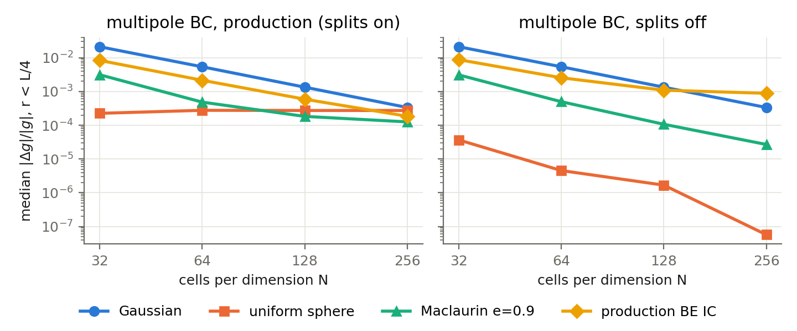

**S3a, S4 — static AMR.** S3a: the sphere with coarse/fine faces inside and outside its surface (roots 32-128,
2-3 levels); S4: the Athena++/Tomida & Stone unequal-mass binary (M = 2, 1; R = 6/1024; box [-0.5,0.5]^3) on 4
nested levels. Potential (splits off): sphere 1.09e-4, 3.99e-5, 1.67e-5; binary 9.6e-5 -> 2.4e-5 (root 64 -> 128,
2nd order). Force per level (`scripts/analyze_deep.py`, `tables/deep_amr.json`):

| mesh | finest level: median / max force error | splits off, finest | coarsest level, production BC |
|---|---|---|---|
| S3a root 64 / 128 | 4.0e-4 / 1.3e-3; 4.2e-4 / 1.4e-3 | 2.3e-6; 8.3e-7 | median 4.8e-2 / 7.1e-2 (outer region) |
| S4 root 32 / 64 / 128 (L4) | 5.7e-4 / 2.3e-2; 5.1e-4 / 1.0e-2; 1.2e-4 / 1.1e-2 | identical to production | median 5.2-5.4e-2 |

The finest levels converge and are identical with and without the splits (the error there is local truncation;
the largest values sit on the surface of the tiny spheres, r = 0.005 vs R = 0.0059). The large coarse-level
numbers are the production BC offset of (i), which dominates only far outside a compact source where the force
is weak (splits off: 6e-5-3e-4 there). Tighter solver tolerance changes nothing (`*_tight` legs identical).

**S8 — MPI invariance** (A++ `jeans_3d.py` style): S3 on 1, 8, 64 ranks: max|dphi|/max|phi| = 9.8e-13
(reduction order; not bitwise).

**S9 — solver controls.** 3-5 iterations per solve wherever the solve converges; cold-start 1e-10 legs equal the
production keys to 3 digits; the error saturates at the truncation error already at tol 1e-2. In the
production collapse run (cycles 680-1405): 725 solves, 0 non-converged, exactly 3 iterations each, max
`grav-res-rel` 0.148.

---

## 6. Group B — gravity coupled to hydrodynamics

**D1/D2 — Jeans waves** (A++ `jeans_3d.py`, `unstable_jeans_3d_mg.py`; Tomida & Stone 2023 Sec. 4.3; Mullen et al.
2021 Sec. 4.2). Oblique linear wave in a periodic 1 x 0.5 x 0.5 box, A = 1e-6, swindle; omega^2 = cs^2 k^2 -
4 pi G rho0. D1: n_J = 0.5 (stable), one period; D2: n_J = 1.5 (unstable), two e-folds of e^{gt}.

| N | 16 | 32 | 64 | 128 | orders |
|---|---|---|---|---|---|
| D1 RMS-L1 | 4.09e-7 | 7.95e-8 | 1.13e-8 | 1.51e-9 | 2.36, 2.82, 2.90 |
| D2 RMS-L1 | 2.40e-6 | 6.68e-7 | 1.63e-7 | 3.88e-8 | 1.85, 2.03, 2.07 (A++ criterion: each doubling divides by > 4/1.5) |

**D3 — dispersion relation**, n_J = 0.2-3 at 64 x 32 x 32 (paper figure):

| n_J | 0.2 | 0.4 | 0.6 | 0.8 | 0.9 | 1.1 | 1.25 | 1.5 | 2.0 | 3.0 |
|---|---|---|---|---|---|---|---|---|---|---|
| rel. error in omega^2 | -7.8e-4 | -2.4e-4 | +1.3e-3 | +7.4e-3 | +2.1e-2 | +4.0e-2 | +2.2e-2 | +1.7e-2 | +1.8e-2 | +2.6e-2 |

Near n_J = 1 omega^2 -> 0, so the relative error is large in absolute-small quantities; growth rates of the
unstable modes are 0.9-1.3 % slow at ~21 cells per wavelength, consistent with D2.

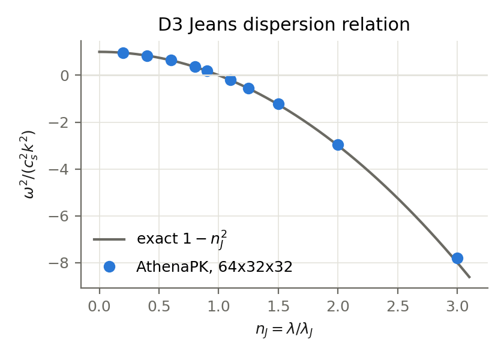

**D4 — advected nonlinear self-gravitating slab** (artemis `grav_slab.py`; Hanawa & Mullen 2025 Sec. 4.3).
eps = 0.3, v = (0.8, 0.6, 0), one period; the exact solution returns to the IC.

| N_x | AthenaPK rk2, CFL 0.327 (= artemis 0.9, SG-F2) | artemis golden | ratio RMS / d / E | AthenaPK vl2, CFL 0.3 |
|---|---|---|---|---|
| 16 | 1.8405e-1 | 1.8507e-1 | 0.994 / 1.002 / 0.994 | 1.7685e-1 |
| 32 | 4.4674e-2 | 4.4145e-2 | 1.012 / 0.997 / 1.016 | 4.0261e-2 |
| 64 | 1.1674e-2 | — | — | 1.0171e-2 |
| 128 | 2.9728e-3 | — | — | 2.6192e-3 |

Orders 2.04, 1.94, 1.97; mass and total momentum unchanged at the history file's precision. The 1.2-1.6 %
differences at N = 32 reflect HLLD (here) vs HLLC (artemis).

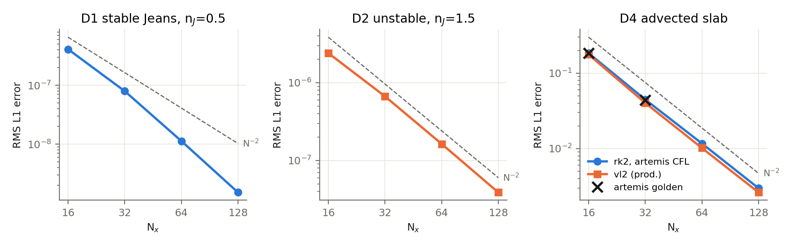

**D5 — n = 1 polytrope in an ambient** (artemis `poly.in` iprob 1). The artemis IC is not an exact equilibrium
(truncation pressure 0.090 vs ambient 0.1, open boundaries): graded by stability and convergence only. Stable for
~12 dynamical times at every resolution; spurious interior speeds 0.207, 0.105, 0.072 (N = 32, 64, 128). The exact
version is L1.

**D6 — offset head-on polytrope collision** (artemis iprob 2): max |P_total|/p_star = 1.1e-14 to t = 10; the
centre of mass stays at the origin.

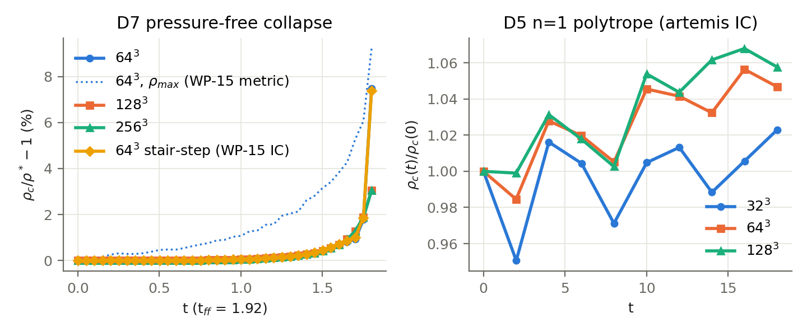

**D7 — pressure-free uniform-sphere collapse** (re-run of APK WP-15 with production keys; sphere sub-sampled).
Exact: rho_c/rho0 = sec^6 beta with t/t_ff = (2/pi)(beta + sin beta cos beta). Central-density error vs exact:

| t (t_ff = 1.92) | 64^3 | 128^3 | 256^3 | 64^3 stair-step IC | rho_MAX at 64^3 (WP-15's metric) |
|---|---|---|---|---|---|
| 0.5 | +0.00 % | +0.00 % | +0.00 % | +0.00 % | +0.46 % |
| 1.0 | +0.053 % | +0.054 % | +0.054 % | +0.054 % | +1.08 % |
| 1.4 | +0.266 % | +0.267 % | +0.267 % | +0.271 % | +2.61 % |

The residual was resolution-independent and FIRST order in dt (dt ladder 0.002 -> 0.00025: +0.0531, +0.0263,
+0.0128, +0.0060 % at t = 1.0); rk2/rk3 sit at a ~1e-5 floor; rk1 is first order. Cause: VL2's donor-cell
predictor (SG-F4, Sec. 11), not the gravity coupling. Multipole splits off: identical (the BC is not involved).

---

## 7. Group C — deep AMR

**DA1 — production IC on 6 nested static levels** (single solve vs exact potential = homogeneous cube + spherical
excess by quadrature). Median force error per level: 2.1e-2 (L0, dx = 0.25), 2.4e-3, 5.2e-4, 1.9e-4, 7.3e-5,
2.5e-5, 7.5e-6 (L6, dx = 0.0039), i.e. 2nd-order per level; the largest error of each level sits near its own
coarse/fine corner (6.4e-4 on L3, 2.5e-5 on L6). No coarse/fine artefact.

**DA2 — pressure-free sphere (R = 4) through 4 nested static levels** (dt_ceil 5e-4; `runs/DA2_freefall_deep/
root64_L4_chain`). Time by which the 3D collapse leads the exact one at the same rho_c (near the singularity
rho ~ (t_ff - t)^-2, so density percentages exaggerate):

| rho_c/rho0 | 1.8 | 3.0 | 4.8 | 9.6 | 34.5 | 138 | 3756 |
|---|---|---|---|---|---|---|---|
| lead (% of t_ff) | 0.005 | 0.009 | 0.012 | 0.017 | 0.023 | 0.027 | 0.027 |
| density error | +0.013 % | +0.041 % | +0.080 % | +0.18 % | +0.53 % | +1.4 % | +7.6 % |

The sphere edge crosses the level boundaries at rho/rho0 ~ 4, 33 and 262; the lead grows smoothly through them
(sampled every 0.16 t).

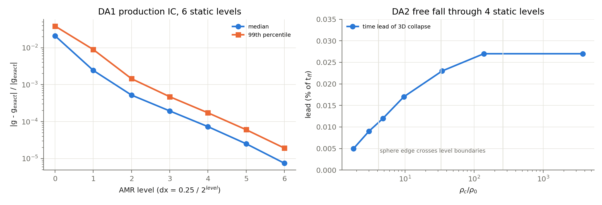

**DA3 = L7 — collapse of the production IC to AMR level 13** (collapse_be, Tomida BE profile f = 5, ideal hydro,
production barotropic EOS, adaptive Jeans refinement) against the 1D Lagrangian solution of the same IC (exact
in spherical symmetry; N = 1000/2000 agree to 2.4e-5). 1D crossing times t(rho_c = 1e2, 1e3, 1e4, 1e5) = 0.8881,
0.9741, 1.0005, 1.0090. Lag t_3D - t_1D:

| run | 1e2 | 1e3 | 1e4 | 1e5 |
|---|---|---|---|---|
| n_J = 4 | — | — | ~+0.037 | ~+0.039 (+-0.005) |
| n_J = 8 (production), donor-cell predictor | +0.0164 | +0.0153 | +0.0142 | +0.0139 |
| n_J = 8, PLM predictor (production since 2026-10-04) | +0.0116 | +0.0102 | +0.0093 | +0.0091 |
| n_J = 8, rk2 | +0.0106 | +0.0091 | +0.0081 | +0.0080 |
| n_J = 16 | +0.0033 | +0.0032 | +0.0030 | +0.0029 |

The lag is set before rho_c = 1e2 and stays constant over three decades: the deep phase (levels 4-13) adds
nothing. It converges with n_J (0.039 -> 0.0139 -> 0.0029, i.e. 1.5 % -> 0.29 % of t_c). Approach to
Larson-Penston (tau = sqrt(D0/rho_c), median |D/D_LP - 1| for x = r/(cs tau) < 3; rho_c <= 1e4 only, where the
barotropic pressure is within 5 % of isothermal):

| run | rho_c ~ 55 | ~ 200-900 | ~ 3e3-9e3 |
|---|---|---|---|
| 1D reference | 1.9 % | 1.1-1.4 % | 0.9-1.0 % |
| n_J = 16 | 6.2 % | 3.5-4.0 % | 2.7 % |
| n_J = 8 | 9.5 % | 9.6 % | 7.7 % |

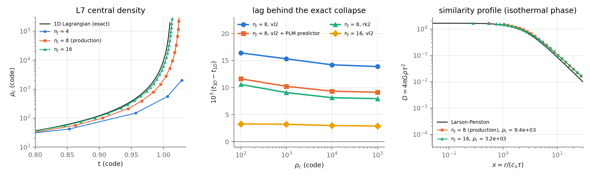

---

## 8. Group D — GPU path (H100, 1 rank) vs CPU (64 ranks), same source

| test | GPU vs CPU |
|---|---|
| production IC Poisson solve (S7 128^3) | max|dphi|/max|phi| = 1.3e-13 |
| deep static AMR, 6 levels (DA1) | 1.1e-13 |
| Jeans 64 (periodic, swindle, SG-F1 floor) | RMS-L1 identical to 7 digits (1.128203e-8); <= 4 iterations, 0 non-converged |
| free fall 64^3 | rho_c error identical to 5 digits at t = 0.5, 1.0, 1.5 |
| adaptive collapse L7 n_J = 8, fresh start to t = 0.7 (levels 0-1) | all fields identical at float32 output precision; dt equal to <= 7.7e-16 every cycle |
| DEEP adaptive collapse: GPU restarted from the CPU cycle-1500 restart (14 levels, 792 blocks, rho_max 1.3e11), 100 cycles | same block set; all fields identical at float32 output precision; dt equal to 2e-16 |

The SG-F1 fallback was not exercised on GPU (the single-rank GPU solve did not stall).

---

## 9. Group E — literature tests

Problem generator `profile1d` (tabulated spherical/planar profiles from `scripts/make_tables.py`, rotation, m = 2
perturbation, barotropic option) unless stated; analysis `scripts/analyze_lit.py` -> `results/tables/lit.json`.

**L1 — n = 1 polytrope with a hydrostatic self-gravitating atmosphere** (Mullen, Hanawa & Gammie 2021, ApJS 252, 30,
Sec. 4.3; gamma = 2, G = M = R = 1, M_atm = 1e-2, box 8R, tau = R/v_esc = 0.707). Exact equilibrium. Max body
speed 0.173, 0.065, 0.017 (R/dx = 5, 10, 20; orders 1.4, 1.9); rho_c at 9 tau 1.032, 0.996, 0.9994; body thermal
energy +5.9 %, +0.32 %, +0.07 %. 100 tau at R/dx = 10: rho_c 0.98, E_th -1.2 % — no secular heating (their
non-conservative reference scheme lost 30 % of rho_c).

**L2 — advected Spitzer sheet** (Mullen et al. 2021 Sec. 4.1; Gamma = 1.2, contrast 1.45e4). L1 error 5.79e-2,
2.33e-2, 7.10e-3, 1.82e-3, 4.58e-4 (N = 32-512): orders 1.32, 1.71, 1.96, 1.99; x-momentum constant at history
precision.

**L3a — n = 5 (Plummer) polytrope equilibrium** (Hanawa & Mullen 2025 Sec. 4.4), 9 dynamical times. rho_c at t = 9
vs exact rho_c = 1: -24.8 %, -7.4 %, -1.9 % (32-128^3), of which the initial cell average of the peaked centre is
-16.7 %, -4.7 %, -1.2 % and the dynamical drift -9.7 %, -2.8 %, -0.7 %; max speed 0.060, 0.019, 0.0052; L1(rho)
5.4 %, 1.6 %, 0.44 %: order ~1.8.

**L3b — n = 5 collapse and bounce** (central pressure uniform within 0.9 R, gamma = 1.3; Hanawa & Mullen 2025
Sec. 4.6) vs the 1D reference: rho_c deviation 128^3 -5.9 % (t = 1.5), -10 % (t = 5); 256^3 -0.27 %, -2.5 %:
~2nd order; bounce at 1.778 vs 1D 1.780; peak rho_c 6.01 vs 7.68 (narrow peak, unresolved).

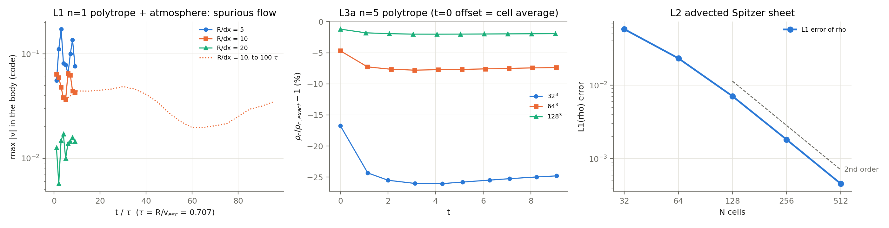
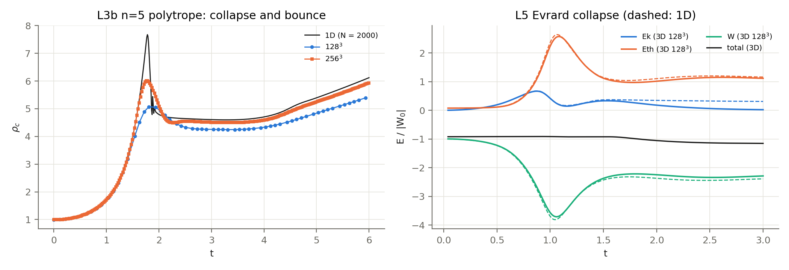

**L4 — Lin-Mestel-Shu pressure-free spheroid collapse** (Lin, Mestel & Shu 1965; a0 = 4, c0 = 2; dynamic test of
the quadrupole BC). Semi-axes vs the exact ODE: 128^3: a within 0.37 % to t = 1.5, c +1.07 % (t = 1.0), +9.0 %
(t = 1.5, pancake 5 cells thick); 256^3: a within 0.06 %, c +0.34 %, +3.2 % (orders 1.7, 1.5).

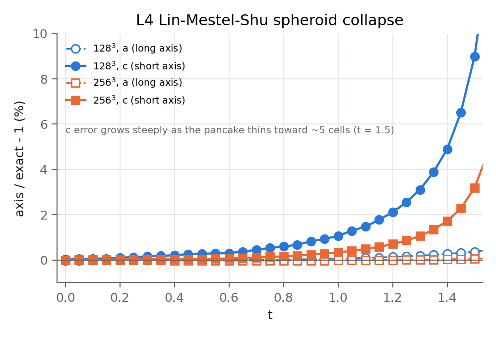

**L5 — Evrard collapse** (Evrard 1988; rho = M/(2 pi R^2 r), u = 0.05 GM/R, gamma = 5/3) vs 1D: total energy incl.
W conserved to <= 1.3 % of |W0| through collapse, bounce and accretion shock (t <= 2); partition error at peak
compression 24 %, 13 %, 3.4 % of |W0| (dx = 0.05, 0.025, 0.0125). After t ~ 2 fast ejecta leave the box (2 % of
the mass by t = 3). This also covers L11 (energy budget of a self-gravitating flow).

**L6 — Bonnor-Ebert stability.** (i) In collapse_be's static ambient the test is invalid: the ambient flows into
the sphere (SG-F5). (ii) L6' (light hot ambient, gamma = 1.001, `outflow` faces): stability boundary correct —
xi = 3 (f = 1.1) stays bounded, xi = 6.45 and 9 (f = 1, unstable equilibria) collapse once grid noise perturbs them
(t ~ 10-15), xi = 9, f = 1.1 collapses — but the xi = 3 minima drifted up (1.21 -> 1.60). Diagnosis: hot ambient
streams in through the zero-gradient faces (box mass +5.1 %, confining pressure +21 % by t = 25, identical at
n_J = 8 and 64); the 1D model driven by the measured pressure ramp reproduces the drift (t 20-25 minima 1.72 vs 3D
1.73). Production BCs (`diode` + `boundary_flux_clamp`, L6c) drain a light ambient instead (box mass -24/-29 %,
sphere disrupted). (iii) L6d, the fix: closed box with the validation-only `reflecting_val` walls, 1D reference with
a rigid wall at the volume-equivalent radius. To t = 29: box mass exact, confining pressure +0.2/+0.3 %, minima
1.06-1.21 vs 1D 1.01-1.19 with no drift (n_J = 8 and 32); maxima 1.33-1.61 (n_J = 8) -> 1.36-1.74 (n_J = 32) vs
1D 1.59-2.05: oscillation damping that decreases with resolution. PASS.

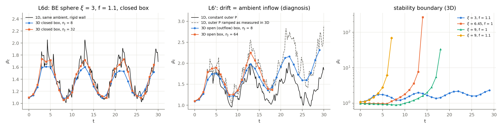

**L7 — Larson-Penston** from the production IC: Sec. 7 (DA3).

**L8 — singular isothermal sphere** (Shu 1977). Static: with a mass-conserving core the solved field matches
g = 2 cs^2/r to <= 0.2 % from 3.5 cells out to r = 1.8 (cube corners +3-10 % at the walls). PASS. Dynamic
(inside-out collapse, mdot = 0.975 cs^3/G): not reproducible without sinks — the unresolved cusp is discretely
over-pressured and blows out; a heavy-core seed collapses violently (this run exposed SG-F6). Not applicable without
sink particles.

**L9 — Boss-Bodenheimer rotating cloud** (Boss & Bodenheimer 1979 standard isothermal test as in Truelove et al.
1998: alpha 0.26, beta 0.16, m = 2 perturbation 10 %; barotropic above 2.6e4 code; 1 code length = 620 au).
Peaks above 1e3 (local maxima merged within 62 au): t = 2.40: n_J = 4 and 8 both give exactly 2 (the binary),
separation 0.829 vs 0.819. t = 2.45: the same fragment chain at both resolutions — binary at r_xy 0.345 / 0.333,
bar pair at 0.192 / 0.198, inner pair at 0.070 / 0.093, plus an outer pair at 0.469 at n_J = 8 (binary 1000x
denser there: 7.7e8 vs 8.2e5). The secondary fragments are resolved structure of the barotropic model, not
artificial fragmentation at the Truelove limit; m = 2 + mirror symmetry exact to all printed digits. The
literature epoch (t ~ 2.61) needs sinks (dt falls to 3-7e-6): qualitative only.

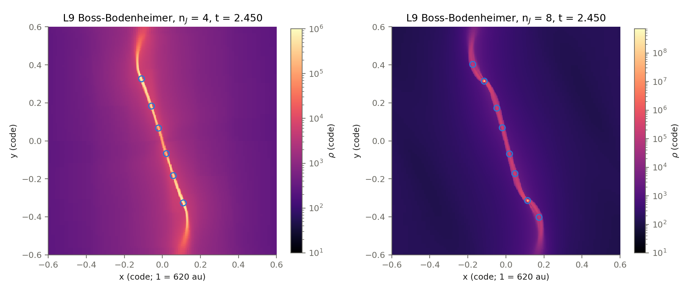

**L10 — magnetised turbulent core** (Hennebelle et al. 2011 set-up: 142 Msun, alpha_th 0.12, Mach 2.24; mu = 120,
5, 2). Collapse onset ordered by field strength as in the paper: rho_max > 1e5 first at t = 1.50 (mu = 120), mu = 5
reaches 6.2e4 at t = 1.60 and mu = 2 1.6e4 at t = 1.80. Fragment statistics at their epochs need sinks:
qualitative only.

---

## 10. Group F — final-configuration regression

Re-run (2026-10-04) of the coupled tests with the FINAL validation binary (`11a642a4`: production defaults =
VL2 with the PLM predictor, NaN guard, SG-F1 floor + fallback) and the production gravity keys ONLY — round 1 had
to add a hand-set `absolute_residual_tolerance` to every periodic leg (SG-F1). `runs/suite_final.sh`,
`scripts/analyze_final.py` -> `results/tables/final.json`, `final_log.txt`.

| test | final configuration | round 1 | reading |
|---|---|---|---|
| S1 sinusoid N = 16 / 32 / 64 / 128 | 4.858e-4 / 1.208e-4 / 3.014e-5 / 7.533e-6, 0 non-converged | identical numbers, but only with a hand-set tolerance; production keys alone gave NaN at 16^3 and 64^3 | SG-F1 fix works out of the box |
| D1 Jeans n_J = 0.5 | 4.70e-7 / 1.02e-7 / 2.00e-8 / 4.42e-9 (orders 2.21, 2.35, 2.18), <= 4 iterations, 0 non-converged | 4.09e-7 / 7.95e-8 / 1.13e-8 / 1.51e-9 (2.36, 2.82, 2.90) | see below |
| D2 Jeans n_J = 1.5 | 2.03e-6 / 4.58e-7 / 9.66e-8 / 2.11e-8 (2.15, 2.25, 2.20), 0 non-converged | 2.40e-6 / 6.68e-7 / 1.63e-7 / 3.88e-8 | 1.2-1.8x lower now |
| D4 slab (vl2, CFL 0.3) | 1.8403e-1 / 4.4689e-2 / 1.1669e-2 / 2.9702e-3 (2.04, 1.94, 1.97), mass drift 0, <= 7 iterations | vl2/donor-cell 1.7685e-1 / 4.0261e-2 / 1.0171e-2 / 2.6192e-3; rk2 1.8405e-1 / 4.4674e-2 / 1.1674e-2 / 2.9728e-3 | now equal to rk2 to 3-4 digits (VL2 with a PLM predictor is a midpoint RK2) |
| D7 free fall, 64^3, dt 0.002 / 0.001 / 0.0005 / 0.00025, error at t = 1.0 | -0.0015 / -0.0010 / -0.0009 / -0.0008 % (dt-independent floor, as rk2/rk3 in round 1) | +0.0531 / +0.0263 / +0.0128 / +0.0060 % (first order in dt) | SG-F4 removed; 35x smaller at dt = 0.002 |

Attribution of the D1 change (`runs/suite_final_d1dc.sh`): the final binary with the OLD donor-cell predictor
gives 1.128e-8 and 1.511e-9 at 64 and 128 — round 1 exactly — so the solver-tolerance change plays no role and the
difference is the predictor. On this smooth linear wave the donor-cell predictor's extra first-order dissipation
partly cancels the dispersive error (hence round 1's super-convergent orders 2.8-2.9); with the PLM predictor the
scheme is a clean 2nd-order midpoint method whose D1 error is 2-3x larger while D2's is 1.2-1.8x smaller. The
predictor change is therefore not uniformly lower-error on linear waves; it removes a genuine first-order error in
converging flows (D7 above; L7: 0.0139 -> 0.0091 of the collapse time), which is the regime of the collapse runs.

**Self-gravity verdict in the final production configuration: PASS.**

---

## 11. Findings

**SG-F1 — BiCGSTAB warm-start residual and the swindle round-off stall (FIXED; cleared
for production).** `relative_residual` is relative to the warm-start residual (Sec. 3.2). In a periodic box with
the Jeans swindle the attainable residual has a round-off floor (measured 8.9e-11 at 64^3, 1.8e-10 at 128^3,
growing as sqrt(N)); when the warm-start target falls below it the solve runs to `max_iterations` and BiCGSTAB
returned its last iterate — NaN, or garbage that produced "Got negative pressure" within 2 cycles (S1 16^3/64^3,
Jeans A = 1e-6 on 8 ranks). Fix: `roundoff_floor` + `safe_fallback` (Sec. 3.2); every previously failing leg
converges in <= 5 iterations. Production (isolated BCs, no swindle) is bit-identical with the fix (a production
restart with the full production configuration, every field; and a fresh production IC) and was never exposed (0
non-converged in 725 production solves). The fix was held back while SG-F7 was open and is now cleared.

**SG-F2 — CFL definition.** artemis: dt = cfl / sum_d (|v_d| + cs)/dx_d; AthenaPK takes the minimum over directions.
artemis 0.9 = AthenaPK 0.327 in 3D; decks ported from artemis must convert.

**SG-F3 — an earlier work package (WP-15) measured rho_MAX, not rho_c.** Its "+1.18 %, first-order, stair-step"
error is an edge pile-up; the central density is on the exact cycloid to +0.054 % at t = 1.0 at every resolution.

**SG-F4 — first order in dt from VL2's donor-cell predictor (FIXED; production default changed).** Ballistic
converging flow with gravity OFF (v = -0.5 r, exact rho_c = (1 - t/2)^-3): vl2 temporal order 0.99, rk2 2.0, vl2
with a PLM predictor 2.0 — the gravity coupling is second order; the donor-cell predictor has an O(dt) error at
converging stagnation points. Impact (L7, n_J = 8): 0.48 % of the collapse time, 35 % of the n_J = 8 error. New key
`hydro/vl2_predictor_recon` (`same` = the deck's reconstruction), now the default; 20 cycles on a production
restart: 0 floors, dt within 0.13 %, same wall time.

**SG-F5 — collapse_be's static ambient still flows into the cloud (VERIFIED; property of the production IC).**
Zeroing momentum beyond r_c keeps the ambient at rest but not its mass flux: a stable xi = 3 BE sphere gained 59 %
mass by t = 24. The production core's mass budget therefore includes accreted ambient gas.

**SG-F6 — no NaN guard (FIXED; production default).** A non-finite cell vanished from the timestep reduction
(`fmin` ignores NaN) and spread through gravity while the run exited rc = 0 (L8 heavy core: 119 586 NaN cells).
`hydro/nan_check` (default on): the hyperbolic-dt kernel flags non-finite primitives
and the run aborts with rank, block, level, cell, coordinates and values (verified: aborts right after cycle 75 at
the centre); bit-identical otherwise (production restart, every field).

**SG-F7 — MPI deadlocks were Open MPI 5.0.7's shared-memory fast boxes (FIXED by configuration).** 64-rank
single-node CPU runs aborted with "MPI probably hanging after 1e9 receive tries" (L9 in every leg, DA2 once).
Experiment on the L9 restart: every arm with the sm BTL hung (~1 per 150 cycles), with or without the SG-F1 patch;
tcp-only (1445 + ~180 cycles) and sm with fast boxes off (`btl_sm_fbox_max = 0`; four complete 1445-cycle
continuations to t = 2.45 plus ~300 cycles, ~6090 cycles in all, same speed as sm) never did. A
diagnostic build that prints each rank's pending tasks showed a send that never completed at the MPI level, or
completed sends whose posted receives never matched, with all other ranks waiting behind them; gdb stacks spin in
`mca_btl_sm_component_progress`. Matches Open MPI issues #12979 (fast-box polling deadlock, PR #13939) and #12816.
Fix: `OMPI_MCA_btl_sm_fbox_max=0` (`scripts/suite_common.sh`). Any Open MPI 5.0.x run that enables the sm BTL
(e.g. single-node multi-GPU with `--mca btl tcp,self,sm`) is potentially exposed.

---

## 12. Defaults in this code

| item | status |
|---|---|
| PLM VL2 predictor (SG-F4) | `hydro/vl2_predictor_recon = same` is the default; `dc` reproduces the old donor-cell predictor |
| NaN guard (SG-F6) | `hydro/nan_check`, default on, bit-identical when no cell is non-finite |
| SG-F1 fix | `self_gravity/solver_params/roundoff_floor` (default 64 under the swindle, 0 otherwise) + BiCGSTAB `safe_fallback` (default on) |
| `OMPI_MCA_btl_sm_fbox_max=0` | set in the validation suite; recommended for any Open MPI 5.0.x run with the sm BTL |
| collapse_be ambient inflow (SG-F5) | documented property of the IC; no change made |
| `reflecting_val` BC | validation-only closed-wall BC |

## 13. Limitations

The multipole BC stops at l = 2 (Maclaurin floor 3.7e-4 with splits off; Athena++ uses l = 4). With the production
splits, compact sources carry a 1.3 % potential offset (force unaffected where the mass is). Tests needing sinks
(L8 dynamic, L9/L10 at the literature epochs) are qualitative or not applicable. The GPU path was compared
single-rank; multi-GPU was not part of this suite. The SG-F1 fallback was not exercised on GPU.

## 14. Reproduction map

| test | deck(s) (`inputs/`) | run script (`runs/`) | analysis (`scripts/`) | table (`results/tables/`) | figure |
|---|---|---|---|---|---|
| S1-S9 | static_poisson.in, be_ic.in, DA1_* | suite_static*.sh | analyze_static.py | static.json | S1_sinusoid.png, S_force_error.png |
| S3a/S4 force, DA1, DA2 | static AMR decks, DA1_*, DA2_freefall_deep.in | suite_static*.sh, lit_DA1.sh, chain_DA2.sh | analyze_deep.py | deep_amr.json, DA2_time_offset.txt | DA_deep_amr.png |
| D1-D3 | jeans_wave.in | suite_jeans*.sh | analyze_jeans.py | jeans.json | D_convergence.png, D3_dispersion.png |
| D4 | grav_slab.in | suite_slab*.sh | analyze_slab.py | slab.json | D_convergence.png |
| D5-D7 | polytrope*.in, freefall.in | suite_poly.sh, suite_ff*.sh | analyze_dynamic.py | dynamic.json | D57_freefall_polytrope.png |
| SG-F4 | freefall.in (gravity off) | suite_f4.sh | (inline) | F4_ballistic.json | — |
| L1-L10 | L*.in (from make_decks.py; tables from make_tables.py) | lit_*.sh, chain_*.sh | analyze_lit.py, ref1d*.py | lit.json, L7_*.txt | L*.png |
| GPU | as the CPU legs | suite_gpu.sh, gpu_l7_deep.sh | (inline comparisons) | Sec. 8 | — |
| SG-F7 | L9 restart | F7_hang/hang_arm*.sh, diag_arm_L9.sh | (logs, gdb stacks) | Sec. 11 | — |
| final regression | as S1/D1/D2/D4/D7 | suite_final.sh | analyze_final.py | final.json | — |

## 15. References

Binney & Tremaine 2008, Galactic Dynamics (2nd ed.); Boss & Bodenheimer 1979, ApJ 234, 289; Chandrasekhar 1969,
Ellipsoidal Figures of Equilibrium; Commerçon et al. 2008, A&A 482, 371; Evrard 1988, MNRAS 235, 911; Foster &
Chevalier 1993, ApJ 416, 303; Hanawa & Mullen 2025, J. Phys. Conf. Ser. 2997, 012012; Hennebelle et al. 2011,
A&A 528, A72; Hunter 1977, ApJ 218, 834; Larson 1969, MNRAS 145, 271; Lin, Mestel & Shu 1965, ApJ 142, 1431;
Mullen, Hanawa & Gammie 2021, ApJS 252, 30; Nagy, Papp & Benedek 2000, J. Geodesy 74, 552; Penston 1969, MNRAS
144, 425; Shu 1977, ApJ 214, 488; Tomida & Stone 2023, ApJS 266, 7; Truelove et al. 1998, ApJ 495, 821;
Open MPI issues #12979, #12816 (github.com/open-mpi/ompi).
